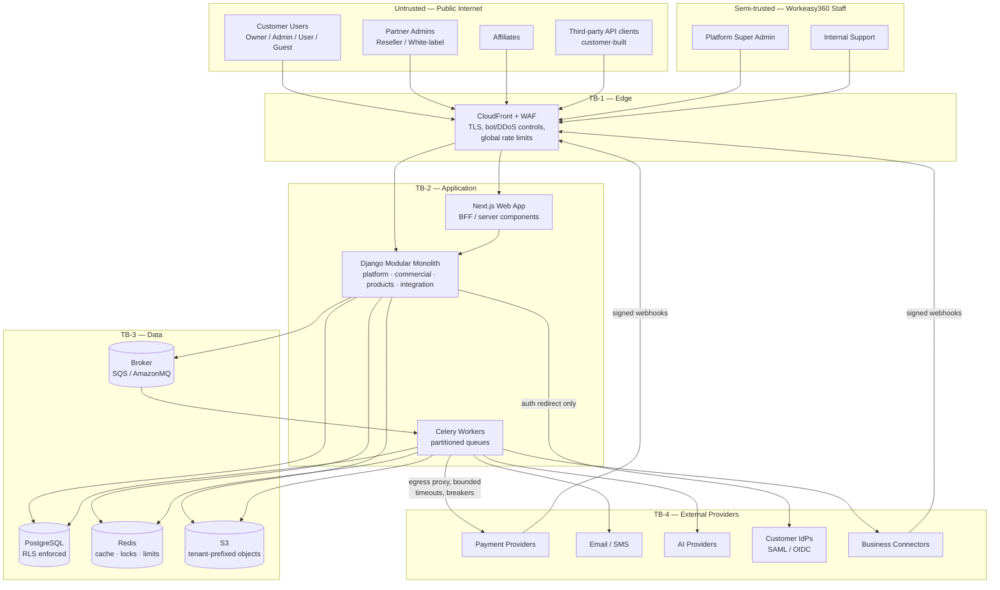
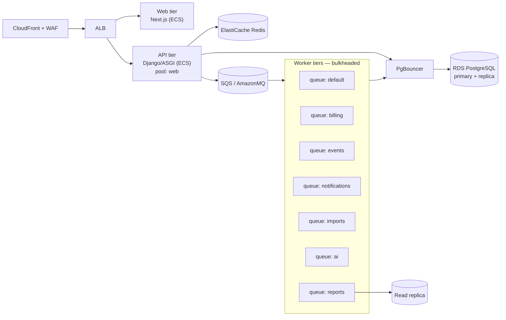

# 00 — System Context

**Status:** Accepted (Phase 0)
**Owner:** Architecture
**Last reviewed:** 2026-09-21

---

## 1. Purpose

This document defines *what Workeasy360 is*, *who talks to it*, and *where the trust boundaries sit*. Every later document (boundaries, tenancy, security, resilience) refines something introduced here. If a later document contradicts this one, this one is wrong and must be amended — not silently ignored.

## 2. The one-sentence definition

> Workeasy360 is a **single multi-tenant business operating platform** that hosts multiple **independently commercializable product domains** (CRM, Books, Inventory, Projects, …) on top of **one shared platform kernel** (identity, tenancy, authorization, entitlements, notifications, files, audit), sold through **direct and partner channels** that are commercial constructs — never separate deployments or forks of the product code.

Three consequences follow immediately, and they are non-negotiable:

1. **One codebase, one deployment, many tenants, many products.** A reseller does not get a copy of CRM. A white-label partner does not get a fork. They get *branding, pricing and relationship metadata* on the same running system.
2. **Products are logical boundaries, not deployment boundaries.** Isolation is enforced by module boundaries, dependency rules and automated fitness tests — not by network hops. See [ADR-001](adrs/ADR-001-modular-monolith-first.md).
3. **A product never learns how a capability was purchased.** It asks "may this organization use this feature?" and gets a yes/no. The entire commercial machinery (plans, bundles, partner margins, negotiated contracts) is invisible to product code. See [06-entitlements.md](06-entitlements.md).

## 3. Actors and external systems

### 3.1 Human and organizational actors

| Actor | Who they are | Primary interface | Tenant scope |
|---|---|---|---|
| **Customer Organization** | The paying business entity. The unit of tenancy, billing and data isolation. | n/a (a container, not a login) | *is* the tenant |
| **Customer Owner** | Owns the org account. Can delete the org, change billing, transfer ownership. Exactly one per org (transferable). | Web app | single org |
| **Customer Admin** | Delegated administration: users, roles, product activation within purchased limits. | Web app | single org |
| **Regular User** | Day-to-day worker. Access limited to products they hold a seat in, and to permissions granted by role. | Web app, mobile web, public API (scoped token) | single org |
| **External Collaborator** | Guest/contractor with narrow access (e.g. one project). Called out explicitly because "user" and "member" are not the same thing. | Web app (restricted) | single org, narrow |
| **Platform Super Admin** | Workeasy360 engineering/ops. Manages catalog, infrastructure, platform config. **Cannot read tenant business data without break-glass.** | Internal admin console | cross-tenant, control plane only |
| **Internal Support** | Workeasy360 support staff. Reads tenant data only via time-boxed, reason-required, customer-visible impersonation. | Internal admin console | break-glass, per-org, time-boxed |
| **Partner Admin (Reseller)** | Sells and manages subscriptions for orgs they introduced. Sees commercial data for their book of business. **No business-data access by default.** | Partner portal | own partner account + linked orgs (commercial data only) |
| **Partner Admin (White-label)** | A reseller that additionally controls branding and a custom domain. | Partner portal | as reseller + branding |
| **Affiliate** | Refers traffic, is paid commission. Sees **aggregate** attribution and payout data only — never customer PII, never customer commercial detail. | Affiliate portal | own attribution records |

> **Design note.** Reseller, white-label and affiliate are *not three actor types with three code paths*. They are one `PartnerAccount` carrying a set of **capability grants**. A partner may hold `REFER` only (affiliate), `RESELL + MANAGE_BILLING` (reseller), or `RESELL + BRAND + CUSTOM_DOMAIN` (white-label). Treating them as an enum with `if partner.type == "affiliate"` branching produces an unmaintainable privilege mess and makes hybrid partners — which are common in practice — impossible. See [05-commercial-model.md](05-commercial-model.md).

### 3.2 External systems

| System | Role | Criticality tier | Failure behaviour |
|---|---|---|---|
| **Payment providers** (Stripe primary; provider-agnostic port) | Charge cards, hold payment methods, emit payment webhooks | **Tier 2 — deferrable** | Billing runs degrade; product access is *never* revoked because of a provider timeout |
| **Tax calculation** (future: Avalara / Stripe Tax) | Jurisdiction tax rates | Tier 3 | Fall back to stored rate table; flag invoice for review |
| **Email provider** (SES primary, SMTP fallback port) | Transactional + notification email | Tier 3 | Queue and retry with backoff; never block a user action |
| **SMS / push providers** | Alerts, MFA delivery | Tier 3 | Degrade to email; TOTP/WebAuthn unaffected |
| **AI providers** (Claude via Anthropic API; provider-agnostic port) | Summarisation, drafting, extraction, assistants | Tier 3 | Feature visibly disabled with explanation; never blocks a core workflow |
| **Identity providers** (customer-side Okta / Entra / Google via SAML 2.0 + OIDC) | Workforce SSO for customer orgs | **Tier 1 for SSO-only orgs** | Documented break-glass local admin path per org |
| **Object storage** (S3) | File content | Tier 1 | Uploads fail closed; metadata-only reads still work |
| **Business connectors** (accounting imports, e-commerce, calendars, telephony) | Product-level integrations | Tier 3 | Per-connector circuit breaker; sync marked stale, never silently wrong |
| **Analytics / warehouse sink** | Product analytics, BI export | Tier 3 | Buffer, then drop with a counter. Analytics must never stall a transaction |
| **Cloud infrastructure** (AWS: RDS PostgreSQL, ElastiCache Redis, SQS/AmazonMQ, ECS, S3, KMS, Secrets Manager, CloudFront, WAF) | Runtime substrate | Tier 0/1 by component | See [09-failure-resilience.md](09-failure-resilience.md) |

Criticality tiers are defined once, in [09-failure-resilience.md](09-failure-resilience.md), and referenced everywhere else. Do not invent new tiers locally.

## 4. System context diagram

## 5. Trust boundaries

A trust boundary is a place where **data changes trust level and must be re-validated**. Crossing one without validation is a security defect, not a style issue.

### TB-1 — Internet → Edge

- Everything inbound is hostile until proven otherwise.
- TLS 1.2+ terminates here. WAF applies IP reputation, bot rules and coarse rate limits.
- **Controls:** managed WAF rules, per-IP and per-token throttles, request size caps, strict allowlist of HTTP methods.
- **Never assume** a client-set header (`X-Forwarded-For`, `X-Request-ID`, `X-Organization-Id`) is truthful. A client-supplied request ID is accepted only for correlation and is length/charset validated. **Organization is never taken from a header** (see TB-3).

### TB-2 — Edge → Application

- The application authenticates the principal and establishes **tenant context**.
- This is the single place where `(principal, organization)` is resolved, derived from the session/token and the verified membership record — never from user input.
- **Controls:** session/token verification, CSRF for cookie flows, membership lookup, organization status check (active / suspended / deleted), MFA step-up policy.
- **Fail-closed rule:** if tenant context cannot be established for a request that touches tenant-owned data, the request is rejected — it does **not** proceed unscoped.

### TB-3 — Application → Data

- The database is a **second line of defence, not a trusting subordinate.**
- Every tenant-owned table carries `organization_id` and is protected by PostgreSQL Row-Level Security bound to a per-transaction session variable set from the *verified* tenant context.
- **Controls:** RLS with `FORCE ROW LEVEL SECURITY`, a non-owner application role, composite foreign keys that make cross-tenant references structurally impossible, tenant-prefixed S3 keys with prefix-scoped presigned URLs.
- See [03-multi-tenancy.md](03-multi-tenancy.md).

### TB-4 — Application → External Providers

- All outbound third-party traffic leaves through a controlled egress path.
- **Controls:** mandatory connect+read timeouts, bounded retries, circuit breakers, SSRF-safe URL resolution for any user-supplied destination, secrets from Secrets Manager, per-provider least-privilege credentials, response size caps, schema validation of responses before they touch domain logic.
- **Inbound webhooks are TB-1 traffic, not TB-4 traffic.** A webhook from a payment provider is an unauthenticated internet request until its HMAC signature and timestamp are verified. See [12-security.md](12-security.md).

### TB-5 — Tenant → Tenant (the boundary with no network)

This is the boundary multi-tenant SaaS actually dies on. It exists *inside* the application and inside a single database. It is enforced by the layered controls in [03-multi-tenancy.md](03-multi-tenancy.md) and continuously verified by the fitness rules in [ARCHITECTURE.md](../../ARCHITECTURE.md).

### TB-6 — Customer data → Workeasy360 staff

Staff are *not* inside the customer's trust boundary. Reading tenant business data requires a break-glass session: explicit reason, time-boxed, customer-visible, fully audited, unavailable to most staff roles. See [12-security.md](12-security.md).

### TB-7 — Partner → Customer

A reseller is a *commercial* intermediary, not an owner of the customer's data. Partner visibility defaults to commercial metadata (subscription, plan, invoice totals, renewal dates). Access to business data (contacts, ledgers, stock) requires an explicit, revocable, audited grant **from the customer organization**, and appears in the customer's audit log.

## 6. Control plane vs data plane

A distinction that prevents an entire class of privilege bugs:

| | **Control plane** | **Data plane** |
|---|---|---|
| Contains | Catalog, plans, prices, partner accounts, platform config, feature flags, infrastructure | Tenant business records: contacts, invoices, stock, projects, employees |
| Tenancy | Global / partner-scoped | Strictly organization-scoped |
| RLS | Not applicable (no `organization_id`) | Mandatory |
| Who may read | Platform Super Admin; partners for their own slice | Organization members; staff only via break-glass |
| Blast radius of a bug | Pricing/packaging errors — recoverable | Cross-tenant data disclosure — **not** recoverable |

**Rule:** a model belongs to exactly one plane. If you find yourself adding a nullable `organization_id` to a control-plane table "for the enterprise case", you are about to create a table where RLS is sometimes on and sometimes off. Split the table instead. (Concrete case: negotiated enterprise prices do not go in the global `PriceBook`; they go in a separate org-scoped `ContractPrice`. See [05-commercial-model.md](05-commercial-model.md).)

## 7. Deployment context (Phase 0 target)

Notes that matter architecturally, not just operationally:

- **Web tier and worker tiers are the same image with different entrypoints.** One build, one dependency graph, one set of migrations. This is the practical payoff of the modular monolith.
- **Queues are bulkheads.** A stuck AI job cannot starve invoice generation because they do not share a worker pool.
- **Reports run against a read replica on a dedicated queue and a dedicated connection pool.** A customer exporting five years of ledger data must not be able to exhaust the pool serving interactive requests.
- **Single region to start.** Multi-region is a data-residency and latency decision, not a reliability one at our stage; multi-AZ covers reliability. The data model permits region-pinned tenants later — `Organization.residency_region` exists from day one — without a rewrite. See [13-deployment-evolution.md](13-deployment-evolution.md).

## 8. Explicitly out of scope for Phase 0

To keep the architecture honest about what has actually been decided:

- No product feature design (CRM objects, chart of accounts, stock valuation methods…).
- No UI/UX design beyond structural gating rules.
- No microservice decomposition. Extraction *points* are defined; extraction is not done.
- No multi-region active-active. Not justified by current requirements.
- No data warehouse modelling. The event stream is designed to feed one later.
- No native mobile app. Responsive web first; the public API is designed so a native client is a client like any other.

## 9. Related documents

- [01-domain-boundaries.md](01-domain-boundaries.md) — what modules exist and what they own
- [02-dependency-rules.md](02-dependency-rules.md) — which module may import which
- [03-multi-tenancy.md](03-multi-tenancy.md) — how TB-5 is enforced
- [12-security.md](12-security.md) — how TB-1, TB-2, TB-4, TB-6 are enforced
- [ARCHITECTURE.md](../../ARCHITECTURE.md) — the rules every developer must know
