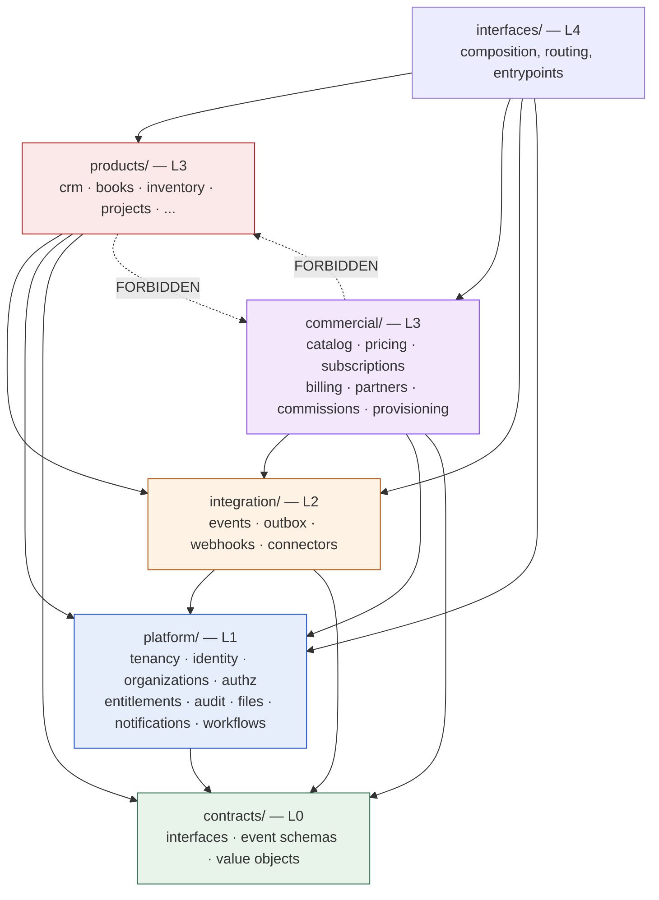

# 01 — Top-Level Domain Boundaries

> **CORRECTION (2026-09-22, [ADR-017](adrs/ADR-017-products-are-separate-applications.md)).**
> This document was written when product domains were to live *inside* this
> repository, under `products/`. They no longer do: each business product is
> a separate application in its own repository. Everything here about
> layering, ownership, isolation and enforcement still holds — but wherever
> it places a product's code in this repository, read
> [16 — Ecosystem / Product Boundary](16-ecosystem-product-boundary.md)
> instead.


**Status:** Accepted (Phase 0)
**Owner:** Architecture
**Last reviewed:** 2026-09-21

---

## 1. Purpose

Define the top-level modules of Workeasy360, what each owns, and — just as importantly — what each is **forbidden** to own. The dependency *directions* between these modules are specified in [02-dependency-rules.md](02-dependency-rules.md).

## 2. Evaluation of the proposed boundaries

The Phase 0 brief proposed `platform/`, `commercial/`, `products/`, `integration/`. That shape is broadly right and is adopted. Four changes are made, each for a concrete reason rather than taste.

### Change 1 — `entitlements` moves from `commercial/` to `platform/` (**critical**)

The brief listed `licensing` under `commercial/`. Entitlement checking cannot live there.

Every product must ask *"may organization X use feature Z?"* on nearly every request. If entitlements live in `commercial/`, then `products → commercial` becomes a legal dependency. Once that edge exists, nothing structurally prevents CRM from importing `Subscription`, reading `plan.name`, and branching on it. That is exactly the coupling the brief forbids, and it would arrive within weeks — not because anyone intends it, but because the import is already allowed.

**Decision:**

- `platform/entitlements` owns the **read model**: `Entitlement`, `FeatureEntitlement`, `SeatGrant`, `SeatAssignment`, and the `entitlements.check()` API that products call.
- `commercial/` owns the **cause**: subscriptions, plans, prices, invoices.
- Exactly one module — `commercial/provisioning` — is permitted to write to the entitlement read model. It translates commercial facts into entitlement facts.

This keeps `products → platform` as the only edge products need, and makes `products → commercial` an outright forbidden dependency that a linter can enforce. See [06-entitlements.md](06-entitlements.md).

### Change 2 — add a dependency-free `contracts/` package

Without it, "products talk through contracts" is unenforceable, because the contract lives inside the implementing module and importing the contract means importing the module.

`contracts/` contains **no Django models, no I/O, no framework imports** — only:

- event envelope + event schema definitions (versioned)
- protocol/interface definitions (`EntitlementService`, `NotificationService`, `FileStore`, …)
- shared value objects (`Money`, `CurrencyCode`, `PostalAddress`, `TenantContext`, `ProductCode`)
- enums shared across module boundaries
- cross-module exception types

It imports nothing from the rest of the system. Everything may import it. This is what makes the boundary rules checkable rather than aspirational.

### Change 3 — `platform/` gets internal layers

`platform/` as a flat bag of ten apps will develop internal cycles almost immediately — `notifications` wants `identity` for the recipient, `identity` wants `notifications` for the verification email. Both edges look reasonable in isolation.

`platform/` is therefore internally layered (P0 → P3), and a module may only depend on **strictly lower** platform layers. The `identity → notifications` case is resolved by an event: identity publishes `identity.user.email_verification_requested`; notifications subscribes. See [02-dependency-rules.md](02-dependency-rules.md).

### Change 4 — separate `integration/` (mechanism) from `connectors/` (vendors), and move API composition to `interfaces/`

The brief put "APIs" inside `integration/`. But each module owns its own API surface — CRM's endpoints belong to CRM. What is genuinely cross-cutting is *composition and versioning*: URL assembly, API versioning policy, key management, throttle classes, schema generation.

- `integration/` owns **mechanism**: outbox, event bus, subscriber registry, webhook delivery, connector framework, idempotency infrastructure.
- `integration/connectors/<vendor>/` owns **vendor adapters** (Stripe, Gmail, Shopify), each behind a port defined in `contracts/`.
- `interfaces/` owns **composition**: the ASGI/WSGI entrypoints, root URL configuration, API version routing, and the admin console mounting. It is the only place allowed to import from everything.

---

## 3. The module map

```
workeasy360/
├── contracts/              # L0 — dependency-free. Interfaces, events, value objects.
├── platform/               # L1 — shared kernel. Tenant-aware, product-agnostic.
│   ├── tenancy/            #   P0  tenant context, scoping, RLS plumbing
│   ├── observability/      #   P0  logging, tracing, metrics, correlation
│   ├── identity/           #   P1  User, credentials, sessions, MFA, SSO
│   ├── organizations/      #   P1  Organization, Membership, invitations
│   ├── authz/              #   P2  Role, Permission, policy evaluation
│   ├── entitlements/       #   P2  Entitlement read model + check API
│   ├── feature_flags/      #   P2  operational flags (NOT commercial features)
│   ├── audit/              #   P2  append-only audit log
│   ├── files/              #   P3  file metadata, storage ports, scanning
│   ├── notifications/      #   P3  channels, templates, preferences, delivery
│   └── workflows/          #   P3  rules, triggers, approvals, scheduling
├── integration/            # L2 — cross-module mechanism
│   ├── events/             #   outbox, relay, dispatcher, subscriber registry
│   ├── webhooks/           #   outbound delivery, signing, retries
│   ├── connectors/         #   vendor adapters behind contracts/ ports
│   └── idempotency/        #   idempotency keys, dedupe stores
├── commercial/             # L3 — how Workeasy360 makes money
│   ├── catalog/            #   Product, Feature, Plan, PlanFeature, Bundle
│   ├── pricing/            #   PriceBook, PlanPrice, ContractPrice, resolution
│   ├── subscriptions/      #   Subscription, SubscriptionItem, lifecycle
│   ├── billing/            #   invoices, payments, dunning, provider ports
│   ├── partners/           #   PartnerAccount, capabilities, relationships, branding
│   ├── commissions/        #   attribution, commission ledger, payouts
│   └── provisioning/       #   the ONLY writer into platform/entitlements
├── products/               # L3 — the sellable business domains
│   ├── crm/  books/  inventory/  projects/
│   ├── marketing/  support/  hr/  payroll/  commerce/
│   └── ...
└── interfaces/             # L4 — composition only
    ├── api/                #   version routing, schema, throttles, keys
    ├── web/                #   server-rendered surfaces if any
    ├── admin/              #   internal staff console
    └── asgi.py, wsgi.py, celery.py
```



---

## 4. `contracts/` — L0

**Owns:** the vocabulary that lets modules talk without touching each other.

```
contracts/
├── events/
│   ├── envelope.py          # DomainEvent envelope, required fields
│   ├── registry.py          # event_type -> schema version map
│   ├── platform_events.py   # identity.*, organizations.*, entitlements.*
│   ├── commercial_events.py # subscription.*, invoice.*, partner.*
│   └── product_events.py    # crm.*, books.*, inventory.* (schemas only)
├── ports/
│   ├── entitlements.py      # EntitlementService protocol
│   ├── notifications.py     # NotificationService protocol
│   ├── files.py             # FileStore protocol
│   ├── payments.py          # PaymentProvider protocol
│   ├── ai.py                # AIProvider protocol
│   └── search.py            # SearchIndex protocol
├── values/
│   ├── money.py             # Money(amount: Decimal, currency: CurrencyCode)
│   ├── address.py           # PostalAddress value object
│   ├── tenant.py            # TenantContext, OrganizationId, UserId
│   └── identifiers.py       # ProductCode, FeatureKey, PermissionKey
├── enums.py
└── errors.py                # MissingTenantContext, EntitlementDenied, ...
```

**Rules:**

- Zero imports from `platform/`, `commercial/`, `products/`, `integration/`, `interfaces/`, or `django.db`.
- Only stdlib, `pydantic`/`dataclasses`, `decimal`, and typing.
- Additive changes only. Removing or narrowing anything here is a breaking change requiring the deprecation procedure in [07-cross-product-integration.md](07-cross-product-integration.md).
- Enforced by an import-linter `forbidden` contract and a unit test that imports `contracts` in a bare interpreter with Django unconfigured.

**Why `ProductCode` is a string, not a foreign key.** `commercial/catalog.Product` is a *sellable SKU*; `products/crm` is *code*. If catalog held an FK into product modules, catalog would depend on every product, and adding a product would require a catalog migration. Instead each product module declares a manifest and registers itself:

```python
# products/crm/manifest.py
MANIFEST = ProductManifest(
    code=ProductCode("crm"),
    name="Workeasy360 CRM",
    features=[
        FeatureDeclaration("crm.pipelines.max", kind=QUOTA, default=3),
        FeatureDeclaration("crm.ai_summaries", kind=BOOLEAN, default=False),
    ],
    publishes=["crm.deal.won.v1", "crm.contact.created.v1"],
    consumes=["books.invoice.paid.v1"],
)
```

Catalog stores `product_code = "crm"` as a validated string. A startup system check asserts every catalog `product_code` resolves to a registered manifest and every `FeatureKey` sold is declared by its owning product. Mis-typed feature keys fail at boot, not in production.

---

## 5. `platform/` — L1, the shared kernel

The test for platform membership: **would every product need this, and is it product-agnostic?** If only two products need it, it is not platform — it is a shared library or belongs to one of them.

### Internal layers

| Layer | Modules | May depend on |
|---|---|---|
| **P0a** | `observability` | `contracts` only |
| **P0b** | `tenancy` | `contracts`, P0a |
| **P1** | `identity`, `organizations` | P0 |
| **P2** | `authz`, `entitlements`, `feature_flags`, `audit` | P0, P1 |
| **P3** | `files`, `notifications`, `workflows` | P0–P2 |

Within a layer, modules may **not** import each other (`identity` and `organizations` are siblings; they communicate via events or via an L4 orchestrator). Upward dependencies are forbidden; needs flowing upward are satisfied by events.

> **Amended by [ADR-015](adrs/ADR-015-platform-p0-ordering.md).** P0 was originally one layer containing both `tenancy` and `observability`. That proved unsatisfiable: `tenancy` must log, and `observability` must stamp `organization_id` on every line. P0 is now two ordered layers, and `observability` imports nothing internal but `contracts` — higher layers *push* what it needs through registries. This adds an ordering constraint rather than removing one.

### Module responsibilities

| Module | Owns | Explicitly does NOT own |
|---|---|---|
| `tenancy` | `TenantContext`, context propagation, `TenantScopedModel`/manager, RLS session variable management, task context propagation | The `Organization` model itself (that is `organizations`) |
| `observability` | structlog config, correlation IDs, OTel setup, metric registry, health checks | Business metrics definitions (each module registers its own) |
| `identity` | `User`, credentials, password policy, `AuthFactor` (TOTP/WebAuthn), sessions, tokens, `IdentityProvider` (SAML/OIDC), login attempts | Membership, roles, permissions, notification delivery |
| `organizations` | `Organization`, `Membership`, `Invitation`, `OrganizationSettings`, org lifecycle | Authentication, entitlements, billing identity |
| `authz` | `Role`, `Permission`, `RoleAssignment`, policy evaluation, permission registry | *Whether the org bought the feature* — that is `entitlements` |
| `entitlements` | `Entitlement`, `FeatureEntitlement`, `SeatGrant`, `SeatAssignment`, `check()`/`feature()` API, entitlement cache | Plans, prices, subscriptions, payment state |
| `feature_flags` | Operational rollout flags, kill switches, A/B targeting | Commercial features (those are `catalog` → `entitlements`) |
| `audit` | `AuditEvent` append-only log, retention, export | Application logs (that is `observability`) |
| `files` | `File` metadata, storage ports, presign, AV scan orchestration, quotas | File *content* semantics (an invoice PDF is Books' business meaning) |
| `notifications` | Channels, templates, user preferences, digesting, delivery records | Deciding *when* a business event is notable — modules publish, notifications delivers |
| `workflows` | Trigger/condition/action engine, approvals, schedules, run history | Domain actions themselves — it invokes registered, product-provided actions |

### The `feature_flags` vs `entitlements` distinction

These are confused constantly, so the rule is explicit:

| | `feature_flags` | `entitlements` |
|---|---|---|
| Question | "Is this code path enabled?" | "Did this customer buy this?" |
| Changed by | Engineering | Commercial events |
| Audience | Us | Customers |
| Failure mode | Default off, safe | Must be correct — wrong answer means revenue loss or free access |
| Lifetime | Temporary, deleted after rollout | Permanent |

A check may legitimately be `if flags.enabled("crm_new_pipeline_ui") and entitlements.feature(org, "crm.pipelines.advanced")`. Never implement one with the other.

---

## 6. `integration/` — L2, mechanism

| Module | Owns |
|---|---|
| `events` | `OutboxEvent`, relay, dispatcher, `Subscription` registry, `ProcessedEvent` dedupe, replay/DLQ tooling |
| `webhooks` | `WebhookEndpoint`, `WebhookDelivery`, HMAC signing, retry schedule, per-endpoint breaker |
| `connectors` | Vendor adapters: OAuth flows, credential storage, sync scheduling, rate-limit handling |
| `idempotency` | `IdempotencyKey` store, request-hash/response capture, `@idempotent_task` |

`integration/` knows **nothing** about CRM deals or invoices. It moves envelopes. A connector's *business mapping* (a Shopify order → a Commerce order) belongs to the product; the connector supplies authenticated transport and normalised payloads.

---

## 7. `commercial/` — L3

| Module | Owns | Key rule |
|---|---|---|
| `catalog` | `Product` (SKU), `Feature`, `Plan`, `PlanVersion`, `PlanFeature`, `Bundle`, `BundleItem` | Control plane. No `organization_id`. |
| `pricing` | `PriceBook`, `PlanPrice`, `PriceTier`, `ContractPrice`, `resolve_price()` | The *only* place a price is computed. No product, and no other commercial module, computes prices. |
| `subscriptions` | `Subscription`, `SubscriptionItem`, `SubscriptionSchedule`, state machine, proration | Owns the customer's commercial state — not their access. |
| `billing` | `BillingInvoice`, `BillingInvoiceLine`, `Payment`, `Refund`, `Credit`, `DunningRun`, provider ports | Never writes entitlements directly. |
| `partners` | `PartnerAccount`, `PartnerCapability`, `PartnerRelationship`, `Brand`, `CustomDomain` | One model for reseller/white-label/affiliate; behaviour by capability. |
| `commissions` | `AttributionRecord`, `CommissionRule`, `CommissionEntry` (append-only), `Payout` | Ledger semantics: entries are never updated, only reversed. |
| `provisioning` | Translation of commercial state → entitlement state; reconciliation job | **The only writer to `platform/entitlements`.** |

`billing.BillingInvoice` is what the customer owes **Workeasy360**. It has nothing to do with `products/books.Invoice`, which is what the customer's customer owes **them**. These must never be unified. See [08-data-ownership.md](08-data-ownership.md).

---

## 8. `products/` — L3

Each product is a self-contained business domain with the internal layout defined in [14 — Repository Structure](14-repository-structure.md).

**A product module owns:** its entities, its business rules, its APIs, its background jobs, its published events, its handlers for others' events, its UI contract.

**A product module must NOT own:** authentication, user records, organizations, roles, permission evaluation, entitlement decisions, billing, pricing, notification delivery, file storage, audit infrastructure, event transport.

| Product | Core aggregates (illustrative — not a feature spec) |
|---|---|
| `crm` | Contact, Company, Lead, Deal, Pipeline, Stage, Activity |
| `books` | Account, JournalEntry, Invoice, Bill, Payment, TaxRate, Ledger |
| `inventory` | Item, Warehouse, StockLevel, StockMovement, Adjustment |
| `projects` | Project, Task, Milestone, Timesheet, Allocation |
| `marketing` | Campaign, Audience, Message, Journey |
| `support` | Ticket, SLA, Queue, Macro, KnowledgeArticle |
| `hr` | Employee, Position, LeaveRequest, Review |
| `payroll` | PayRun, PaySlip, Deduction, Contribution |
| `commerce` | Storefront, Order, Fulfilment, Discount |

### Products are peers, not a hierarchy

There is a strong temptation to say "Books is foundational, everything posts to it." Resist it. If Inventory imports Books to post a journal entry, Inventory cannot ship without Books, cannot be sold without Books, and cannot be extracted without Books. Inventory publishes `inventory.stock.consumed.v1`; Books subscribes *if the organization has Books*. If it does not, the event is simply unconsumed. That is the whole point of independent commercialization.

### Where a shared product concern actually goes

When two products need the same non-trivial logic, there are exactly three legitimate answers, in order of preference:

1. **It is genuinely platform-level** → promote to `platform/` (high bar: every product would need it, product-agnostic).
2. **It is a calculation with no state** → a pure library in `contracts/values` or a dedicated `libs/` package with no domain knowledge (e.g. date arithmetic, tax-number validation).
3. **It belongs to one product and the other consumes it via a contract** → the owner exposes an application service or publishes events.

There is no fourth answer. "Put it in `products/shared/`" is forbidden: it becomes a second, unowned product that every product depends on, and it will contain CRM logic within a year.

---

## 9. `interfaces/` — L4

The only layer permitted to import from everywhere. It contains **no business logic** — no `if`, no calculation, no persistence. It assembles:

- `interfaces/api/v1/urls.py` — includes each module's router
- API version negotiation and deprecation headers
- Throttle classes, API key auth, schema generation
- `interfaces/api/v1/admin_*_views.py` — the internal staff console's API, including break-glass flows (the empty `interfaces/admin/` placeholder was removed in Phase 9)
- `asgi.py`, `wsgi.py`, `celery.py`, settings composition

A code reviewer who sees a domain rule in `interfaces/` rejects the PR.

---

## 10. Boundary decision checklist

When adding anything non-trivial, answer these in the PR description:

1. Which single module **owns** this data or rule?
2. Does it need `organization_id`? If yes it is data plane; if no, justify.
3. Who else needs to read it? Via **selector, application service, or event** — which, and why?
4. Does it introduce an import that crosses a forbidden edge? If yes, stop.
5. Does it need a new event type? Is it versioned? Who consumes it?
6. If this module were extracted to its own service in three years, what breaks?

Question 6 is the cheapest architectural test available. If the answer is "nothing — it only uses contracts and events", the boundary is correct. If it is "everything, it reads six other modules' tables", the boundary is already broken.

---

## 11. Related documents

- [02-dependency-rules.md](02-dependency-rules.md) — enforcement of the edges above
- [06-entitlements.md](06-entitlements.md) — why entitlements sit in platform
- [08-data-ownership.md](08-data-ownership.md) — per-entity ownership matrix
- [14-repository-structure.md](14-repository-structure.md) — inside a module
- [ADR-001](adrs/ADR-001-modular-monolith-first.md), [ADR-005](adrs/ADR-005-product-entitlement-model.md)
