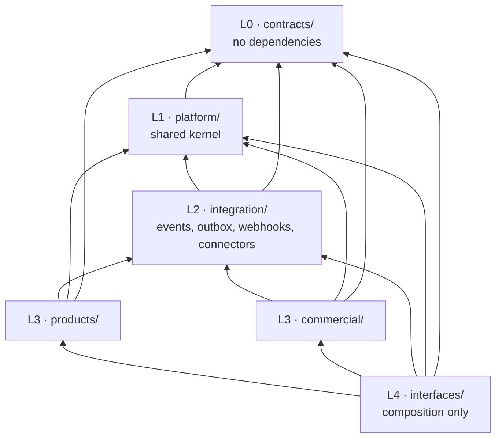
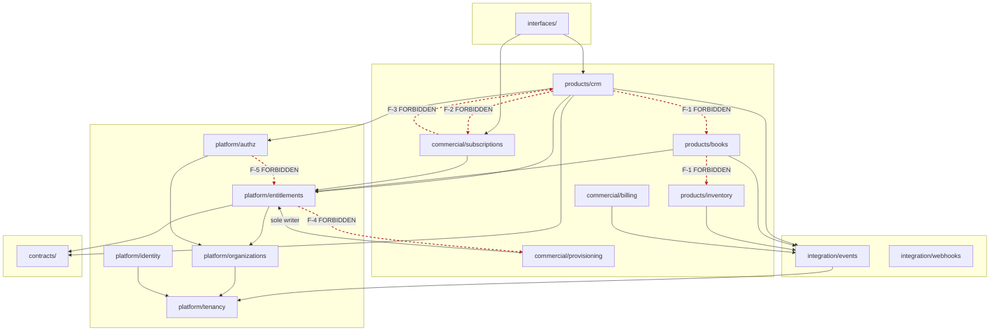

# 02 — Dependency Rules

> **CORRECTION (2026-09-22, [ADR-017](adrs/ADR-017-products-are-separate-applications.md)).**
> This document was written when product domains were to live *inside* this
> repository, under `products/`. They no longer do: each business product is
> a separate application in its own repository. Everything here about
> layering, ownership, isolation and enforcement still holds — but wherever
> it places a product's code in this repository, read
> [16 — Ecosystem / Product Boundary](16-ecosystem-product-boundary.md)
> instead.


**Status:** Accepted (Phase 0)
**Owner:** Architecture
**Last reviewed:** 2026-09-21

---

## 1. Purpose

Boundaries that are not enforced are decoration. This document defines the allowed dependency directions, the forbidden ones, the mechanisms that replace forbidden edges, and the **automated enforcement** that makes the rules real.

## 2. The layer model



**The single rule that generates all others:** *dependencies point downward and never sideways at L3.*

| From | May import | May NOT import |
|---|---|---|
| `contracts/` | nothing internal | everything internal |
| `platform/<m>` | `contracts`, strictly lower platform layers | same-layer platform siblings, `integration`, `commercial`, `products`, `interfaces` |
| `integration/` | `contracts`, `platform` | `commercial`, `products`, `interfaces` |
| `commercial/<m>` | `contracts`, `platform`, `integration`, lower commercial layers | `products`, `interfaces` |
| `products/<p>` | `contracts`, `platform`, `integration` | **any other product**, `commercial`, `interfaces` |
| `interfaces/` | everything | — (but no business logic) |

## 3. The forbidden edges, and what to do instead

These are the seven edges that would destroy the architecture. Each has a mandated replacement.

### F-1 — `products/a` → `products/b` (any import at all)

The defining rule of the system. No exceptions, including "just for a type hint" and "just reading one field".

**Instead:**

| Need | Mechanism |
|---|---|
| React to something that happened in B | Subscribe to B's published domain event |
| Ask B for data, now, read-only | `contracts` port implemented by B, resolved at runtime via the registry — never a direct import |
| Cause a write in B | Publish an event; B decides. You do not get a return value, and you must not need one |
| Reference a B record | Store a soft reference `(product_code, entity_type, entity_id)`. No FK |

See [07-cross-product-integration.md](07-cross-product-integration.md) for the runtime-resolution pattern and why it is deliberately awkward to use.

### F-2 — `products/*` → `commercial/*`

A product must never see a `Subscription`, `Plan`, `Price`, `BillingInvoice`, or `PartnerAccount`.

**Instead:** `platform.entitlements.check(org_id, "crm")` / `.feature(org_id, "crm.pipelines.max")`.

If a product genuinely needs commercial context — e.g. Books wants to show a white-label logo — the answer is not to import `partners`. It is that **branding is resolved at the request boundary** and placed on the request context as neutral data (`request.branding.logo_url`). The product consumes a value object from `contracts`, not a commercial model.

### F-3 — `commercial/*` → `products/*`

Commercial must be able to sell a product that is not installed, and must not break when a product is removed.

**Instead:** `ProductCode` strings validated against the manifest registry at startup. If commercial needs a count ("how many contacts does this org have?" for usage billing), the product **publishes** usage metrics to a platform-level usage sink; commercial reads the sink.

### F-4 — `platform/*` → anything above it

The kernel cannot depend on its consumers. Particularly tempting: `platform/notifications` wanting to render a CRM deal in an email.

**Instead:** the publisher supplies the rendered content. Products push a `NotificationRequest` containing already-resolved template data; notifications owns delivery, preferences and channels, not domain rendering.

### F-5 — Same-layer imports inside `platform/`

`identity ↔ organizations`, `authz ↔ entitlements` — these look harmless and create the worst cycles.

**Instead:** events, or orchestration one layer up. Example: creating an organization needs a user, and inviting a user needs an organization. Neither imports the other; `interfaces` (or a dedicated `platform/onboarding` at P3) orchestrates the use case across both.

### F-6 — ORM access across any module boundary

Even where the import is *legal* by layer, reading another module's tables is not.

```python
# ILLEGAL even though products -> platform is a legal edge
from platform.organizations.models import Membership
Membership.objects.filter(organization_id=org_id, is_active=True)

# LEGAL
from platform.organizations import selectors as org_selectors
org_selectors.active_member_ids(org_id)   # returns DTOs, not model instances
```

Reason: a queryset over another module's model welds you to its schema. When that module changes a column, your code breaks — and your code is not in its test suite. Selectors are a contract; models are an implementation detail.

**Corollary:** no cross-module `ForeignKey` except to a small, explicitly frozen set:

| Allowed FK target | Why |
|---|---|
| `platform.organizations.Organization` | the tenant discriminator; needed on every tenant row for RLS |
| `platform.identity.User` | actor attribution (`created_by`, `assigned_to`) |
| `platform.files.File` | attachment references |

Everything else is a soft reference. These three are frozen by ADR-009 and adding a fourth requires an ADR.

### F-7 — Business logic in `interfaces/`, views, serializers, admin, tasks, or signals

Not a layer violation but a location violation, with the same effect: logic becomes unfindable and untestable.

**Instead:** views and tasks are 5–15 line adapters that parse input, call one application service, and shape output. See [14-repository-structure.md](14-repository-structure.md).

### F-8 — Django signals for cross-module communication

Banned outright. `post_save` handlers across modules are invisible dependencies with no ordering guarantees, they fire inside the sender's transaction, they break in bulk operations (`bulk_create`, `update()`, `loaddata`), and they make tests non-deterministic.

**Instead:** an explicit call in an application service, or a domain event written to the outbox within the same transaction. Signals are permitted only *within* a module and only for mechanical concerns (cache invalidation of the module's own cache).

## 4. Dependency diagram with forbidden edges



Note `CRM → EVT` and `BKS → EVT`: CRM publishes `crm.deal.won.v1`, Books consumes it. The arrows both point *into* `integration/events`. There is no arrow between CRM and Books, which is exactly the property that lets either ship without the other.

## 5. Cycle prevention

Cycles are prevented structurally rather than by vigilance:

1. **Strict layering.** A cycle requires an upward edge; upward edges are linter-blocked.
2. **Intra-layer isolation at L3.** Products cannot import products; commercial modules are themselves sub-layered (`catalog` → `pricing` → `subscriptions` → `billing`/`provisioning`; `partners` → `commissions`).
3. **Events are acyclic by construction** at the *code* level: a subscriber never imports its publisher, only the schema in `contracts`.
4. **Runtime event cycles are still possible** (A publishes → B handles → B publishes → A handles). These are detected, not prevented by the type system:
   - every event carries `causation_id` and a `causation_depth` counter,
   - the dispatcher rejects any event with `causation_depth > 10` and raises an alert,
   - a CI test builds the publish/consume graph from the manifests and fails on a cycle unless the pair is listed in `docs/architecture/allowed-event-cycles.yml` with a written justification.

## 6. Enforcement

Rules the CI does not check are rules that do not exist.

### 6.1 Static import analysis — `import-linter`

`.importlinter` at repo root, run in CI on every PR and locally via `make lint-arch`:

```ini
[importlinter]
root_packages =
    contracts
    platform
    integration
    commercial
    products
    interfaces

[importlinter:contract:layers]
name = Top-level layering
type = layers
layers =
    interfaces
    products | commercial
    integration
    platform
    contracts
containers =
exhaustive = false

[importlinter:contract:contracts-are-pure]
name = contracts/ depends on nothing internal
type = forbidden
source_modules = contracts
forbidden_modules =
    platform
    integration
    commercial
    products
    interfaces
    django

[importlinter:contract:products-are-independent]
name = No product imports another product
type = independence
modules =
    products.crm
    products.books
    products.inventory
    products.projects
    products.marketing
    products.support
    products.hr
    products.payroll
    products.commerce

[importlinter:contract:products-never-see-commercial]
name = Products must not import commercial
type = forbidden
source_modules = products
forbidden_modules = commercial

[importlinter:contract:commercial-never-sees-products]
name = Commercial must not import products
type = forbidden
source_modules = commercial
forbidden_modules = products

[importlinter:contract:platform-internal-layers]
name = platform internal layering
type = layers
layers =
    platform.files | platform.notifications | platform.workflows
    platform.authz | platform.entitlements | platform.feature_flags | platform.audit
    platform.identity | platform.organizations
    platform.tenancy | platform.observability

[importlinter:contract:entitlements-single-writer]
name = Only provisioning may import entitlement write services
type = forbidden
source_modules =
    products
    commercial.catalog
    commercial.pricing
    commercial.subscriptions
    commercial.billing
    commercial.partners
    commercial.commissions
forbidden_modules = platform.entitlements.services.write
```

### 6.2 Runtime system checks (fail at boot, not in production)

Registered as Django system checks in `platform/tenancy/checks.py` and friends; `manage.py check --deploy` runs in CI and at container start:

| Check | Fails when |
|---|---|
| `W360.E001` | A model with `organization_id` does not inherit `TenantScopedModel` |
| `W360.E002` | A `TenantScopedModel` has no RLS policy in the migration state |
| `W360.E003` | A `ForeignKey` crosses a module boundary outside the frozen allowlist |
| `W360.E004` | A catalog `product_code` has no registered `ProductManifest` |
| `W360.E005` | A sold `FeatureKey` is not declared by its owning product manifest |
| `W360.E006` | An event type is published but has no schema in `contracts.events.registry` |
| `W360.E007` | A Celery task has no explicit queue, or no `soft_time_limit` |
| `W360.E008` | An HTTP client is constructed without an explicit timeout |
| `W360.E009` | A cross-module `post_save`/`pre_save` receiver is registered |

### 6.3 Architecture tests

`tests/architecture/` — ordinary pytest, runs in the fast suite:

```python
def test_no_cross_product_orm_access(): ...      # AST scan for products.X.models in products.Y
def test_every_tenant_model_has_rls_policy(): ...
def test_every_view_calls_at_most_one_service(): ...
def test_no_external_http_inside_atomic_block(): ...
def test_event_graph_has_no_undeclared_cycles(): ...
def test_public_event_schemas_are_backward_compatible(): ...  # vs. schemas on main
```

### 6.4 Human enforcement

- `CODEOWNERS`: `/contracts/`, `/platform/`, `/.importlinter`, `/docs/architecture/` require Architecture review.
- A PR that modifies `.importlinter` to permit a new edge must include an ADR. Weakening the rules is a decision, not a fix.
- Suppressions (`# noqa: arch`) require an inline ticket reference and expire: a CI job fails on suppressions older than 90 days.

## 7. The escape hatch, and its price

Occasionally a rule will genuinely be wrong. The procedure:

1. Write the ADR: what edge, why, what was tried, what the cost of not having it is.
2. Get Architecture review.
3. Add the exception to `.importlinter` **narrowly** — specific module to specific module, never a blanket `ignore_imports` wildcard.
4. Add a dated entry to `docs/architecture/debt-register.md` with an owner and a review date.

This is deliberately more work than doing it correctly. That asymmetry is the enforcement mechanism.

## 8. Related documents

- [01-domain-boundaries.md](01-domain-boundaries.md) — what the modules are
- [07-cross-product-integration.md](07-cross-product-integration.md) — the sanctioned replacements for forbidden edges
- [14-repository-structure.md](14-repository-structure.md) — where code goes inside a module
- [ADR-007](adrs/ADR-007-cross-product-communication.md)
