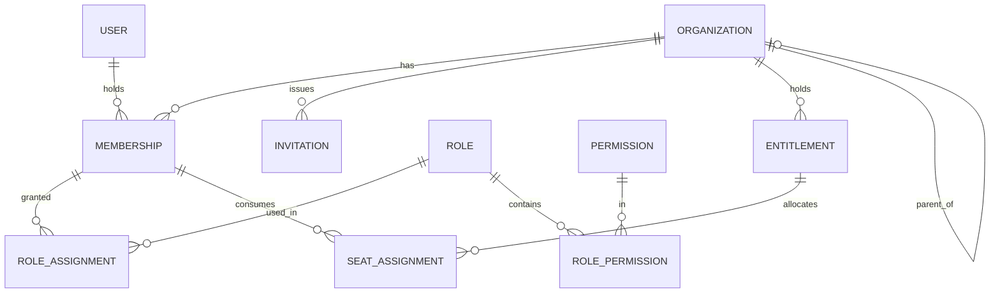
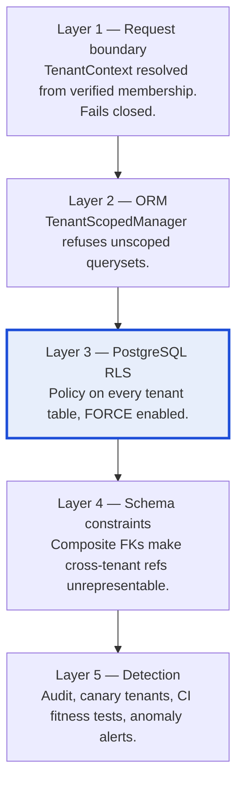

# 03 — Multi-Tenancy and Tenant Isolation

**Status:** Accepted (Phase 0)
**Owner:** Architecture
**Last reviewed:** 2026-09-21

---

## 1. Purpose

Define the tenancy model and how tenant isolation is enforced. A cross-tenant data leak is the one class of bug this platform cannot recover from commercially. Everything here is designed around the assumption that **application code will eventually contain a bug that forgets to filter by organization**, and that the system must survive that bug.

## 2. The tenancy decision

**Shared database, shared schema, row-level tenancy with `organization_id`, defended by PostgreSQL Row-Level Security.**

### Alternatives considered

| Model | Isolation | Cost at 10k tenants | Migrations | Cross-tenant reporting | Verdict |
|---|---|---|---|---|---|
| Database per tenant | Strongest | Unworkable — thousands of connections, pools, backups | Thousands of runs; one failure = split-brain | Requires ETL | **Rejected** — operationally impossible at our target scale |
| Schema per tenant | Strong | `search_path` switching, catalog bloat, `pg_dump` pain; Postgres degrades past a few thousand schemas | Thousands of runs | Hard | **Rejected** — same failure mode, arrives later |
| Shared schema, app-level filtering only | Weak | Cheap | One run | Easy | **Rejected** — one missing `.filter()` is a breach |
| **Shared schema + app scoping + RLS** | Strong in practice | Cheap | One run | Easy | **Selected** |

The decisive argument is the **migration blast radius**. With a modular monolith hosting a dozen products, we will deploy schema changes constantly. A per-tenant model turns every migration into a distributed transaction across thousands of databases with partial-failure states. Shared schema keeps migrations a solved problem and moves the isolation burden to RLS, where PostgreSQL enforces it below the application.

**Enterprise escape hatch:** an organization can be assigned a dedicated *database* later without changing the data model, because every tenant row already carries `organization_id` and the application already routes by tenant context. `Organization.residency_region` and `Organization.shard_key` exist from day one, unused. See [13-deployment-evolution.md](13-deployment-evolution.md).

## 3. The organization model



### 3.1 `Organization` — the tenant

```python
class Organization(models.Model):          # platform/organizations
    id                = UUIDField(primary_key=True, default=uuid7)
    slug              = SlugField(unique=True)          # URL identity, immutable
    legal_name        = CharField()
    display_name      = CharField()
    status            = CharField(choices=OrganizationStatus)
    residency_region  = CharField(default="eu-west-1")  # reserved for future pinning
    shard_key         = CharField(db_index=True)        # reserved; = str(id) initially
    parent            = FK("self", null=True, on_delete=PROTECT)   # see 3.2
    created_by        = FK(User, on_delete=PROTECT)
    created_at        = DateTimeField()
    deleted_at        = DateTimeField(null=True)        # soft delete, purge job after retention
```

`OrganizationStatus`:

| Status | Read | Write | Login | Meaning |
|---|---|---|---|---|
| `provisioning` | no | no | no | Being created |
| `active` | yes | yes | yes | Normal |
| `suspended` | **yes** | no | yes | Non-payment or policy. Data visible, read-only. |
| `locked` | no | no | no | Security incident / legal hold. Staff-only access. |
| `pending_deletion` | yes (export only) | no | owner only | In the 30-day recovery window |
| `deleted` | no | no | no | Purged; tombstone retained for audit |

**Design choice: suspension is read-only, not lockout.** A customer whose card expired must still be able to see their invoices, export their data and pay. Hard lockout maximises churn, generates support load and risks data-protection complaints. Suspension blocks writes, background jobs and API mutations, and shows a persistent banner.

### 3.2 On parent/child organizations

`parent` is present because multi-entity customers (holding companies, franchises) are a real and early requirement, and retrofitting a hierarchy is expensive. But its semantics are deliberately minimal in Phase 0:

- A parent organization is **a tenant like any other**. It does not automatically see children's data.
- Hierarchy grants nothing implicitly. Cross-org visibility requires an explicit, audited `OrganizationLink` grant with a scope.
- RLS policies match on `organization_id` **only** — never `organization_id IN (descendants)`. A recursive RLS predicate is a performance and correctness hazard and would silently widen every query in the system.
- Consolidated reporting across a group is built later as an explicit cross-org read path with its own authorization, not as a loosening of tenancy.

This is the conservative choice: the column exists so the model can grow, but no isolation rule depends on it.

### 3.3 `User` — global identity, scoped access

```python
class User(models.Model):                   # platform/identity — NOT tenant-scoped
    id            = UUIDField(primary_key=True, default=uuid7)
    email         = CitextField(unique=True)
    email_verified_at = DateTimeField(null=True)
    full_name     = CharField()
    status        = CharField(choices=UserStatus)   # active | disabled | locked
    last_login_at = DateTimeField(null=True)
```

**A `User` is global, not per-organization.** One person, one account, many organizations — an accountant serving twelve clients should not maintain twelve passwords. This is a deliberate trade:

| Consequence | Handling |
|---|---|
| `User` has no `organization_id`, so RLS cannot protect it | `User` is control-plane-adjacent. Access is via `organizations` selectors that always join through `Membership`; the raw `User` table is never queried by product code (enforced by F-6). |
| Email enumeration across tenants | Invitation and login flows return uniform responses; existence is never disclosed. |
| A user disabled globally affects all their orgs | Correct and intended — a compromised account must be stoppable everywhere at once. Per-org deactivation is `Membership.status`. |
| SSO conflicts: user belongs to an SSO-enforcing org and a non-SSO org | Authentication method is resolved per *organization session*, not per user. Entering an SSO-enforcing org requires an SSO assertion even if the user logged in with a password elsewhere. |

### 3.4 `Membership` — the junction that authorizes everything

```python
class Membership(TenantScopedModel):        # platform/organizations
    id              = UUIDField(primary_key=True, default=uuid7)
    organization    = FK(Organization, on_delete=CASCADE)
    user            = FK(User, on_delete=PROTECT)
    status          = CharField(choices=MembershipStatus)  # invited|active|suspended|removed
    is_owner        = BooleanField(default=False)
    member_type     = CharField(choices=MemberType)  # internal | collaborator | service
    joined_at       = DateTimeField(null=True)
    removed_at      = DateTimeField(null=True)

    class Meta:
        constraints = [
            UniqueConstraint("organization", "user", name="uq_membership_org_user"),
            UniqueConstraint("organization", condition=Q(is_owner=True),
                             name="uq_one_owner_per_org"),
            UniqueConstraint("id", "organization", name="uq_membership_id_org"),  # composite-FK target
        ]
```

`Membership` is the object that grants access. **Authorization always resolves through a membership, never through a user.** `user.has_perm(...)` does not exist in this system; `authz.check(membership, permission, resource)` does.

`member_type=service` covers API-only principals so that machine access is a membership with roles like any other, rather than a parallel privilege system.

### 3.5 `Role`, `Permission`, `RoleAssignment`

Full treatment in [04-identity-authz.md](04-identity-authz.md). For the tenancy model, the relevant facts are:

- `Permission` is **global reference data** (control plane): `crm.deal.update`, `books.journal.post`. Declared in code by the owning module, synced to the DB at deploy.
- `Role` exists in two forms: **system roles** (global templates, no `organization_id`) and **custom roles** (tenant-owned, `organization_id` set, RLS-protected).
- `RoleAssignment` is tenant-owned and binds `(membership, role, scope)`, where scope may narrow a role to a product or a resource subtree.

## 4. Tenant isolation — five layers of defence

No single mechanism is trusted. Each layer assumes the one above it has failed.



### Layer 1 — Tenant context at the request boundary

```python
# platform/tenancy/context.py
_tenant: ContextVar[TenantContext | None] = ContextVar("tenant", default=None)

@dataclass(frozen=True)
class TenantContext:
    organization_id: UUID
    membership_id: UUID
    user_id: UUID
    is_break_glass: bool = False
    reason: str | None = None
```

Resolution order in middleware:

1. Authenticate the principal (session cookie, API key, or OAuth token).
2. Determine the target organization from the **URL path** (`/api/v1/orgs/{org_slug}/...`) or the API key's bound organization. **Never from a request header or body.**
3. Look up an `active` `Membership` for `(user, organization)`. No membership → 403.
4. Check `Organization.status` gates the requested method (writes blocked when `suspended`).
5. Bind `TenantContext` to the contextvar; open the DB transaction and set the RLS variable.

A `ContextVar` is used rather than thread-local storage because the application runs under ASGI, where a single thread interleaves many requests. Thread-locals are a correctness bug under async, not a style preference.

**Propagation into Celery.** Tasks do not inherit contextvars. A custom task base class serialises `organization_id` + `user_id` into task headers at publish time and re-establishes `TenantContext` in `before_start`:

```python
class TenantTask(celery.Task):
    def apply_async(self, *a, **kw):
        ctx = current_tenant_or_none()
        kw.setdefault("headers", {})["w360_tenant"] = ctx.to_headers() if ctx else None
        kw["headers"]["w360_correlation_id"] = current_correlation_id()
        return super().apply_async(*a, **kw)

    def before_start(self, task_id, args, kwargs):
        headers = self.request.headers or {}
        raw = headers.get("w360_tenant")
        if raw is None and self.requires_tenant:          # default True
            raise MissingTenantContext(f"{self.name} dispatched without tenant context")
        set_tenant(TenantContext.from_headers(raw))
```

Tasks that are legitimately cross-tenant (nightly reconciliation, catalog sync) set `requires_tenant = False` explicitly and are reviewed by CODEOWNERS. They must then iterate organizations and enter tenant context per organization — never run a single unscoped query across all tenants.

### Layer 2 — ORM-level scoping

```python
class TenantScopedQuerySet(models.QuerySet):
    def _require_context(self):
        ctx = current_tenant_or_none()
        if ctx is None:
            raise MissingTenantContext(
                f"Query on {self.model.__name__} without tenant context"
            )
        return ctx

class TenantScopedManager(models.Manager.from_queryset(TenantScopedQuerySet)):
    def get_queryset(self):
        ctx = self._require_context()
        return super().get_queryset().filter(organization_id=ctx.organization_id)

class TenantScopedModel(models.Model):
    organization = models.ForeignKey(
        "organizations.Organization", on_delete=models.CASCADE, db_index=True,
    )
    objects       = TenantScopedManager()
    unscoped      = models.Manager()   # audited, restricted usage — see below

    class Meta:
        abstract = True
```

Rules:

- `objects` raises `MissingTenantContext` rather than returning an empty queryset. **Silent emptiness is the dangerous failure** — it looks like "no data" and gets shipped. An exception is loud.
- `unscoped` exists because migrations, the reconciliation jobs and RLS tests genuinely need it. Its use is restricted by an AST-based CI check to an allowlist of modules, and every call site must be inside `with unscoped_access(reason=...)`, which writes an audit record.
- `organization_id` is set automatically on save from context if unset; a mismatch between context and an explicitly-set value raises rather than silently overwriting.

### Layer 3 — PostgreSQL Row-Level Security

This is the layer that survives application bugs.

```sql
-- Applied by a migration helper for every TenantScopedModel
ALTER TABLE crm_deal ENABLE ROW LEVEL SECURITY;
ALTER TABLE crm_deal FORCE  ROW LEVEL SECURITY;   -- critical: also applies to the table owner

CREATE POLICY tenant_isolation ON crm_deal
    USING      (organization_id = current_setting('app.organization_id', true)::uuid)
    WITH CHECK (organization_id = current_setting('app.organization_id', true)::uuid);
```

Four details that are easy to get wrong and fatal if missed:

1. **`FORCE ROW LEVEL SECURITY` is mandatory.** Without it, the table *owner* bypasses all policies. Django's migration role usually owns the tables; if the app connects as that same role, RLS silently does nothing.
2. **The application connects as a dedicated non-owner, non-superuser role** (`w360_app`) with `NOBYPASSRLS`. Migrations connect as `w360_migrator` (owner). This is enforced by a startup assertion:
   ```sql
   SELECT rolsuper, rolbypassrls FROM pg_roles WHERE rolname = current_user;
   ```
   Both must be false, or the process refuses to start.
3. **`current_setting('app.organization_id', true)`** with `missing_ok=true` returns `NULL` when unset. `NULL = uuid` evaluates to `NULL`, which is not `TRUE`, so **an unset variable matches zero rows**. This is the fail-closed property we want. It is asserted by a test that runs a query with no variable set and expects zero rows on a table known to contain data.
4. **`WITH CHECK` as well as `USING`.** `USING` filters reads and the *old* row on update; `WITH CHECK` validates the *new* row on insert/update. Without it, code could insert a row belonging to another tenant even though it could not read it.

#### Setting the variable safely under connection pooling

This is the single most dangerous operational detail in the design.

We use **PgBouncer in transaction pooling mode** for connection efficiency. In transaction pooling, a server connection is returned to the pool at `COMMIT`, so a session-level `SET app.organization_id = ...` can **leak into another tenant's transaction**. That would be a catastrophic cross-tenant read.

**Mandatory rule: only `SET LOCAL`, only inside an explicit transaction.**

```python
@contextmanager
def tenant_db_scope(ctx: TenantContext):
    with transaction.atomic():
        with connection.cursor() as cur:
            cur.execute("SELECT set_config('app.organization_id', %s, true)", [str(ctx.organization_id)])
        yield
```

`set_config(..., is_local=true)` is the function form of `SET LOCAL`: it is reverted at transaction end, so nothing can leak to the next borrower of that server connection.

Consequences accepted deliberately:

- **Every tenant-scoped request runs inside a transaction.** `ATOMIC_REQUESTS` is *not* used (it wraps too much and holds locks across slow serialization); instead the tenancy middleware opens the transaction explicitly and the same span is used for the request's writes.
- **Autocommit reads outside a transaction cannot see tenant data.** That is the intended behaviour: such a query would be unscoped anyway.
- Guarded by a CI test that runs two interleaved transactions through a real PgBouncer in transaction mode and asserts no leakage. This test is a release gate, not an optional extra.

> **Risk R-01 (P0, closed by decision).** If PgBouncer transaction pooling proves unworkable with `set_config` under our driver/ORM combination, the documented fallback is: run the **web tier through PgBouncer in session pooling mode with a smaller pool plus an in-process pool**, and keep transaction pooling only for worker tiers, which are less connection-dense. This costs connections, not correctness. The spike that proves which path we take is a Phase 1 Sprint 0 entry condition. See [15-risk-register.md](15-risk-register.md).

### Layer 4 — Schema constraints that make cross-tenant references unrepresentable

RLS stops you reading another tenant's row. It does **not** stop you writing a row in *your* tenant that points at another tenant's row, if you somehow obtained the ID. Composite foreign keys close that gap at the schema level:

```sql
-- Parent exposes a composite unique key
ALTER TABLE crm_deal ADD CONSTRAINT uq_deal_id_org UNIQUE (id, organization_id);

-- Child references BOTH columns
ALTER TABLE crm_activity
  ADD CONSTRAINT fk_activity_deal
  FOREIGN KEY (deal_id, organization_id)
  REFERENCES crm_deal (id, organization_id)
  ON DELETE CASCADE;
```

Now a cross-tenant reference is not merely forbidden by policy — it **cannot exist**, because the FK requires the child's own `organization_id` to match the parent's. The database rejects it regardless of what the application believes.

Django does not generate composite FKs natively, so this is applied by a `RunSQL` operation emitted by a migration helper (`tenancy.migrations.add_tenant_fk(...)`). A fitness test walks every `TenantScopedModel` FK that targets another `TenantScopedModel` and asserts a composite constraint exists.

### Layer 5 — Detection

Prevention can fail silently. Detection must not.

- **Canary tenants.** Two synthetic organizations with known, distinctive data. A continuous probe queries as tenant A and asserts tenant B's canary strings never appear, across the API surface and search index. Alerts at P0.
- **Fitness tests in CI** — every tenant model has RLS, `FORCE`, both `USING` and `WITH CHECK`, a composite FK where applicable, and an `organization_id` index.
- **Audit of `unscoped` usage** — every call recorded with module, reason and row count; anomalous volumes alert.
- **Query-level assertion in non-production** — a `connection.execute_wrapper` that inspects every SELECT against a tenant table and fails the test suite if no `organization_id` predicate and no RLS variable are present.
- **Cross-tenant ID probing detection** — repeated 404/403 on well-formed UUIDs from one principal raises a security event ([11-observability.md](11-observability.md)).

## 5. Tenancy beyond PostgreSQL

Isolation is not only a database concern.

| Store | Isolation mechanism |
|---|---|
| **Redis** | Every key is prefixed `w360:{org_id}:{namespace}:{key}` by a wrapper client. Raw client access is linter-blocked outside `platform/`. Cross-tenant keys (catalog cache) use the reserved `w360:global:` prefix. |
| **S3** | Object keys are `org/{org_id}/{module}/{uuid}`. Presigned URLs are generated only for a key that has been verified to start with the current tenant's prefix, and are short-lived (≤15 min, single-use where the operation allows). Bucket policy additionally restricts the app role to the `org/` prefix. |
| **Search index** | `organization_id` is a mandatory filter injected by the search port, not by callers. Index-per-tenant is rejected for the same reasons as schema-per-tenant; a tenant filter clause is applied in the engine's filter context and asserted by a canary test. |
| **Celery / broker** | Tenant travels in task headers, never in the queue name. Queue names encode *workload class* only, so queues remain bulkheads rather than becoming a per-tenant resource explosion. |
| **Logs & traces** | `organization_id` is a first-class field on every log line and span. Log access for staff is filtered by the same break-glass rules as data access — logs are a copy of customer data. |
| **Cache invalidation** | Entitlement and permission caches are versioned per organization (`w360:{org}:perm:v{n}`), so invalidation is a version bump, never a cross-tenant flush. |

## 6. Tenant lifecycle

| Event | Actions |
|---|---|
| **Create** | Allocate org → create owner membership → assign `owner` role → seed system roles → start trial entitlements → publish `organizations.organization.created.v1` |
| **Suspend** | Set status → invalidate permission/entitlement cache → revoke write tokens → cancel non-essential queued jobs → publish event. Reads continue. |
| **Reactivate** | Status → active, cache bump, resume schedules. No data restoration needed because nothing was deleted. |
| **Request deletion** | Status → `pending_deletion`, 30-day timer, export bundle generated, owner notified, partner notified if reseller-managed |
| **Purge** | Hard-delete tenant rows module by module in reverse dependency order, delete S3 prefix, delete search documents, retain: audit tombstone, billing records (statutory retention), commission ledger. Publish `organizations.organization.purged.v1`. |
| **Export** | Per-module exporters registered against a platform contract; a module that cannot export its data cannot ship. This is a release requirement, not a nice-to-have — data portability is a legal obligation in our target markets. |

**Purge is a distributed problem even in a monolith.** It touches every module's tables, S3, search and caches. It runs as a resumable, idempotent workflow with a per-module checkpoint, not as a single `DELETE` cascade, because a cascade across hundreds of millions of rows will exceed any statement timeout and leave partial state.

## 7. What is deliberately *not* tenant-scoped

Adding `organization_id` to these would be wrong:

| Entity | Why global |
|---|---|
| `User` | One human, many orgs |
| `Permission` | Code-declared reference data |
| System `Role` templates | Shared definitions; customisation creates a tenant-owned copy |
| `catalog.*` (Product, Plan, Feature, Bundle) | The menu, not the order |
| `pricing.PriceBook` / `PlanPrice` | List prices. **Negotiated prices live in org-scoped `ContractPrice`** — see the control/data plane rule |
| `PartnerAccount` | A partner is not a tenant. Partner data is partner-scoped, a third scope with its own policies |
| `FeatureFlag` definitions | Operational config (targeting rules may reference org IDs as data) |
| Currency / country / timezone reference data | Universal |

**`PartnerAccount` deserves emphasis.** Partner scoping is a *separate* isolation problem from tenant scoping, with its own predicate (`partner_id`) and its own policies. Modelling partners as organizations to reuse RLS would be a false economy: it conflates "a business that buys software" with "a business that sells our software", and it would give partners a data plane they should not have. See [05-commercial-model.md](05-commercial-model.md).

## 8. Fail-closed summary

| Situation | Behaviour |
|---|---|
| No tenant context on a tenant query | `MissingTenantContext` exception → 500 in dev/CI, 403 + security event in prod |
| RLS variable unset | Zero rows (NULL predicate), never all rows |
| Membership missing or inactive | 403, uniform response, security event |
| Organization suspended, write attempted | 402/403 with machine-readable reason code |
| Entitlement service unavailable | Deny the grant, surface degraded-mode error — never default-allow |
| Task dispatched without tenant headers | Task refuses to start and dead-letters |
| Composite FK violation | Database error; the write cannot complete |

Every default is deny. There is no code path where "unknown tenant" widens access.

## 9. Related documents

- [04-identity-authz.md](04-identity-authz.md) — roles, permissions, the seven personas
- [12-security.md](12-security.md) — break-glass, session management, staff access
- [10-performance-concurrency.md](10-performance-concurrency.md) — RLS cost and index strategy
- [ADR-002](adrs/ADR-002-multi-tenant-organization-model.md), [ADR-003](adrs/ADR-003-shared-identity.md), [ADR-009](adrs/ADR-009-tenant-data-isolation.md)
