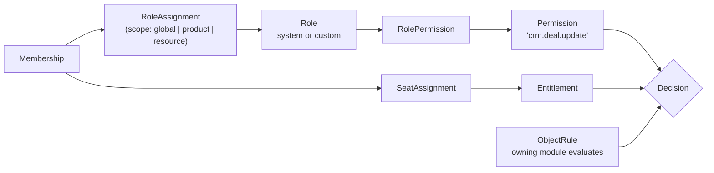
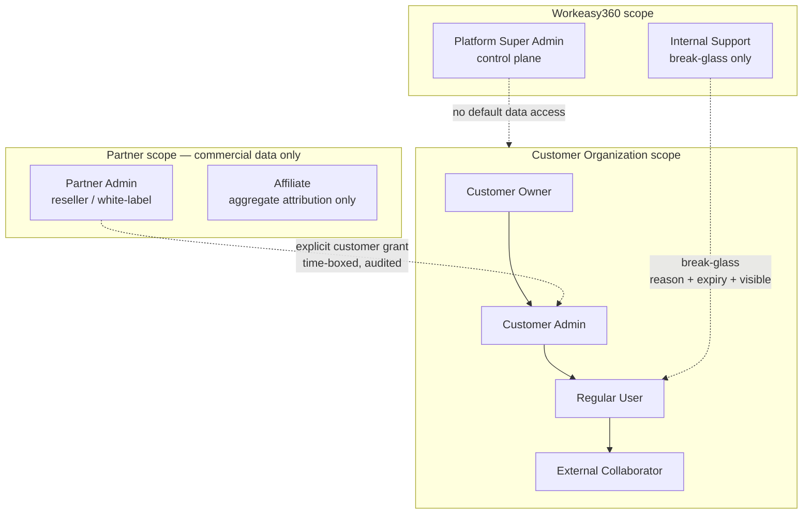

# 04 — Identity and Authorization

**Status:** Accepted (Phase 0)
**Owner:** Architecture
**Last reviewed:** 2026-09-21

---

## 1. Purpose

Define how principals are authenticated, how authorization decisions are made, and how the seven personas are separated. Identity is a **platform** capability: no product implements authentication, and no product defines its own permission model outside the shared registry.

## 2. The two questions, kept apart

Every access decision in Workeasy360 answers two independent questions:

| | Question | Owner | Source of truth |
|---|---|---|---|
| **Authorization** | *May this person do this?* | `platform/authz` | Roles assigned to their membership |
| **Entitlement** | *Did this organization buy this?* | `platform/entitlements` | Commercial provisioning |

They are checked in a fixed order and must never be merged:

```
1. Authenticated?          -> 401
2. Member of this org?     -> 403
3. Org status permits it?  -> 403 / 402
4. Entitled? (org bought)  -> 402  "upgrade required"
5. Seat? (user licensed)   -> 402  "no seat assigned"
6. Permitted? (role)       -> 403  "insufficient permission"
7. Object-level rule?      -> 403 / 404
```

**Why entitlement is checked before permission:** the error messages differ and so does the remedy. "Your plan does not include Books" is a sales conversation; "You lack permission to post journals" is an admin conversation. Merging them produces the classic SaaS bug where an admin is told they lack permission for a feature nobody in the org has bought — and raises a support ticket that engineering cannot resolve.

**Why seat is separate from entitlement:** an organization may hold Books (entitled) with 5 of 5 seats assigned. User 6 is in an entitled org but has no seat. This distinction is what makes per-seat pricing enforceable.

### Step 7: 403 vs 404

Returning 403 for an object that exists but belongs to another tenant discloses its existence. The rule:

- **Cross-tenant miss → 404.** The object does not exist *in your world*. RLS produces this naturally.
- **Same-tenant, insufficient permission → 403.** The user knows the org has the object; hiding it is not a security gain and produces confusing UX.

## 3. Authentication

### 3.1 Principal types

| Principal | Credential | Session model | Typical caller |
|---|---|---|---|
| **Interactive user** | Password + optional MFA, or SSO assertion | Server-side session, HttpOnly cookie | Web app |
| **Service account** | API key (org-bound) | Stateless, per-request | Customer scripts, integrations |
| **OAuth client** | Client credentials or authorization code | Access + refresh token | Third-party apps on our platform |
| **Internal staff** | SSO (our IdP) + mandatory hardware MFA | Short session, re-auth for sensitive actions | Admin console |
| **Partner admin** | Password/SSO + mandatory MFA | Server-side session | Partner portal |
| **System (internal)** | No external credential | Tenant context from task headers | Celery tasks |

### 3.2 Session strategy

**First-party web app uses server-side sessions in an HttpOnly, Secure, SameSite=Lax cookie.** Not JWTs.

Reasoning: the dominant operational requirement for a business platform is **immediate revocation** — a fired employee, a compromised laptop, a suspended organization. Stateless JWTs cannot be revoked before expiry without a server-side blocklist, at which point they are stateful with extra steps and worse ergonomics. Sessions are stored in PostgreSQL with Redis as a read-through cache, so a Redis outage degrades latency, not authentication.

Token-based auth is used where it belongs: the public API, where clients are not browsers and revocation is handled by key rotation.

```python
class Session(models.Model):              # platform/identity
    id                 = UUIDField(primary_key=True, default=uuid7)
    user               = FK(User, on_delete=CASCADE)
    active_membership  = FK("organizations.Membership", null=True, on_delete=CASCADE)
    auth_method        = CharField(choices=AuthMethod)    # password | sso | impersonation
    aal                = SmallIntegerField(default=1)     # 1 = single factor, 2 = MFA satisfied
    ip_hash            = CharField()
    user_agent_hash    = CharField()
    created_at         = DateTimeField()
    last_seen_at       = DateTimeField()
    absolute_expires_at= DateTimeField()
    idle_expires_at    = DateTimeField()
    revoked_at         = DateTimeField(null=True)
    revoked_reason     = CharField(null=True)
```

- `active_membership` on the session means **switching organization is an explicit, audited action**, not a URL parameter. Combined with path-based org routing, both must agree or the request is rejected.
- Both idle (8h) and absolute (30d) expiry. Idle alone allows an indefinitely-extended stolen session.
- `aal` (authenticator assurance level) enables step-up: sensitive operations require `aal >= 2` and a recent re-auth, regardless of how the session started.

### 3.3 MFA-ready architecture

MFA is modelled from day one even though enforcement policies arrive later. Retrofitting a factor model into a live auth system is expensive and risky.

```python
class AuthFactor(models.Model):           # platform/identity
    user        = FK(User, on_delete=CASCADE)
    kind        = CharField(choices=FactorKind)   # totp | webauthn | recovery_code | sms
    label       = CharField()
    secret_ref  = CharField(null=True)   # KMS-encrypted reference, never the raw secret
    credential_id = BinaryField(null=True)        # WebAuthn
    public_key  = BinaryField(null=True)          # WebAuthn
    sign_count  = BigIntegerField(default=0)      # WebAuthn clone detection
    confirmed_at= DateTimeField(null=True)
    last_used_at= DateTimeField(null=True)
```

Design points:

- **WebAuthn is a first-class factor, not an afterthought.** The schema carries `credential_id`, `public_key` and `sign_count` now so that adding passkeys is a feature, not a migration of the auth model.
- **The factor model is generic**; the *policy* ("this org requires MFA", "this role requires MFA", "this action requires step-up") lives in `OrganizationSecurityPolicy` and is evaluated at the request boundary. Policy changes never require schema changes.
- **Recovery codes are factors too**, single-use, hashed, and their consumption is an audit event and a security signal.
- SMS is supported but classified as a weak factor and cannot satisfy `aal=2` for staff or partner admins.

### 3.4 SSO

```python
class IdentityProvider(models.Model):     # platform/identity
    organization  = FK(Organization, on_delete=CASCADE)
    protocol      = CharField(choices=["saml2", "oidc"])
    is_enforced   = BooleanField(default=False)   # block password login for this org
    metadata      = JSONField()                    # entity ID, certs, endpoints
    jit_provision = BooleanField(default=True)
    attribute_map = JSONField()                    # IdP claim -> membership attributes
    verified_domains = ArrayField(CharField())     # DNS-verified
```

Rules that prevent the classic SSO takeover:

1. **Domain claims must be DNS-verified** before an IdP may auto-attach users with that email domain. Without this, anyone can register an org, claim `@bigcorp.com`, and capture their logins.
2. **`is_enforced` blocks password login for that organization only**, not globally for the user. A user in an SSO-enforcing org and a personal org logs in differently per org session.
3. **Break-glass local admin.** Every SSO-enforcing org must retain at least one owner with a working non-SSO path, gated by hardware MFA. Enforced by a check that refuses to enable `is_enforced` otherwise. An IdP misconfiguration must not permanently lock a customer out of their own data.
4. **JIT provisioning creates a `Membership`, never grants roles implicitly.** Group-to-role mapping is explicit in `attribute_map`, and unmapped groups grant nothing.
5. SAML assertions are validated for signature, audience, recipient, `NotBefore`/`NotOnOrAfter`, and replayed-assertion ID; the assertion ID is cached for its validity window.

## 4. Authorization model

### 4.1 Shape: RBAC core with scoping and a narrow ABAC extension

Pure RBAC cannot express "may edit deals **they own**". Full ABAC/policy-engine approaches are powerful but produce decisions nobody can explain to a customer admin, and they are slow to evaluate at list-query scale.

**Selected: role-based permissions, scoped by product and optionally by resource subtree, with a small set of named object-level rules evaluated by the owning module.**



### 4.2 `Permission` — code-declared, never user-created

```python
@dataclass(frozen=True)
class PermissionDeclaration:
    key: str            # "<product>.<resource>.<action>"
    label: str
    product: ProductCode
    category: str
    implies: tuple[str, ...] = ()   # "crm.deal.delete" implies "crm.deal.read"
    dangerous: bool = False         # requires aal>=2 and appears in a separate UI group
```

- Declared in each module's `permissions.py`, collected into a registry at startup, synced to the DB by a deploy step.
- **A permission that is not declared in code cannot be granted.** This makes the full privilege surface greppable and reviewable.
- Naming is mechanical: `<product>.<resource>.<action>`. Platform permissions use `platform.*`. No free-form names — a CI check enforces the pattern and that `product` matches a registered manifest.
- `implies` is expanded at **role-compile time**, not at check time, so a check is a single set membership test.

### 4.3 `Role` — system templates and tenant-owned customs

```python
class Role(models.Model):                  # platform/authz
    id             = UUIDField(primary_key=True, default=uuid7)
    organization   = FK(Organization, null=True, on_delete=CASCADE)  # NULL = system template
    key            = CharField()           # "owner", "crm_manager", or custom slug
    name           = CharField()
    product        = CharField(null=True)  # NULL = cross-product role
    is_system      = BooleanField(default=False)
    is_assignable  = BooleanField(default=True)

    class Meta:
        constraints = [
            UniqueConstraint("organization", "key", name="uq_role_org_key"),
            UniqueConstraint("key", condition=Q(organization__isnull=True),
                             name="uq_system_role_key"),
        ]
```

> **Note on the plane rule.** This is the one table with a nullable `organization_id`, which [00-system-context.md](00-system-context.md) warns against. It is permitted here as an explicit, reviewed exception because the alternative — two tables with an identical shape and a polymorphic join from `RoleAssignment` — is materially worse for every query. The exception is made safe by a **partial RLS policy** that allows reads where `organization_id = current_setting(...)` **OR** `organization_id IS NULL AND is_system`, and a `WITH CHECK` that forbids writing a row with `organization_id IS NULL` from the application role entirely. System roles are therefore readable by all tenants and writable by none. This is recorded in the debt register with a review date.

System roles shipped by default:

| Role | Scope | Notes |
|---|---|---|
| `owner` | org-wide | Full control including billing, deletion, ownership transfer. Exactly one. |
| `admin` | org-wide | Users, roles, product activation. **Not** billing by default. |
| `billing_manager` | org-wide | Billing and subscriptions only. Separable from `admin` on purpose. |
| `member` | org-wide | Baseline: sign in, see the org, use products where seated |
| `<product>_admin` | per product | Configure that product |
| `<product>_user` | per product | Normal use |
| `<product>_readonly` | per product | Read |
| `collaborator` | narrow | External guest; resource-scoped assignments only |

Customers may not edit system roles. "Customising" one clones it into a tenant-owned role, so an upgrade that adds a permission to a system role does not silently mutate a customer's security posture.

### 4.4 `RoleAssignment` — scope is where the real power is

```python
class RoleAssignment(TenantScopedModel):   # platform/authz
    membership   = FK(Membership, on_delete=CASCADE)
    role         = FK(Role, on_delete=PROTECT)
    scope_type   = CharField(choices=["organization", "product", "resource"])
    scope_product= CharField(null=True)              # ProductCode
    scope_ref    = CharField(null=True)              # "projects.project:<uuid>"
    granted_by   = FK(Membership, null=True, on_delete=SET_NULL)
    expires_at   = DateTimeField(null=True)          # time-boxed grants
```

- **`expires_at` exists from day one.** Temporary elevation that expires automatically is the difference between a contractor with two weeks of access and a contractor with permanent access nobody remembers granting.
- `scope_ref` is a soft reference (`"<product>.<model>:<id>"`) — not an FK, because it may point into any product and [02-dependency-rules.md](02-dependency-rules.md) forbids `platform → products` FKs.
- Resource-scoped assignments are resolved by the **owning product**, via a registered `ScopeResolver`, because only Projects knows that a task belongs to a project. `authz` orchestrates; it does not model every product's hierarchy.

### 4.5 The decision function

```python
def check(ctx: TenantContext, permission: str, obj: Any | None = None) -> Decision:
    """Single entry point for every authorization decision in the system."""
```

Evaluation:

1. Load the **compiled permission set** for `(membership_id, permission_set_version)` from cache.
2. Fast reject if the permission key is absent — covers the vast majority of checks with one set lookup.
3. If the permission is product-scoped, require entitlement + seat for that product.
4. If `obj` is given and its model registers object rules, call the owning module's rule.
5. If `permission.dangerous`, require `aal >= 2` and recent re-auth.
6. Record a denial as a structured security event; sample successes for audit.

**Compiled permission sets.** Computing effective permissions by joining assignments → roles → permissions on every check is unaffordable. On assignment change we compute the flattened set once and cache it under `w360:{org}:perms:{membership}:v{n}`, where `n` is a per-organization version counter. Any change to roles or assignments bumps the counter, invalidating the whole org's cache without enumerating members. Cached entries carry a short TTL as a backstop against missed invalidations.

Redis unavailable → recompute from the database per request. Slower, still correct. Authorization never fails open.

### 4.6 Authorization in list queries — the N+1 authorization trap

Per-object checks work for detail views and are a disaster for lists: 50 objects means 50 rule evaluations, and pagination counts become wrong when post-filtering removes rows.

**Rule: object-level visibility must be expressible as a queryset predicate.** Each product provides:

```python
# products/crm/authz.py
def visible_deals(ctx: TenantContext) -> QuerySet[Deal]:
    qs = Deal.objects.all()                     # already tenant-scoped by manager + RLS
    if authz.check(ctx, "crm.deal.read_all").allowed:
        return qs
    return qs.filter(Q(owner_id=ctx.membership_id) | Q(team_id__in=ctx.team_ids))
```

Selectors start from `visible_*`, never from `.objects.all()`. Enforced by convention plus a fitness test that flags selectors returning a product model queryset without passing through a `visible_*` function.

If a proposed visibility rule cannot be written as a predicate, it is the wrong rule — simplify it rather than falling back to per-row evaluation.

## 5. The seven personas, separated



| Persona | Scope | Can read tenant business data? | Can change billing? | Notable limits |
|---|---|---|---|---|
| **Platform Super Admin** | Control plane, all orgs | **No** — requires break-glass | Yes (catalog/config) | Cannot silently read customer data; every break-glass entry is customer-visible |
| **Internal Support** | One org at a time, time-boxed | Only in a break-glass session | No | Session expires (default 60 min); read-only unless a write reason is approved by a second staff member |
| **Partner Admin** | Own partner + linked orgs | **No** by default | For orgs they bill, within their capability grants | Business-data access requires a customer-issued, revocable grant |
| **Affiliate** | Own attribution records | **No**, ever | No | Sees referral counts, conversion status, commission — never PII or org internals |
| **Customer Owner** | One org, everything | Yes | Yes | Only persona that can delete the org or transfer ownership |
| **Customer Admin** | One org | Yes, per roles | No by default | Cannot grant themselves billing; cannot remove the owner |
| **Regular User** | One org, per roles + seats | Per roles | No | Product access requires a seat |
| **External Collaborator** | Resource-scoped | Only granted resources | No | Cannot see the member directory or org settings; grants carry `expires_at` |

Two separations that matter more than they look:

- **Admin ≠ billing.** In most customers, the person administering users is not the person holding the card. Bundling them forces over-privileging.
- **Super Admin ≠ data access.** The highest-privilege internal role deliberately has *no* default path to customer records. Privilege escalation to data is a separate, logged, customer-visible act. This is what makes a compromised staff account a contained incident rather than a total breach.

## 6. Impersonation and break-glass

Support cannot work without occasionally seeing what a customer sees. The design makes that possible and expensive:

```python
class ImpersonationGrant(models.Model):   # platform/identity
    staff_user     = FK(User, on_delete=PROTECT)
    organization   = FK(Organization, on_delete=CASCADE)
    target_membership = FK(Membership, null=True, on_delete=SET_NULL)
    reason         = TextField()                  # required, free text, min length enforced
    ticket_ref     = CharField(null=True)
    mode           = CharField(choices=["read_only", "read_write"])
    approved_by    = FK(User, null=True, on_delete=PROTECT)   # required for read_write
    starts_at      = DateTimeField()
    expires_at     = DateTimeField()              # hard cap 4h, default 1h
    revoked_at     = DateTimeField(null=True)
```

Non-negotiables:

- Every impersonated request carries `is_break_glass=True` in `TenantContext`, is tagged in logs, traces and audit, and is **visible to the customer** in their own audit log in near-real-time.
- Read-write impersonation needs a second staff approver. One compromised support account cannot modify customer data alone.
- The customer receives a notification when a grant opens, and an org setting can require explicit customer approval before any grant activates.
- Impersonated sessions cannot: change security settings, add auth factors, export bulk data, rotate API keys, or perform anything marked `dangerous`. These are blocked in the decision function, not in the UI.
- All grants expire. There is no indefinite mode.

## 7. API authentication

| Mechanism | Use | Notes |
|---|---|---|
| **Session cookie** | First-party web | HttpOnly, Secure, SameSite=Lax, CSRF double-submit on unsafe methods |
| **API key** | Server-to-server, customer scripts | `w360_live_<keyid>_<secret>`; only a hash stored (Argon2id); `keyid` prefix makes lookup O(1) without exposing the secret; bound to one org; carries an explicit scope set; rotatable with an overlap window |
| **OAuth 2.0 + PKCE** | Third-party apps acting for a user | Scopes map to permission groups; refresh rotation with reuse detection |

All three converge on the same `TenantContext` and the same `authz.check()`. There is exactly one authorization path in the system. An API key never gets a privilege a role could not grant: keys are attached to a `member_type=service` membership with roles.

## 8. What products must never do

| Forbidden | Instead |
|---|---|
| Define a `User` model | Use `platform.identity.User` via selectors |
| Implement login, password reset, MFA | Platform owns it |
| Store credentials or tokens for platform access | Platform owns it |
| Invent a permission string not in their registry | Declare it in `permissions.py` |
| Check `if role.name == "admin"` | Check the permission key |
| Check `if plan.name == "pro"` | Check the entitlement/feature |
| Bypass `authz.check()` for "internal" endpoints | There are no internal endpoints |

## 9. Related documents

- [03-multi-tenancy.md](03-multi-tenancy.md) — tenant context, membership, isolation layers
- [06-entitlements.md](06-entitlements.md) — steps 4 and 5 of the decision chain
- [12-security.md](12-security.md) — session/token handling, secrets, admin security
- [ADR-003](adrs/ADR-003-shared-identity.md), [ADR-004](adrs/ADR-004-rbac-authorization.md)
