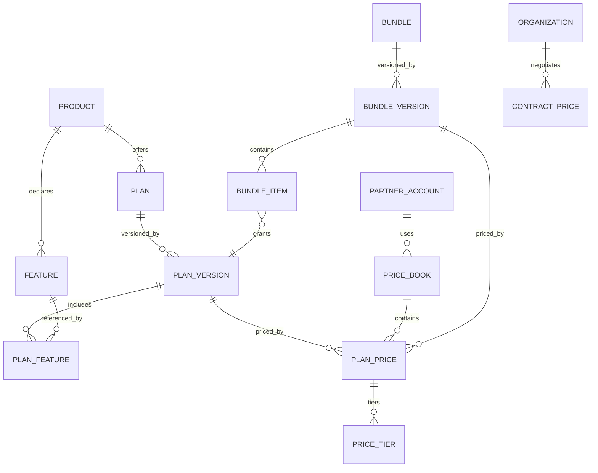

# 05 — Commercial Model: Catalog, Pricing, Bundles, Partners

**Status:** Accepted (Phase 0)
**Owner:** Architecture
**Last reviewed:** 2026-09-21

---

## 1. Purpose

Define how Workeasy360 packages and prices what it sells, and how partner channels attach to the same catalog without forking anything. This document covers Tasks 5 and 7 of the Phase 0 brief. Subscriptions and entitlements are in [06-entitlements.md](06-entitlements.md).

## 2. Governing principles

1. **Pricing lives in exactly one place.** `commercial/pricing` is the only module that computes a price. No product, and no other commercial module, contains a price rule. A product that knows what it costs cannot be repackaged.
2. **The catalog is control plane.** Products, plans and list prices are global reference data. Anything customer-specific (a negotiated rate) is a *separate, org-scoped* entity.
3. **Published commercial records are immutable.** Editing a live plan or price in place retroactively changes what customers agreed to buy. Changes create new versions; existing subscriptions keep their pinned version.
4. **The catalog describes packaging; it does not implement it.** `PlanFeature` says *what* a plan includes. `platform/entitlements` is what the runtime consults.
5. **Partners are a commercial dimension, not a deployment.** One catalog, one codebase; partners get price books, branding and relationships.

## 3. Catalog model



### 3.1 `Product` — a sellable SKU, not a code module

```python
class Product(models.Model):                # commercial/catalog — control plane
    id            = UUIDField(primary_key=True, default=uuid7)
    code          = CharField(unique=True)      # ProductCode: "crm", "books"
    name          = CharField()
    description   = TextField()
    status        = CharField(choices=["draft", "available", "deprecated", "retired"])
    licensing_mode= CharField(choices=["per_seat", "per_organization", "usage"])
    sort_order    = IntegerField()
```

`code` is a **validated string, never a foreign key into a product module** ([01-domain-boundaries.md](01-domain-boundaries.md)). A startup check asserts every `code` resolves to a registered `ProductManifest`, so a typo fails at boot.

`licensing_mode` belongs on the product because it is intrinsic to how the capability is consumed: CRM is per-seat because value scales with users; Books is per-organization because a ledger is not per-person. A plan may narrow this but not contradict it.

### 3.2 `Feature` — the unit the runtime actually checks

```python
class Feature(models.Model):                # commercial/catalog
    key           = CharField(unique=True)      # "crm.pipelines.max", "books.multi_currency"
    product_code  = CharField()
    name          = CharField()
    kind          = CharField(choices=["boolean", "quota", "enum"])
    unit          = CharField(null=True)        # "pipelines", "GB", "emails/month"
    default_value = JSONField()                 # value when NOT entitled
    is_public     = BooleanField(default=True)  # shown on pricing pages
```

Three kinds, deliberately no more:

| Kind | Value | Example | Runtime check |
|---|---|---|---|
| `boolean` | on/off | `books.multi_currency` | `feature_enabled(org, key)` |
| `quota` | integer, or `-1` for unlimited | `crm.pipelines.max` | `quota(org, key)` then compare to usage |
| `enum` | one of a set | `support.sla_tier` → `standard`/`priority` | `feature_value(org, key)` |

A fourth "JSON config" kind is explicitly rejected: it becomes a dumping ground, cannot be displayed on a pricing page, cannot be compared across plans, and produces packaging that nobody can reason about.

**Feature keys are declared by the owning product**, synced into the catalog at deploy. Commercial can only sell features that exist in code — this is what stops the catalog and the runtime drifting apart.

### 3.3 `Plan` and `PlanVersion` — immutability where it counts

```python
class Plan(models.Model):                   # stable identity
    code          = CharField(unique=True)      # "crm_professional"
    product_code  = CharField()
    name          = CharField()
    status        = CharField(choices=["draft", "available", "grandfathered", "retired"])
    is_public     = BooleanField(default=True)  # false = partner/enterprise only

class PlanVersion(models.Model):            # immutable once published
    plan            = FK(Plan, on_delete=PROTECT)
    version         = PositiveIntegerField()
    published_at    = DateTimeField(null=True)
    effective_from  = DateTimeField()
    effective_to    = DateTimeField(null=True)
    included_seats  = IntegerField(default=1)
    max_seats       = IntegerField(null=True)
    trial_days      = IntegerField(default=0)

    class Meta:
        constraints = [UniqueConstraint("plan", "version", name="uq_plan_version")]

class PlanFeature(models.Model):
    plan_version = FK(PlanVersion, on_delete=CASCADE)
    feature_key  = CharField()
    value        = JSONField()      # true | 50 | -1 | "priority"
```

**Why versioning is non-optional.** Without it, "raise the Professional pipeline limit from 10 to 25" silently changes every existing customer's entitlements, including customers on a grandfathered arrangement, with no record of what they originally bought. With it: publish `v2`, new subscriptions get `v2`, existing subscriptions keep `v1` until explicitly migrated, and a migration is a deliberate, auditable batch operation.

Immutability is enforced in the database, not by convention:

```sql
CREATE RULE plan_version_immutable AS
  ON UPDATE TO catalog_planversion
  WHERE OLD.published_at IS NOT NULL
    AND (NEW.included_seats, NEW.trial_days) IS DISTINCT FROM (OLD.included_seats, OLD.trial_days)
  DO INSTEAD NOTHING;
```
(plus an application-level guard that raises rather than failing silently; the DB rule is the backstop for bulk updates and admin tooling).

`grandfathered` status: no new subscriptions, existing ones continue and still renew. This is distinct from `retired` (no new, existing must migrate) and it is a status people forget to model until they need it under time pressure.

### 3.4 `Bundle` — composition, priced as one thing

```python
class Bundle(models.Model):
    code        = CharField(unique=True)        # "starter", "full_suite"
    name        = CharField()
    kind        = CharField(choices=["predefined", "ecosystem", "custom"])
    owner_partner = FK("partners.PartnerAccount", null=True, on_delete=CASCADE)
    owner_organization = FK(Organization, null=True, on_delete=CASCADE)  # custom enterprise
    status      = CharField(choices=["draft", "available", "grandfathered", "retired"])

class BundleVersion(models.Model):
    bundle      = FK(Bundle, on_delete=PROTECT)
    version     = PositiveIntegerField()
    published_at= DateTimeField(null=True)

class BundleItem(models.Model):
    bundle_version = FK(BundleVersion, on_delete=CASCADE)
    plan_version   = FK(PlanVersion, on_delete=PROTECT)
    quantity       = IntegerField(default=1)
    is_optional    = BooleanField(default=False)     # customer may decline within the bundle
    seat_pool      = CharField(null=True)            # shared seat pool name, see below
```

**A bundle grants plan versions, not products.** "The Full Suite" must be precise about *which* CRM plan it includes. Granting "CRM" without a tier is ambiguous and unpriceable.

**`kind` matters commercially:**
- `predefined` — public bundles in the catalog.
- `ecosystem` — the everything bundle; typically has its own price rather than a computed discount.
- `custom` — enterprise or partner-specific, owned by an org or partner, invisible to everyone else. A `custom` bundle **must** have exactly one of `owner_partner` / `owner_organization` set (DB check constraint).

**`seat_pool`** lets a bundle grant, say, 10 seats usable across CRM and Projects rather than 10 each. It is a string naming a pool; entitlement provisioning creates one `SeatGrant` per pool. Modelled now because retrofitting shared seat pools into a per-product seat model is a painful migration, and "10 users across the suite" is a normal enterprise ask.

**Bundle pricing is explicit, not derived.** A `PlanPrice` row can reference a `BundleVersion` instead of a `PlanVersion`. A bundle price is a real price, not "sum of parts minus 20%", because derived pricing breaks the moment a component's price changes and makes historical invoices irreproducible.

## 4. Pricing model

### 4.1 `PriceBook` — the axis of segmentation

```python
class PriceBook(models.Model):              # commercial/pricing — control plane
    code          = CharField(unique=True)
    name          = CharField()
    channel       = CharField(choices=["direct", "partner", "internal"])
    partner       = FK("partners.PartnerAccount", null=True, on_delete=CASCADE)
    region        = CharField(null=True)        # ISO 3166-1 alpha-2 or region group
    currency      = CharField()                 # ISO 4217
    priority      = IntegerField(default=100)   # lower wins
    valid_from    = DateTimeField()
    valid_to      = DateTimeField(null=True)
    is_active     = BooleanField(default=True)
```

A price book is a *named set of prices for a segment*. Segmentation dimensions are `channel × partner × region × currency × time`. Adding a new segment is a new price book, never a new column and never a code change. This is the mechanism that makes "future pricing strategies" cheap.

```python
class PlanPrice(models.Model):
    price_book     = FK(PriceBook, on_delete=CASCADE)
    plan_version   = FK(PlanVersion, null=True, on_delete=PROTECT)
    bundle_version = FK(BundleVersion, null=True, on_delete=PROTECT)
    interval       = CharField(choices=["monthly", "quarterly", "annual", "one_time"])
    model          = CharField(choices=["flat", "per_seat", "tiered", "volume", "usage"])
    amount_minor   = BigIntegerField(null=True)   # integer minor units; NULL when tiered
    currency       = CharField()
    min_quantity   = IntegerField(default=1)
    max_quantity   = IntegerField(null=True)
    tax_behaviour  = CharField(choices=["inclusive", "exclusive"])

    class Meta:
        constraints = [
            CheckConstraint(check=Q(plan_version__isnull=False) ^ Q(bundle_version__isnull=False),
                            name="ck_price_targets_exactly_one"),
        ]

class PriceTier(models.Model):
    plan_price   = FK(PlanPrice, on_delete=CASCADE)
    up_to        = IntegerField(null=True)        # NULL = infinity
    unit_amount_minor = BigIntegerField(null=True)
    flat_amount_minor = BigIntegerField(null=True)
```

**Money is stored as integer minor units plus an explicit currency code.** Never a float; never a bare `Decimal` without its currency. All arithmetic goes through `contracts.values.Money`, which refuses to add different currencies. This single rule eliminates the most common class of billing defect.

**`tiered` vs `volume`** are distinct and routinely confused: `tiered` charges each band at its own rate (graduated); `volume` charges *all* units at the rate of the band reached. Both are needed; conflating them produces invoices customers dispute.

### 4.2 `ContractPrice` — negotiated, org-scoped, data plane

```python
class ContractPrice(TenantScopedModel):     # commercial/pricing — DATA PLANE, RLS applies
    organization   = FK(Organization, on_delete=CASCADE)
    plan_version   = FK(PlanVersion, null=True, on_delete=PROTECT)
    bundle_version = FK(BundleVersion, null=True, on_delete=PROTECT)
    interval       = CharField(choices=BillingInterval)
    model          = CharField(choices=PriceModel)
    amount_minor   = BigIntegerField(null=True)
    currency       = CharField()
    valid_from     = DateTimeField()
    valid_to       = DateTimeField(null=True)
    contract_ref   = CharField(null=True)
    approved_by    = FK(User, on_delete=PROTECT)      # negotiated prices need an approver
```

Negotiated prices are deliberately **not** rows in the global `PriceBook` with a nullable org. This keeps the plane separation from [00-system-context.md](00-system-context.md) intact: `PriceBook` has no `organization_id` and never needs RLS; `ContractPrice` has one and always does. A bug in price-book querying can produce a wrong price; it cannot leak one customer's negotiated rate to another.

### 4.3 Price resolution — one function, deterministic order

```python
def resolve_price(
    *, target: PlanVersion | BundleVersion, organization_id: UUID | None,
    partner_id: UUID | None, region: str, currency: str,
    interval: BillingInterval, quantity: int, at: datetime,
) -> PriceQuote:
    """The single entry point for 'what does this cost?'. No other code computes prices."""
```

Resolution order — first match wins:

1. **`ContractPrice`** for this organization, valid at `at`.
2. **Partner price book** for `partner_id`, matching currency/region, valid at `at`, lowest `priority`.
3. **Regional price book** for `channel=direct` matching `region` + `currency`.
4. **Default price book** for `channel=direct` + `currency`.
5. **No price → raise `PriceNotAvailable`.** Never fall back to another currency, never to zero, never to a "close enough" region. A missing price is a catalog defect that must surface loudly; a silent fallback bills someone incorrectly.

`PriceQuote` carries the resolved `price_id`, the amount, the currency, the tier breakdown and **the reason it was chosen** (which rule matched). Storing that reason on the subscription and the invoice line makes "why is this customer paying this?" answerable in production — a support question that is otherwise unanswerable.

**Prices are pinned at subscription time.** `SubscriptionItem.price_id` references the exact `PlanPrice`/`ContractPrice` row. Renewals re-resolve only if the subscription is flagged `follow_list_price`; otherwise the pinned price holds until an explicit change. Customers must not discover a price change through their invoice.

### 4.4 Currency, region and tax

- **Currency is fixed per subscription at creation.** Mid-subscription currency switching is a cancel-and-resubscribe, not an update. Anything else makes proration and revenue reporting incoherent.
- **Region** drives price book selection and tax treatment, and is derived from the organization's billing address (verified), not from IP or locale.
- **Tax is calculated at invoicing, never stored in the catalog.** `tax_behaviour` on the price says whether the amount is tax-inclusive; the rate comes from the tax service at invoice time with a stored-table fallback. A catalog that embeds VAT rates is wrong within a quarter.

## 5. Partner / commercial channel architecture

### 5.1 One account, capability-based

```python
class PartnerAccount(models.Model):         # commercial/partners — partner scope
    id            = UUIDField(primary_key=True, default=uuid7)
    code          = SlugField(unique=True)
    legal_name    = CharField()
    status        = CharField(choices=["pending", "active", "suspended", "terminated"])
    tier          = CharField(null=True)        # bronze/silver/gold — drives default margins
    home_organization = FK(Organization, null=True, on_delete=SET_NULL)  # their own tenant
    billing_currency = CharField()
    payout_currency  = CharField()
    default_price_book = FK(PriceBook, null=True, on_delete=SET_NULL)
    contract_signed_at = DateTimeField(null=True)

class PartnerCapability(models.Model):
    partner    = FK(PartnerAccount, on_delete=CASCADE)
    capability = CharField(choices=PartnerCapabilityKind)
    granted_at = DateTimeField()
    granted_by = FK(User, on_delete=PROTECT)
    expires_at = DateTimeField(null=True)
```

```python
class PartnerCapabilityKind(TextChoices):
    REFER              = "refer"               # earn commission on referrals
    RESELL             = "resell"              # sell subscriptions, own the customer relationship
    MANAGE_BILLING     = "manage_billing"      # be invoiced instead of the customer
    MANAGE_SUBSCRIPTION= "manage_subscription" # change plans on behalf of customers
    BRAND              = "brand"               # custom logo/colour/email branding
    CUSTOM_DOMAIN      = "custom_domain"       # serve on their own hostname
    SUB_PARTNER        = "sub_partner"         # recruit partners beneath them
    SUPPORT_TIER1      = "support_tier1"       # be the customer's first line of support
```

The three named channel types are **presets**, not types:

| Channel | Capabilities |
|---|---|
| Affiliate | `REFER` |
| Reseller | `REFER`, `RESELL`, `MANAGE_BILLING`, `MANAGE_SUBSCRIPTION` |
| White-label | Reseller set + `BRAND`, `CUSTOM_DOMAIN`, `SUPPORT_TIER1` |

**Why capabilities rather than a `type` enum.** Real partner programmes are not clean. An affiliate becomes a reseller for two accounts. A reseller wants branding but not billing. A distributor recruits sub-partners. With an enum, every one of these is an `if` in privilege-checking code — and the branch that grants an affiliate too much access is a data breach. With capabilities, each is a row. The authorization code reads `partner.has(RESELL)` and never asks what type the partner is.

**Affiliate privileges stay separate by construction:** `REFER` grants attribution and commission visibility only. There is no code path where holding `REFER` yields customer data, because customer-scoped reads require `RESELL` plus an active relationship, and business-data reads require a customer-issued grant on top of that.

### 5.2 `PartnerRelationship` — the partner/customer link

```python
class PartnerRelationship(models.Model):
    partner      = FK(PartnerAccount, on_delete=PROTECT)
    organization = FK(Organization, on_delete=CASCADE)
    kind         = CharField(choices=["referred", "managed", "supported"])
    status       = CharField(choices=["pending", "active", "ended"])
    started_at   = DateTimeField()
    ended_at     = DateTimeField(null=True)
    data_access_grant = FK("DataAccessGrant", null=True, on_delete=SET_NULL)

    class Meta:
        constraints = [
            UniqueConstraint("organization", condition=Q(kind="managed", status="active"),
                             name="uq_one_active_manager_per_org"),
        ]
```

- `referred` — attribution only; the partner earns commission, sees nothing else.
- `managed` — the partner is the commercial owner: they are invoiced, they change plans. **At most one active manager per organization**, enforced by a partial unique constraint. Two partners both believing they own an account is a billing and support disaster.
- `supported` — first-line support without commercial control.

**`DataAccessGrant` is issued by the customer, not the partner.** It is scoped (which products), time-boxed, revocable from the customer's settings, and every access under it appears in the customer's audit log. A reseller who loses an account does not retain read access.

### 5.3 Branding and custom domains

```python
class Brand(models.Model):
    partner       = FK(PartnerAccount, on_delete=CASCADE)
    name          = CharField()
    logo_file     = FK("files.File", null=True, on_delete=SET_NULL)
    palette       = JSONField()          # validated against a schema, not free CSS
    email_from    = EmailField()
    email_domain_verified = BooleanField(default=False)
    support_url   = URLField(null=True)
    is_default    = BooleanField(default=False)

class CustomDomain(models.Model):
    partner       = FK(PartnerAccount, on_delete=CASCADE)
    brand         = FK(Brand, on_delete=PROTECT)
    hostname      = CharField(unique=True)
    verification_token = CharField()
    verified_at   = DateTimeField(null=True)
    certificate_arn = CharField(null=True)
    status        = CharField(choices=["pending_dns", "provisioning", "active", "failed", "revoked"])
```

Rules that keep white-labelling from becoming a security hole:

1. **Branding is data, resolved at the edge.** The hostname maps to a `Brand`; the resolved branding is attached to the request as a neutral value object. Product code reads `request.branding.logo_url` and never imports `partners` ([02-dependency-rules.md](02-dependency-rules.md), F-2).
2. **A custom domain changes presentation, never authorization.** Tenant resolution still comes from session + path. A user on `app.partner.com` who belongs to an org not managed by that partner gets the branding but the same permissions — or, if partner policy requires isolation, is refused entirely. The domain is never an implicit credential.
3. **Palette is a validated schema** (named colour tokens), not arbitrary CSS. Partner-supplied CSS is a stored-XSS vector.
4. **`email_domain_verified`** gates sending from the partner's domain — DKIM/SPF/DMARC verified before use, or we damage our own sending reputation and enable phishing.
5. **Session cookies are scoped per hostname.** A session on `app.partnerA.com` is not valid on `app.partnerB.com` or `app.workeasy360.com`. Cross-domain session sharing across partner boundaries is forbidden.

### 5.4 Margins, commissions and payouts

Two distinct economic models, deliberately not unified:

| | **Reseller margin** | **Affiliate commission** |
|---|---|---|
| Mechanism | Buys at a discounted price book, sells at their own price | Earns a percentage of revenue we collect |
| Money flow | We invoice the partner; they invoice the customer | We invoice the customer; we pay the partner |
| Where modelled | `PriceBook(channel=partner)` + margin | `CommissionRule` + `CommissionEntry` |
| Revenue recognised | Partner price | Full customer price, commission as an expense |

```python
class AttributionRecord(models.Model):      # commercial/commissions
    partner       = FK(PartnerAccount, on_delete=PROTECT)
    organization  = FK(Organization, null=True, on_delete=SET_NULL)
    visitor_hash  = CharField(db_index=True)     # hashed anonymous identifier
    campaign_ref  = CharField(null=True)
    touch_kind    = CharField(choices=["first", "last"])
    occurred_at   = DateTimeField()
    window_ends_at= DateTimeField()

class CommissionRule(models.Model):
    partner       = FK(PartnerAccount, null=True, on_delete=CASCADE)  # NULL = programme default
    applies_to    = CharField(choices=["all", "product", "plan", "bundle"])
    target_ref    = CharField(null=True)
    basis         = CharField(choices=["net_revenue", "gross_revenue", "fixed"])
    rate_bp       = IntegerField(null=True)      # basis points — integer, no float
    fixed_amount_minor = BigIntegerField(null=True)
    recurring     = BooleanField(default=True)
    max_periods   = IntegerField(null=True)      # e.g. 12 months then stop
    valid_from    = DateTimeField()
    valid_to      = DateTimeField(null=True)

class CommissionEntry(models.Model):        # APPEND-ONLY LEDGER
    partner       = FK(PartnerAccount, on_delete=PROTECT)
    organization  = FK(Organization, on_delete=PROTECT)
    source_ref    = CharField()                  # "billing.invoice:<uuid>"
    rule          = FK(CommissionRule, on_delete=PROTECT)
    amount_minor  = BigIntegerField()            # negative for reversals
    currency      = CharField()
    status        = CharField(choices=["pending", "approved", "paid", "reversed", "void"])
    earned_at     = DateTimeField()
    clears_at     = DateTimeField()              # after refund window
    reverses      = FK("self", null=True, on_delete=PROTECT)
    payout        = FK("Payout", null=True, on_delete=SET_NULL)
```

Design points that prevent partner disputes:

- **The commission ledger is append-only.** A refund does not edit the original entry; it writes a reversal referencing it. Partners can reconcile; we can explain; the numbers survive audit.
- **`clears_at` implements a holdback.** Commission is earned on payment but payable only after the refund/chargeback window. Paying immediately means clawing money back from partners, which is commercially poisonous.
- **Rates are basis points as integers.** `rate_bp = 1500` is 15%. No floats anywhere in money math.
- **Attribution keeps both first and last touch** and the programme decides which governs. Recording only the winner makes disputes unresolvable.
- **Attribution has an explicit window** (`window_ends_at`, default 90 days). Unbounded attribution means paying commission forever on a customer the partner touched once.
- **Attribution never stores raw PII.** Pre-signup identifiers are hashed. A partner with `REFER` learns that a referral converted, not who it is.

```python
class Payout(models.Model):
    partner       = FK(PartnerAccount, on_delete=PROTECT)
    period_start  = DateField()
    period_end    = DateField()
    amount_minor  = BigIntegerField()
    currency      = CharField()
    status        = CharField(choices=["draft", "approved", "processing", "paid", "failed"])
    approved_by   = FK(User, null=True, on_delete=PROTECT)
    external_ref  = CharField(null=True)
    idempotency_key = CharField(unique=True)     # payment provider dedupe
```

`idempotency_key` is unique at the database level. A retried payout job cannot pay a partner twice — the second insert fails rather than the second payment succeeding.

### 5.5 Sub-partners

`SUB_PARTNER` allows a distributor to recruit partners beneath them, with `PartnerAccount.parent`. Constraints decided now to prevent it becoming unbounded:

- Maximum depth 2 (distributor → partner → customer). Deeper trees make commission computation recursive and unexplainable.
- A sub-partner's price book must not undercut its parent's floor price (validated at price-book publish).
- Override commission to the parent is a separate `CommissionRule` with `basis=net_revenue` on the child's volume — a normal ledger entry, not special-cased code.

## 6. What products must never know

| Concept | Where it lives |
|---|---|
| Plan, price, bundle, discount | `commercial/` |
| Whether the customer is on trial | `platform/entitlements` exposes status, not plan identity |
| Partner, margin, commission | `commercial/` |
| Currency of the subscription | `commercial/` (products use org's *operating* currency, a different thing) |
| Branding | Resolved at the edge into a neutral value object |

A product asking "what plan is this org on?" is a design error. The correct question is always "is feature X available, and what is its value?"

## 7. Related documents

- [06-entitlements.md](06-entitlements.md) — subscriptions, entitlement lifecycle, seats
- [08-data-ownership.md](08-data-ownership.md) — `BillingInvoice` vs `books.Invoice` and other collisions
- [12-security.md](12-security.md) — partner portal security, custom domain security
- [ADR-006](adrs/ADR-006-product-catalog-and-bundles.md), [ADR-010](adrs/ADR-010-partner-reseller-whitelabel-model.md)
