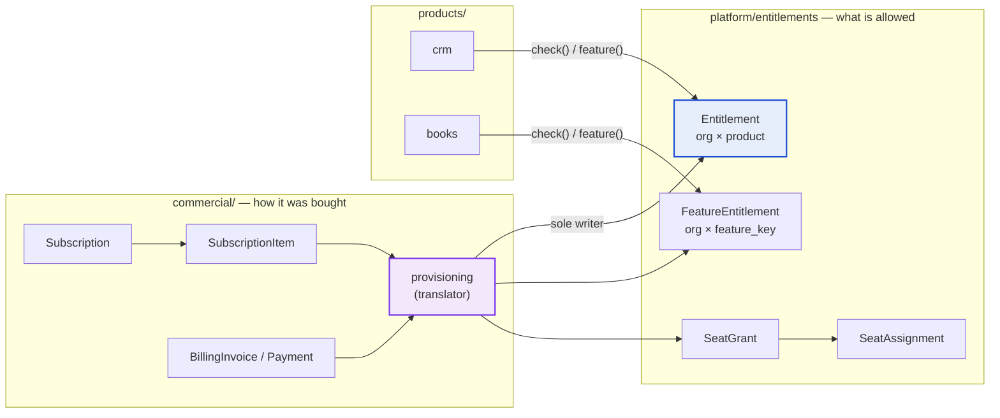
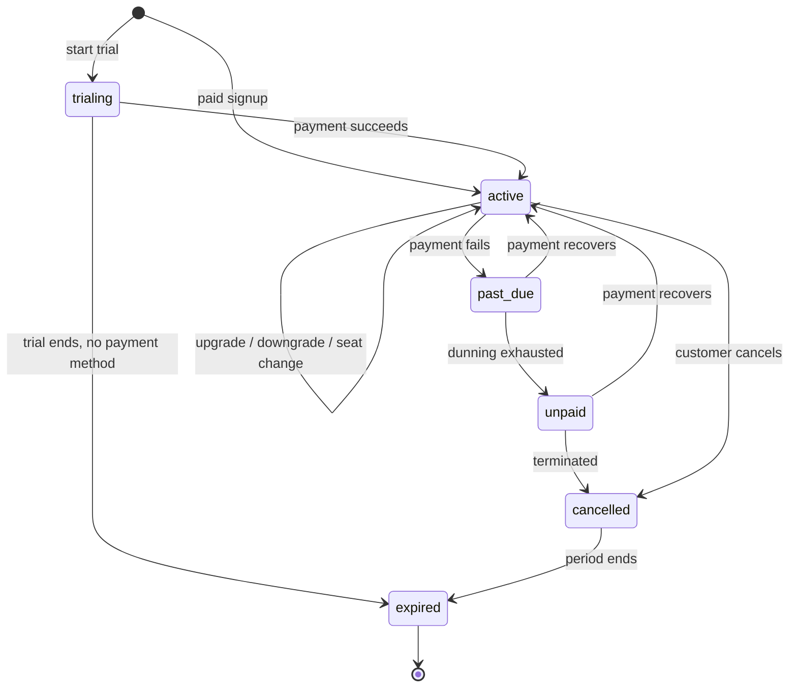
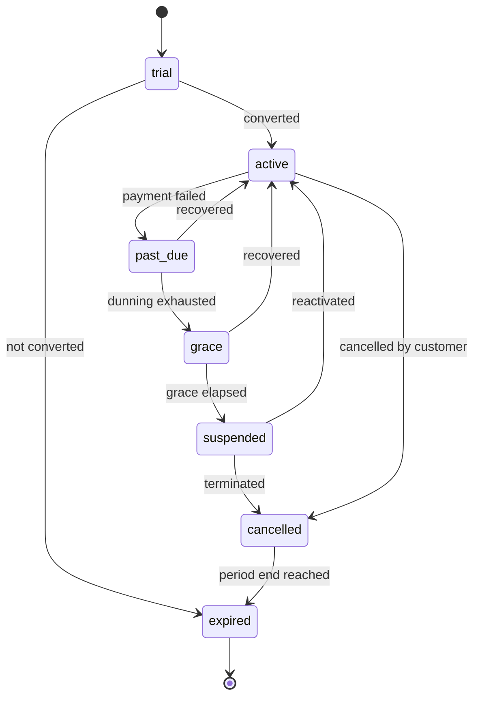

# 06 — Subscriptions and Entitlements

**Status:** Accepted (Phase 0)
**Owner:** Architecture
**Last reviewed:** 2026-09-21

---

## 1. Purpose

Define the separation between *how a customer bought something* (commercial) and *what they may do* (entitlement), the lifecycle that connects them, and the guarantee that a billing failure can never corrupt authorization state.

## 2. The core separation



Two facts do all the work:

1. **`platform/entitlements` is a read model.** It is derived, rebuildable, and optimised for the question products ask thousands of times per second.
2. **`commercial/provisioning` is the only writer.** Nothing else in the system — not billing, not subscriptions, not a support tool, not a product — writes an entitlement row. One writer means one place to audit, one place to test, and one place to fix.

### Why entitlements live in `platform/` and not `commercial/`

Restating the decision from [01-domain-boundaries.md](01-domain-boundaries.md) because it is the most consequential structural choice in this document: if entitlements lived in `commercial/`, then `products → commercial` would be a legal import edge. Once legal, a product will eventually read `subscription.plan.name`. Keeping the read model in `platform/` makes `products → commercial` an edge the linter can forbid outright.

## 3. Subscription model

```python
class Subscription(TenantScopedModel):          # commercial/subscriptions
    id                = UUIDField(primary_key=True, default=uuid7)
    organization      = FK(Organization, on_delete=PROTECT)
    status            = CharField(choices=SubscriptionStatus)
    currency          = CharField()                       # fixed at creation
    billing_interval  = CharField(choices=BillingInterval)
    collection_mode   = CharField(choices=["automatic", "invoice", "partner_billed"])
    billed_to_partner = FK("partners.PartnerAccount", null=True, on_delete=PROTECT)
    current_period_start = DateTimeField()
    current_period_end   = DateTimeField()
    trial_ends_at     = DateTimeField(null=True)
    cancel_at         = DateTimeField(null=True)          # scheduled cancellation
    cancelled_at      = DateTimeField(null=True)
    ended_at          = DateTimeField(null=True)
    version           = IntegerField(default=0)           # optimistic concurrency

class SubscriptionItem(TenantScopedModel):
    subscription   = FK(Subscription, on_delete=CASCADE)
    plan_version   = FK(PlanVersion, null=True, on_delete=PROTECT)
    bundle_version = FK(BundleVersion, null=True, on_delete=PROTECT)
    price_id       = UUIDField()          # pinned PlanPrice or ContractPrice
    price_source   = CharField()          # "price_book" | "contract" — from PriceQuote
    quantity       = IntegerField(default=1)             # seats or units
    added_at       = DateTimeField()
    removed_at     = DateTimeField(null=True)
```

Points worth stating explicitly:

- **A subscription can hold heterogeneous items**: one CRM plan, one bundle, one usage-based add-on. Modelling one subscription per product would make a suite purchase four subscriptions with four renewal dates and four dunning cycles — a support nightmare. One subscription, many items, one renewal.
- **`collection_mode=partner_billed`** means the partner is invoiced, not the customer. Entitlements are still granted to the *customer's* organization. Who pays and who benefits are separate facts.
- **Items are soft-removed** (`removed_at`), never deleted. Proration, revenue reporting and disputes all need the history.
- **`version`** supports optimistic concurrency: a customer clicking "upgrade" twice, or an admin and a webhook racing, must not produce a double charge. See [10-performance-concurrency.md](10-performance-concurrency.md).

### 3.1 Subscription lifecycle



`cancelled` vs `expired` matters: cancelled means "will not renew" — the customer keeps access until `current_period_end`, because they paid for it. Expired means access has ended. Revoking on cancellation instead of at period end is theft, and generates chargebacks.

## 4. Entitlement model

```python
class Entitlement(TenantScopedModel):           # platform/entitlements
    id             = UUIDField(primary_key=True, default=uuid7)
    organization   = FK(Organization, on_delete=CASCADE)
    product_code   = CharField()
    status         = CharField(choices=EntitlementStatus)
    source_kind    = CharField(choices=["subscription", "bundle", "grant", "trial"])
    source_ref     = CharField()                  # "subscriptions.subscription:<uuid>"
    seats_total    = IntegerField(null=True)      # NULL = not seat-limited
    effective_from = DateTimeField()
    effective_to   = DateTimeField(null=True)
    grace_ends_at  = DateTimeField(null=True)
    computed_at    = DateTimeField()              # when provisioning last recomputed this
    computation_id = UUIDField()                  # groups one reconciliation run

    class Meta:
        constraints = [
            UniqueConstraint("organization", "product_code", "source_ref",
                             name="uq_entitlement_org_product_source"),
        ]

class FeatureEntitlement(TenantScopedModel):
    organization   = FK(Organization, on_delete=CASCADE)
    feature_key    = CharField()
    value          = JSONField()                  # true | 50 | -1 | "priority"
    kind           = CharField(choices=["boolean", "quota", "enum"])
    source_ref     = CharField()
    effective_from = DateTimeField()
    effective_to   = DateTimeField(null=True)
```

### 4.1 Overlapping grants and the resolution rule

An organization can hold the same product from several sources at once: a bundle, a standalone subscription, and a support-issued grant. The resolution rule is **most generous wins**:

| Kind | Resolution |
|---|---|
| `boolean` | `True` if any active source grants it |
| `quota` | `max()` across sources; `-1` (unlimited) beats any number |
| `enum` | Highest-ranked value per the feature's declared ordering |
| Product access | Entitled if any source is in an access-granting status |
| Seats | Sum of `seats_total` across active sources |

Alternatives were considered and rejected: "sum quotas" double-counts when a bundle and a standalone plan both include CRM; "latest wins" makes a support grant silently *downgrade* a paying customer. "Most generous" is the only rule where adding a grant can never reduce access — which is the property that prevents the worst support incidents.

The resolved answer is materialised into a per-organization snapshot so reads do not repeat the resolution:

```python
class EntitlementSnapshot(TenantScopedModel):
    organization   = OneToOneField(Organization, on_delete=CASCADE)
    version        = BigIntegerField()            # monotonic, bumped on every recompute
    products       = JSONField()                  # {"crm": {"status": "active", "seats": 10}}
    features       = JSONField()                  # {"crm.pipelines.max": 50}
    computed_at    = DateTimeField()
```

This is the row the cache is built from, and the row a support engineer reads to answer "what does this customer actually have?" in one query.

### 4.2 Entitlement lifecycle — the states products see



| Status | Read | Write | New records | Background jobs | API | Customer sees |
|---|---|---|---|---|---|---|
| `trial` | yes | yes | yes | yes | yes | Days remaining |
| `active` | yes | yes | yes | yes | yes | Normal |
| `past_due` | yes | yes | yes | yes | yes | Payment banner |
| `grace` | yes | yes | yes | yes | yes | Urgent banner + deadline |
| `suspended` | **yes** | no | no | no | read-only | Read-only banner + pay CTA |
| `cancelled` | yes | yes | yes | yes | yes | Ends on `<date>` |
| `expired` | export only | no | no | no | export only | Export + resubscribe |

Two decisions that differ from common practice, both deliberate:

**`past_due` and `grace` do not restrict anything.** A failed card is usually an expired card, not a customer who stopped paying. Degrading service on the first failure creates support load and churn out of proportion to the recovered revenue. Escalation is by *notification intensity*, not by capability removal, until grace elapses.

**`suspended` is read-only, not lock-out.** The customer's data remains visible and exportable. This keeps us on the right side of data-protection obligations, keeps the "pay now" path open, and removes an entire category of angry support escalation. Writes, background automation and API mutations stop.

### 4.3 The check API

```python
# contracts/ports/entitlements.py — what products import
class EntitlementService(Protocol):
    def check(self, org_id: UUID, product: ProductCode) -> EntitlementDecision: ...
    def feature(self, org_id: UUID, key: FeatureKey) -> FeatureValue: ...
    def quota(self, org_id: UUID, key: FeatureKey) -> int: ...
    def has_seat(self, org_id: UUID, membership_id: UUID, product: ProductCode) -> bool: ...

@dataclass(frozen=True)
class EntitlementDecision:
    allowed: bool
    status: EntitlementStatus
    write_allowed: bool
    reason_code: str           # "ok" | "not_entitled" | "suspended" | "no_seat" | "unknown"
    grace_ends_at: datetime | None
    upgrade_hint: str | None   # machine-readable, for the UI to render a CTA
```

`reason_code` is machine-readable and distinct from the HTTP status, because the UI needs to render three different things for "you never bought this", "you bought it and it lapsed", and "the org has it but you have no seat". Returning a bare `False` forces the UI to guess.

Usage in product code is uniform:

```python
# products/crm/services/deal_services.py
def create_deal(ctx: TenantContext, data: DealInput) -> Deal:
    entitlements.require(ctx.organization_id, "crm", write=True)       # raises EntitlementDenied
    authz.require(ctx, "crm.deal.create")
    limit = entitlements.quota(ctx.organization_id, "crm.pipelines.max")
    ...
```

Note the order: entitlement before permission, per [04-identity-authz.md](04-identity-authz.md).

### 4.4 Caching and failure behaviour

| Layer | Contents | TTL | Invalidation |
|---|---|---|---|
| Request-local | Snapshot for the current org | request | n/a |
| Redis | `w360:{org}:ent:v{version}` → snapshot | 300s | Version bump — old key is simply never read again |
| PostgreSQL | `EntitlementSnapshot` | — | Rewritten by provisioning |

Version-keyed caching means invalidation is a single counter increment, with no key enumeration and no risk of a stale key surviving a flush. Stale entries expire on their own.

Failure behaviour, stated precisely because "fail closed" and "graceful degradation" pull in opposite directions here:

| Failure | Behaviour | Rationale |
|---|---|---|
| Redis down | Read `EntitlementSnapshot` from PostgreSQL directly | Slower, still correct |
| Snapshot row missing | Compute from `Entitlement` rows synchronously, then repair the snapshot | Self-healing |
| PostgreSQL down | Request fails | Nothing works without the database; no special case needed |
| Provisioning lagging | Entitlements are *stale*, not wrong — they reflect the last known good commercial state | A customer keeps what they had; they do not lose access because a worker is behind |
| Payment provider down | **No entitlement change at all** | See §5 |

The rule is: **absence of information never causes revocation.** Revocation requires a positive, durable decision (grace expired, cancellation effective, explicit termination). An error, a timeout, or a lagging queue can only ever leave the customer with what they already had. Conversely, absence of information never *grants* access either — an org with no entitlement row for a product is denied, because the default is `not_entitled`.

## 5. Preventing billing failures from corrupting authorization

This is the specific guarantee requested in the brief, so the mechanism is spelled out.

### 5.1 Provisioning is a pure function plus an idempotent writer

```python
def compute_entitlements(org_id: UUID, at: datetime) -> ComputedEntitlements:
    """Pure. Reads subscriptions, items, bundles, grants. No I/O to providers. Deterministic."""

def apply_entitlements(org_id: UUID, computed: ComputedEntitlements) -> None:
    """Idempotent. Diffs against current rows, writes changes, bumps version, publishes events."""
```

Because `compute_entitlements` is a deterministic function of durable database state — never of a provider response — it can be re-run at any time and will produce the same answer. That single property is what makes the system recoverable.

### 5.2 Nothing in the payment path writes entitlements

```mermaid
sequenceDiagram
    participant PP as Payment Provider
    participant WH as Webhook Endpoint
    participant OB as Outbox
    participant BI as billing
    participant PR as provisioning
    participant EN as entitlements

    PP->>WH: payment_intent.succeeded
    WH->>WH: verify HMAC + timestamp
    WH->>OB: persist raw event (idempotent by provider event id)
    WH-->>PP: 200 immediately
    OB->>BI: process payment (async)
    BI->>BI: update Payment, Invoice; state machine step
    BI->>OB: publish billing.payment.succeeded.v1
    OB->>PR: handle event
    PR->>PR: recompute from durable state
    PR->>EN: apply diff, bump version
    EN->>EN: publish entitlements.changed.v1
```

Properties this buys:

- **The webhook handler does almost nothing.** It verifies, persists, returns 200. A slow provisioning run can never cause a webhook timeout, and a provider retry storm cannot amplify into database load.
- **Provider event IDs are the idempotency key.** Payment providers deliver at-least-once; duplicates are unavoidable and are dropped by a unique constraint, not by application logic.
- **Provisioning recomputes from durable state**, so a duplicated or out-of-order event converges to the same result. Out-of-order delivery — `subscription.updated` arriving after `payment.failed` — is a normal occurrence with payment providers, and a diff-from-truth model is immune to it, whereas an incremental "apply this delta" model is not.

### 5.3 Reconciliation

A scheduled job (hourly for organizations with recent commercial activity, daily for the rest) recomputes entitlements for every organization and compares with what is stored:

- **Drift found** → repair, emit `entitlements.drift_repaired.v1`, alert with the diff. Drift is a bug; it is never silently fixed without a signal.
- **Drift rate** is a monitored SLI. A rising rate means provisioning logic or event delivery is broken, and it surfaces before customers notice.

This job is also the disaster-recovery tool: if the entitlement tables were lost entirely, one full reconciliation pass rebuilds them from subscriptions.

### 5.4 Manual override, safely

Support must be able to fix things. `EntitlementGrant` is a first-class source (`source_kind="grant"`):

```python
class EntitlementGrant(TenantScopedModel):
    organization  = FK(Organization, on_delete=CASCADE)
    product_code  = CharField(null=True)
    feature_key   = CharField(null=True)
    value         = JSONField(null=True)
    reason        = TextField()                   # required
    granted_by    = FK(User, on_delete=PROTECT)
    approved_by   = FK(User, null=True, on_delete=PROTECT)
    expires_at    = DateTimeField(null=True)      # required unless approved by a second person
    revoked_at    = DateTimeField(null=True)
```

Because a grant is an *input* to `compute_entitlements`, reconciliation preserves it rather than reverting it. The failure mode of "support fixes it manually, the nightly job undoes it" cannot occur. Grants are time-boxed by default and appear in the customer's audit log.

## 6. Seats and licences

```python
class SeatGrant(TenantScopedModel):             # platform/entitlements
    organization = FK(Organization, on_delete=CASCADE)
    pool_key     = CharField()          # product code, or a bundle's shared seat_pool name
    seats_total  = IntegerField()
    source_ref   = CharField()

class SeatAssignment(TenantScopedModel):
    seat_grant   = FK(SeatGrant, on_delete=CASCADE)
    membership   = FK(Membership, on_delete=CASCADE)
    assigned_at  = DateTimeField()
    assigned_by  = FK(Membership, null=True, on_delete=SET_NULL)
    released_at  = DateTimeField(null=True)

    class Meta:
        constraints = [
            UniqueConstraint("seat_grant", "membership", condition=Q(released_at__isnull=True),
                             name="uq_active_seat_per_member_per_pool"),
        ]
```

**Seat counting is a contention point and is handled explicitly.** Two admins assigning the last seat simultaneously must not both succeed. Assignment takes a row lock on the `SeatGrant` and counts inside the same transaction:

```python
with transaction.atomic():
    grant = SeatGrant.objects.select_for_update().get(pk=grant_id)
    used = SeatAssignment.objects.filter(seat_grant=grant, released_at__isnull=True).count()
    if used >= grant.seats_total:
        raise SeatLimitReached(pool=grant.pool_key, total=grant.seats_total)
    SeatAssignment.objects.create(seat_grant=grant, membership_id=membership_id, ...)
```

The lock is on a single low-traffic row and the transaction is short, so contention is negligible. A counter cache with optimistic checking was rejected: it can over-allocate under concurrency, and over-allocating paid seats is a revenue leak that is embarrassing to explain.

**Downgrades that reduce seats below current assignments** do not auto-revoke. Assignments beyond the new limit are marked `over_limit`; the org is given a deadline to choose who keeps access, with a default (most recently active) applied if they do not. Silently revoking someone's access because of a billing change produces "I was locked out mid-invoice" incidents.

**Shared seat pools** are why `pool_key` is not simply `product_code`: a bundle may grant 10 seats usable across CRM and Projects. Per-product seats are the common case (`pool_key == product_code`), shared pools the enterprise case, with one model covering both.

## 7. Trials

```python
trial_source  = CharField(choices=["self_serve", "sales", "partner", "extension"])
```

Rules:

- A trial is an entitlement with `status=trial` and `effective_to` set. It is **not** a flag on the organization, and not a plan called "Trial". Modelling it as a status means every code path that handles entitlements handles trials automatically.
- Trial-to-paid conversion changes status and source, never data. Nothing is migrated, nothing is re-created.
- Trial abuse is a platform concern: signup fingerprinting, per-domain trial limits, and a `trial_source` audit trail — not a product concern.
- Expiry moves to `expired` (export-only), not deletion. Data is retained for the standard window so a late conversion restores everything instantly.

## 8. Events published by entitlements

| Event | Payload | Typical consumers |
|---|---|---|
| `entitlements.product.granted.v1` | org, product_code, status, seats | Products (provision defaults), notifications, analytics |
| `entitlements.product.revoked.v1` | org, product_code, reason | Products (disable automation), notifications |
| `entitlements.status.changed.v1` | org, product_code, from, to | UI banners, notifications |
| `entitlements.feature.changed.v1` | org, feature_key, from, to | Caches, UI |
| `entitlements.seat.assigned.v1` | org, membership, pool | Products (create user workspace) |
| `entitlements.seat.released.v1` | org, membership, pool | Products (reassign ownership) |
| `entitlements.drift_repaired.v1` | org, diff | Alerting, engineering |

Products **react** to these events for setup work (seed a default pipeline on first grant), but never **cache** the result and never treat the event as the source of truth. The source of truth is always `check()`. An event may be lost or delayed; a check cannot be wrong.

## 9. Anti-patterns, explicitly forbidden

| Anti-pattern | Why it is forbidden |
|---|---|
| `if subscription.plan.code == "pro"` in a product | Hard-codes packaging into product code; repackaging becomes a code change across every product |
| Caching entitlements in a product's own table | Two sources of truth that will diverge |
| A product writing `Entitlement` rows | Breaks the single-writer guarantee and makes drift undiagnosable |
| Revoking access on a payment-provider error | Confuses "we do not know" with "they did not pay" |
| Checking entitlement in the view only | Service and task paths bypass it; checks belong in application services |
| Deleting data on expiry | Legally risky, commercially fatal to win-backs |
| A separate "enterprise" code path | Enterprise is a `ContractPrice` plus a custom `Bundle`, not a branch in product code |

## 10. Related documents

- [05-commercial-model.md](05-commercial-model.md) — catalog, pricing, bundles, partners
- [04-identity-authz.md](04-identity-authz.md) — the seven-step decision chain
- [07-cross-product-integration.md](07-cross-product-integration.md) — outbox and event delivery
- [09-failure-resilience.md](09-failure-resilience.md) — degradation tiers
- [ADR-005](adrs/ADR-005-product-entitlement-model.md)
