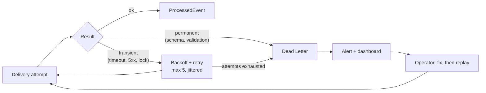
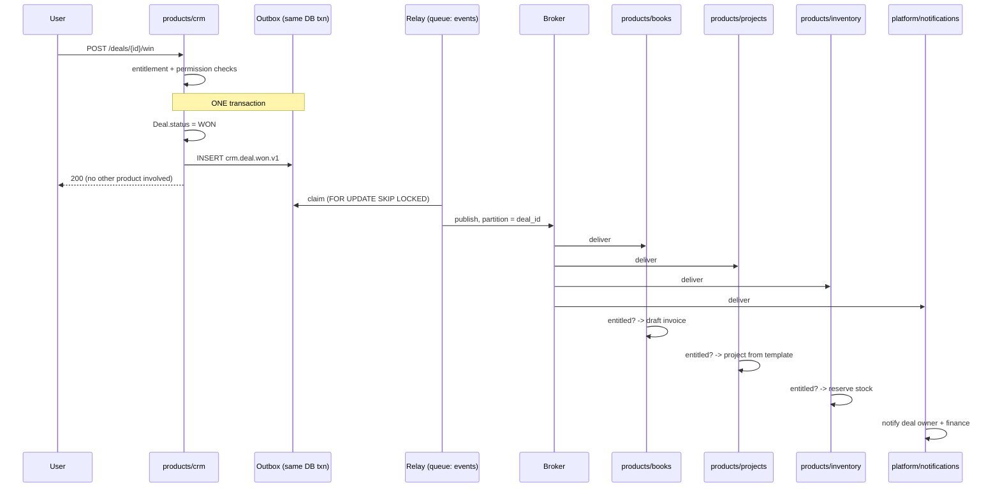

# 07 — Cross-Product Integration

> **CORRECTION (2026-09-22, [ADR-017](adrs/ADR-017-products-are-separate-applications.md)).**
> This document was written when product domains were to live *inside* this
> repository, under `products/`. They no longer do: each business product is
> a separate application in its own repository. Everything here about
> layering, ownership, isolation and enforcement still holds — but wherever
> it places a product's code in this repository, read
> [16 — Ecosystem / Product Boundary](16-ecosystem-product-boundary.md)
> instead.


**Status:** Accepted (Phase 0)
**Owner:** Architecture
**Last reviewed:** 2026-09-21

---

## 1. Purpose

Define how products communicate without depending on each other. This is the mechanism that makes independent commercialization real: Inventory must ship, run and be sold to a customer who has never bought Books.

## 2. The four sanctioned mechanisms, and when each applies

| # | Mechanism | Coupling | Use when | Do not use when |
|---|---|---|---|---|
| 1 | **Domain event** (async, via outbox) | Lowest — publisher does not know consumers | Something happened that others may care about | You need a result back |
| 2 | **Contract port** (sync read, runtime-resolved) | Low — caller depends on an interface in `contracts/` | You need another product's data *now*, read-only, to render or validate | The call would write anything |
| 3 | **Platform application service** (sync, direct import) | Medium — but only downward | Calling `platform/` capabilities: entitlements, authz, files, notifications | Calling another *product* |
| 4 | **Public API / webhook** | Zero internal coupling | The other side is external, or a customer's own automation | Two internal products are talking |

**The decision rule, in one line:** *cross-product **writes** are always events; cross-product **reads** are ports; anything sideways and synchronous that writes is a design error.*

### Why cross-product writes must be asynchronous

A synchronous write from CRM into Books would mean: CRM's request latency includes Books' latency; a Books outage becomes a CRM outage; a Books deployment blocks CRM writes; and CRM cannot be sold without Books. Every one of those breaks a stated requirement. Asynchrony is not a performance optimisation here — it is what preserves the product boundary.

## 3. Domain events

### 3.1 The envelope

```python
# contracts/events/envelope.py
@dataclass(frozen=True)
class DomainEvent:
    event_id:        UUID          # unique; the idempotency key for consumers
    event_type:      str           # "crm.deal.won"
    event_version:   int           # 1, 2, 3 — schema version of the payload
    occurred_at:     datetime      # when the fact happened (business time)
    organization_id: UUID          # tenant. Mandatory. No cross-tenant events exist.
    aggregate_type:  str           # "crm.deal"
    aggregate_id:    str           # partition key for ordering
    actor:           Actor | None  # membership_id / service name; None for system
    correlation_id:  UUID          # the originating request, end to end
    causation_id:    UUID | None   # the event or command that caused this one
    causation_depth: int           # cycle guard, see §3.6
    payload:         dict          # validated against the registered schema
    schema_ref:      str           # "crm.deal.won.v1"
```

Rules:

- **`organization_id` is mandatory on every event.** There is no such thing as a cross-tenant domain event. Control-plane events (catalog changes) use a separate `PlatformEvent` type that is explicitly not tenant-scoped, so the two cannot be confused.
- **`occurred_at` is business time, not publish time.** Delivery timestamps live on the delivery record.
- **`correlation_id`** flows from the HTTP request through every event and task it spawns, making a whole causal chain one query in the log aggregator.
- **Events are facts in the past tense.** `crm.deal.won`, never `books.create_invoice`. An event that names a command is a disguised RPC: it tells the consumer what to do, which re-introduces the coupling events are meant to remove.

### 3.2 Naming and the published-language contract

`<product>.<aggregate>.<past_tense_verb>` — `crm.deal.won`, `inventory.stock.depleted`, `books.invoice.paid`.

A published event is a **public contract**, not an implementation detail. Consequences:

- Schemas live in `contracts/events/`, not inside the publishing module, so consumers do not import publishers.
- Each product's manifest declares `publishes` and `consumes`. A CI check builds the graph from manifests, verifies every consumed type is published by someone, and renders the integration diagram. The diagram is generated, so it cannot go stale.
- Payloads carry **stable identifiers and denormalised essentials**, not entire object graphs:

```python
# contracts/events/product_events.py
class CrmDealWonV1(EventSchema):
    event_type = "crm.deal.won"
    version = 1
    deal_id:        UUID
    deal_name:      str
    amount:         MoneyDTO          # value + currency, never a float
    closed_at:      datetime
    owner_membership_id: UUID
    company_id:     UUID | None
    company_name:   str | None        # denormalised: consumers should not call back
    contact_ids:    list[UUID]
```

`company_name` is duplicated deliberately. Without it, every consumer calls back into CRM to render a line item, producing an N+1 across a module boundary and a hard runtime dependency on CRM being up. Denormalising the few fields consumers need is cheaper than the callback, and it makes the event self-describing in a dead-letter queue.

### 3.3 Versioning

| Change | Allowed in place? | Action |
|---|---|---|
| Add an optional field | Yes | Same version |
| Add a required field | No | New version |
| Remove or rename a field | No | New version |
| Change a field's type or units | No | New version — and this is the one that causes silent corruption |
| Change the meaning of a value | No | New version |

Migration procedure: publish both `v1` and `v2` for a deprecation window (minimum two releases, default 90 days); consumers migrate; a metric tracks `v1` consumption; `v1` is removed only when that metric reads zero. A CI check compares event schemas against `main` and fails on an incompatible change without a version bump.

### 3.4 Transactional outbox

The problem: writing to the database and publishing to a broker are two systems. Commit-then-publish loses events on a crash; publish-then-commit emits events for work that rolled back. Both are unacceptable — the first silently drops business facts, the second creates invoices for deals that were never won.

**Solution: write the event into the same database transaction as the business change.**

```python
class OutboxEvent(models.Model):            # integration/events
    id              = BigAutoField(primary_key=True)   # sequential: relay ordering
    event_id        = UUIDField(unique=True)
    event_type      = CharField(db_index=True)
    organization_id = UUIDField(db_index=True)
    aggregate_type  = CharField()
    aggregate_id    = CharField(db_index=True)
    envelope        = JSONField()
    status          = CharField(choices=["pending", "publishing", "published", "failed"])
    attempts        = IntegerField(default=0)
    available_at    = DateTimeField(db_index=True)     # backoff
    published_at    = DateTimeField(null=True)
    last_error      = TextField(null=True)

    class Meta:
        indexes = [Index(fields=["status", "available_at", "id"],
                         name="ix_outbox_claim", condition=Q(status__in=["pending", "failed"]))]
```

```python
# products/crm/services/deal_services.py
def mark_deal_won(ctx, deal_id) -> Deal:
    with transaction.atomic():
        deal = Deal.objects.select_for_update().get(pk=deal_id)
        deal.status = DealStatus.WON
        deal.closed_at = timezone.now()
        deal.save(update_fields=["status", "closed_at"])
        events.publish(CrmDealWonV1(...))    # INSERT into outbox, same transaction
    return deal
```

`events.publish()` performs an insert, nothing more. No network call, no broker connection, no latency added to the request. If the transaction rolls back, the event vanishes with it. **Atomicity is free because it is the database's own atomicity.**

The relay drains the outbox:

```python
@shared_task(queue="events", bind=True)
def relay_outbox(self, batch_size=200):
    with transaction.atomic():
        rows = (OutboxEvent.objects
                .select_for_update(skip_locked=True)
                .filter(status__in=["pending", "failed"], available_at__lte=now())
                .order_by("id")[:batch_size])
        claimed = list(rows)
        OutboxEvent.objects.filter(id__in=[r.id for r in claimed]).update(status="publishing")
    for row in claimed:
        try:
            broker.publish(row.envelope, partition_key=row.aggregate_id)
            mark_published(row)
        except TransientError as exc:
            schedule_retry(row, exc)     # exponential backoff + full jitter, capped
```

- `SELECT ... FOR UPDATE SKIP LOCKED` lets many relay workers drain one table without blocking each other. This is the standard, correct pattern and avoids both the single-relay bottleneck and lock contention.
- The partial index on `(status, available_at, id)` keeps the claim query fast as the table grows — without it, the relay degrades as published rows accumulate.
- Published rows are archived and pruned after 30 days by a separate job, so the hot table stays small.

**Delivery is at-least-once.** Exactly-once does not exist across a database and a broker; pretending otherwise produces systems that lose messages in the gaps. Consumers are idempotent instead.

### 3.5 Consumer idempotency

```python
class ProcessedEvent(models.Model):         # integration/events
    consumer   = CharField()          # "books.on_deal_won"
    event_id   = UUIDField()
    processed_at = DateTimeField()
    result     = CharField(choices=["applied", "skipped", "failed"])

    class Meta:
        constraints = [UniqueConstraint("consumer", "event_id", name="uq_processed_consumer_event")]
```

```python
@event_handler("crm.deal.won", version=1, queue="events")
def on_deal_won(event: CrmDealWonV1, ctx: TenantContext) -> None:
    with transaction.atomic():
        try:
            ProcessedEvent.objects.create(consumer="books.on_deal_won", event_id=event.event_id)
        except IntegrityError:
            return                       # already handled; duplicate delivery
        create_draft_invoice_from_deal(ctx, event)
```

The marker is inserted **in the same transaction as the effect**. If the handler fails, the marker rolls back too, so the retry genuinely retries. Inserting the marker first in a separate transaction produces the classic bug where a crash mid-handler permanently marks an event processed that never was.

Each `(consumer, event_id)` pair is independent, so three consumers of the same event retry independently.

### 3.6 Ordering, and what is not guaranteed

Stated plainly, because assuming guarantees that do not exist is a common source of production bugs:

| Guarantee | Provided? |
|---|---|
| At-least-once delivery | **Yes** |
| Per-aggregate ordering | **Yes** — outbox `id` order plus `aggregate_id` as broker partition key |
| Global ordering across aggregates | **No** |
| Ordering across products | **No** |
| Exactly-once | **No** — idempotency substitutes |
| Bounded delivery latency | **No** — SLO-monitored, not guaranteed |

Consumers must therefore tolerate out-of-order and duplicate delivery. The practical techniques: carry a monotonic `aggregate_version` in payloads where order matters and ignore events older than the last applied version; prefer idempotent "set to this state" handlers over "increment by this delta".

**Event-loop cycles** (A → B → A) are guarded by `causation_depth`: the dispatcher refuses any event exceeding depth 10 and raises a P1 alert. A CI check on the manifest graph fails on a publish/consume cycle unless the pair appears in `allowed-event-cycles.yml` with a written justification.

### 3.7 Failure handling and the dead-letter path



- **Transient vs permanent is decided explicitly** by exception type, never by string matching. Retrying a validation error five times is wasted work and noise.
- **Retries are bounded** — 5 attempts, exponential with full jitter, capped at 1 hour. Never infinite: an event that cannot be processed will not become processable by being retried forever, and infinite retries turn one bad event into a permanent queue clog.
- **The dead-letter store keeps the full envelope**, so replay needs no reconstruction.
- **Replay is a first-class operation** with a tenant/type/time-range filter and a dry-run mode.
- **Consumer isolation:** one consumer's failure never blocks another's. Each `(event, consumer)` pair is a separate unit of work.
- **A failing consumer trips a breaker** after a threshold, pausing that consumer only and alerting, so a broken handler does not burn the whole `events` queue.

## 4. Synchronous cross-product reads: the contract port

Sometimes a product genuinely needs another's data to render a page — Projects showing the CRM company name on a project header. Copying it via events is wrong (it goes stale); importing CRM is forbidden.

```python
# contracts/ports/product_data.py
class CompanyDirectory(Protocol):
    def get_companies(self, org_id: UUID, ids: Sequence[UUID]) -> dict[UUID, CompanyRef]: ...

@dataclass(frozen=True)
class CompanyRef:
    id: UUID
    name: str
    is_active: bool
```

```python
# products/crm/adapters.py
@provides(CompanyDirectory, product="crm")
class CrmCompanyDirectory:
    def get_companies(self, org_id, ids): ...
```

```python
# products/projects/selectors.py
directory = registry.get(CompanyDirectory)        # None if CRM absent or not entitled
refs = directory.get_companies(org_id, ids) if directory else {}
```

The rules that make this safe rather than a backdoor:

1. **Resolution is at runtime through a registry**, so there is no import edge and the linter stays satisfied.
2. **The port may return `None`.** Every caller must handle the product being absent, not installed, or not entitled. The UI degrades to showing an ID, not a 500.
3. **Reads only.** A port that writes is a forbidden edge wearing a costume — code review rejects it.
4. **Batch signatures only** (`ids: Sequence`), never single-item getters. Single getters guarantee N+1 across a boundary.
5. **The port is entitlement-aware:** if the org lacks CRM, the registry returns `None` rather than leaking data from a product they have not bought.
6. **Ports are deliberately awkward** — nullable, batch-only, DTO-returning. That friction is a feature: it keeps the count of ports low and pushes teams toward events.

## 5. Worked example: Deal Won



What this demonstrates:

- **CRM's response time is unaffected** by how many products consume the event.
- **CRM does not know Books exists.** Consumers can be added with no change to CRM.
- **Each consumer checks its own entitlement.** An org without Books simply has no Books consumer acting. The event is delivered and ignored — no error, no special case.
- **Partial failure is contained.** If Projects' handler fails, Books' invoice still exists; only the Projects handler retries.
- **The user is not blocked** by any of it.

A question this raises honestly: the user sees "Deal won" but the invoice appears a second later. That is eventual consistency, and it must be designed for in the UI — optimistic placeholders, a "creating your invoice…" state, or simply not promising instant cross-product results. Pretending the system is synchronous when it is not produces confusing products; being explicit produces good ones.

## 6. Cross-product references without foreign keys

Books' invoice needs to remember which CRM deal produced it. A foreign key is forbidden ([02-dependency-rules.md](02-dependency-rules.md), F-6).

```python
class ExternalRef(TypedDict):
    product: str        # "crm"
    entity:  str        # "deal"
    id:      str

class Invoice(TenantScopedModel):           # products/books
    source_refs = JSONField(default=list)   # [{"product":"crm","entity":"deal","id":"..."}]
```

- Indexed with a GIN index for reverse lookups.
- **Dangling references are normal and must be handled.** The deal may be deleted; the org may lose CRM. Resolution returns `None` and the UI renders "source no longer available". Modelling this as an error state produces broken pages years later.
- A `crm.deal.deleted.v1` event lets consumers mark refs stale rather than discovering it on read.

## 7. Public APIs and webhooks

These are for *external* consumers, and they are not a shortcut for internal integration. A product calling another product over our own public HTTP API would add network latency, authentication overhead and a circular runtime dependency inside one process — all to avoid a rule that exists for good reason. Explicitly forbidden.

**Outbound webhooks** are how customers subscribe to the same domain events:

```python
class WebhookEndpoint(TenantScopedModel):   # integration/webhooks
    organization  = FK(Organization, on_delete=CASCADE)
    url           = URLField()                    # SSRF-validated at save AND at send
    secret_ref    = CharField()                   # KMS reference
    event_types   = ArrayField(CharField())
    status        = CharField(choices=["active", "paused", "disabled"])
    failure_count = IntegerField(default=0)
```

- Signed `HMAC-SHA256(timestamp + "." + body)`, header `X-W360-Signature: t=<ts>,v1=<sig>`, 5-minute tolerance, versioned scheme for rotation.
- Same delivery semantics as internal events: at-least-once, bounded retries, dead letter, per-endpoint circuit breaker.
- Auto-disable after sustained failure, with customer notification. Hammering a dead endpoint forever wastes our capacity and is a nuisance to the recipient.
- **SSRF validation happens at send time, not only at save time**, because DNS can be re-pointed to a private address after the URL is accepted. See [12-security.md](12-security.md).

## 8. Anti-patterns

| Anti-pattern | Why forbidden | Instead |
|---|---|---|
| `from products.books.models import Invoice` in CRM | The defining violation | Event or port |
| Django signal across modules | Invisible, unordered, breaks on bulk ops, fires inside the sender's transaction | Explicit service call or outbox event |
| Command-shaped event (`books.create_invoice`) | RPC in disguise; publisher dictates consumer behaviour | `crm.deal.won` — state the fact |
| Publishing before commit | Emits events for rolled-back work | Outbox |
| `transaction.on_commit(lambda: http_call())` | Fires outside the transaction with no durability — lost on crash | Outbox |
| Consumer calls publisher back to enrich | Runtime dependency + N+1 across a boundary | Denormalise into the payload |
| Shared `products/common/` module | Becomes an unowned product everyone depends on | Promote to platform, or a pure library, or events |
| Unbounded retries | One poison event clogs the queue permanently | Bounded retries + DLQ |
| Cross-product database view or trigger | Couples at the schema level, invisible to code review, breaks extraction | Events |

## 9. Related documents

- [02-dependency-rules.md](02-dependency-rules.md) — forbidden edges F-1, F-6, F-8
- [09-failure-resilience.md](09-failure-resilience.md) — queue bulkheads, breakers, backpressure
- [10-performance-concurrency.md](10-performance-concurrency.md) — outbox contention, idempotency
- [ADR-007](adrs/ADR-007-cross-product-communication.md), [ADR-008](adrs/ADR-008-transactional-outbox.md)
