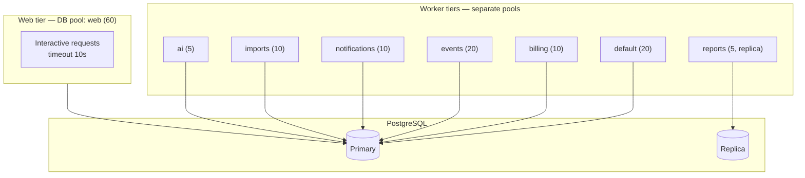

# 09 — Failure Boundaries and Resilience

**Status:** Accepted (Phase 0)
**Owner:** Architecture
**Last reviewed:** 2026-09-21

---

## 1. Purpose

Define how Workeasy360 behaves when things break. The governing objective: **a failure in a non-essential dependency must never take down a core workflow, and a failure in one product must never take down another.**

The design assumption is not "these things might fail" but "these things will fail regularly, and the system must stay useful while they do."

## 2. Dependency criticality tiers

This table is the canonical definition referenced by every other document.

| Tier | Meaning | Members | If unavailable |
|---|---|---|---|
| **0 — Vital** | Nothing works without it | PostgreSQL primary | Writes fail. Reads may serve from replica. Honest error page. |
| **1 — Load-bearing** | Core works, degraded | Redis, S3, PostgreSQL replica, customer IdP (SSO-only orgs) | Documented degradation path per component |
| **2 — Deferrable** | Work is delayed, not lost | Broker, Celery workers, payment provider, search index | Queue up; user actions still succeed; state marked pending |
| **3 — Optional** | Feature unavailable, platform fine | Email, SMS, AI providers, connectors, analytics, tax service | Feature visibly disabled with a clear reason; never blocks |

**The rule that follows: a Tier-N component may never make a Tier-(N-1) or lower operation fail.** Analytics cannot block a save. Email cannot block a signup. AI cannot block anything. Enforced by review and by the transaction rules in §7.

## 3. Failure behaviour by dependency

### 3.1 Redis unavailable (Tier 1)

Redis holds cache, rate-limit counters, distributed locks and session cache. Treating it as vital would make it a single point of failure; treating it as optional would be unsafe for locks.

| Use | Degradation | Correctness |
|---|---|---|
| Entitlement cache | Read `EntitlementSnapshot` from PostgreSQL | Correct, slower |
| Permission cache | Recompute from DB per request | Correct, slower |
| Session cache | PostgreSQL is the source of truth; Redis is a read-through cache | Correct, slower |
| Rate limiting | Fall back to an in-process per-worker limiter at `global_limit / worker_count`, biased conservative | Approximate; fails toward restriction |
| Distributed locks | **Operations requiring a lock fail closed** | Correct — see below |
| Idempotency keys | PostgreSQL-backed; Redis is only a fast path | Correct |
| Celery result backend | Results unavailable; tasks still run | Fire-and-forget tasks unaffected |

**Locks fail closed, deliberately.** If a lock cannot be acquired because Redis is down, the operation is refused rather than proceeding unlocked. The lock existed because concurrent execution was unsafe; "Redis is down" does not make it safe. The affected operations are few (payout batches, some reconciliation jobs) and short-lived.

Where a lock protects a database row, we prefer `SELECT ... FOR UPDATE` over a Redis lock precisely so that Redis is not on the critical path. Redis locks are reserved for coordinating *across* processes on non-database resources.

Implementation: a wrapped client with a 50 ms connect / 100 ms operation timeout and a circuit breaker. Once open, calls return a miss immediately instead of waiting — **the timeout, not the outage, is what causes cascading failure.** A 5-second Redis timeout on every request exhausts the worker pool in seconds; a 100 ms one does not.

### 3.2 Celery workers or broker unavailable (Tier 2)

The outbox pattern means this degrades gracefully by construction:

- Business writes **still commit**; events accumulate in `OutboxEvent`. Nothing is lost.
- User-facing actions succeed. The deal is won; the invoice appears later.
- Scheduled jobs are skipped, not stacked — Celery Beat uses a locked scheduler so a recovering system does not execute six hours of accumulated ticks at once.
- Operations that *require* async completion within an SLA surface an explicit pending state in the UI rather than a spinner that never resolves.

Outbox growth is the key signal: `outbox_pending_age_seconds` alerts at 5 minutes (warning) and 30 minutes (page). Depth alone is not enough — a large-but-draining backlog is healthy, while a small stuck one is not.

**Guard against recovery stampede.** When workers return, they face a large backlog. The relay uses a fixed batch size and a bounded concurrency, and the `events` queue has a dedicated pool, so draining the backlog cannot saturate the database and take down the web tier. Recovery is throttled on purpose.

### 3.3 Email provider unavailable (Tier 3)

- All email is queued; nothing is sent inline. A user action is never blocked on an email send.
- Bounded retries (5, exponential, capped 1 h), then dead-letter with alerting.
- Provider port allows failover to a secondary; failover is manual in Phase 0 (automatic failover on a transient blip causes duplicate sends from two providers).
- **Critical path exception:** password reset and MFA delivery are user-visible and time-sensitive. If the queue is stuck, the UI says so explicitly — "we're having trouble sending email, try again in a few minutes" — rather than claiming success. A silent lie here produces users who think they are locked out.
- Email is never part of a transaction ([§7](#7-the-transaction-rules)).

### 3.4 AI provider unavailable (Tier 3)

AI is additive by design and its unavailability is always survivable:

- Every AI call has an explicit timeout (default 30 s for interactive, 120 s for batch) and a token/cost budget per request and per organization.
- Circuit breaker per provider. Open → the feature shows a clear "AI features are temporarily unavailable" state.
- **No workflow blocks on AI.** An AI-suggested field is empty; the user types it. An AI summary is missing; the raw record is shown.
- AI output is untrusted input: validated against a schema before it touches domain logic, and never used to make an authorization or billing decision.
- Streaming responses degrade to non-streaming; non-streaming degrades to unavailable.
- Cost controls are a reliability control too: a runaway loop calling an AI provider is both an outage and an invoice.

### 3.5 Payment provider slow or unavailable (Tier 2)

The highest-risk interaction, because timeouts create money ambiguity.

| Scenario | Behaviour |
|---|---|
| Checkout call times out | **Never auto-retry a charge on timeout.** Mark the payment `unknown`, reconcile against the provider by idempotency key, then resolve. A retried charge can double-bill. |
| Webhook delayed | Entitlements unchanged. Polling reconciliation closes the gap. |
| Provider down during renewal | Renewal marked pending; subscription stays `active`; retried with backoff. **No entitlement change.** |
| Provider down during signup | Offer trial-without-card where policy allows; otherwise an honest "payments are temporarily unavailable". Never create a subscription believed paid. |

Every provider call carries a client-generated idempotency key derived from durable state (`sub:{id}:period:{n}`), not a random UUID. A retry of the same logical operation reuses the same key and is deduplicated by the provider.

**The invariant: uncertainty never changes entitlement state** ([06-entitlements.md](06-entitlements.md)). A timeout is not a failed payment; it is an unknown.

### 3.6 Another product module fails (Tier 2 relative to its peers)

In a monolith, "module failure" means its code raises, its queries are slow, or its data is inconsistent — not that a server is down. Isolation is achieved by:

1. **No synchronous cross-product calls in the write path.** A broken Books handler cannot break CRM's write, because CRM never calls Books.
2. **Event consumer isolation.** Each `(event, consumer)` is a unit of work; Books failing does not prevent Projects from consuming the same event.
3. **Per-consumer circuit breakers.** A consumer failing above a threshold is paused and alerted, so it does not burn the queue.
4. **Nullable ports.** A synchronous read port returning an error is caught by the caller and degrades to showing an identifier.
5. **Query timeouts per workload class** (§5) — a pathological query in one product cannot hold connections indefinitely.
6. **Kill switches.** Every product has a flag that disables its endpoints and pauses its consumers, returning a maintenance response for that product only. This is the blast-radius control of last resort, and it exists because in a monolith you otherwise have no way to take one product offline.

### 3.7 External connectors fail (Tier 3)

- Per-connector circuit breaker and rate-limit budget; one customer's misbehaving integration must not consume the shared budget for that vendor.
- Sync state is explicit: `healthy` / `degraded` / `failed` / `auth_expired`, surfaced in the UI. **A stale sync is shown as stale, never as current.** Silently serving stale data as fresh is worse than an error.
- Auth expiry is a distinct, non-retryable state that notifies the customer to reconnect rather than retrying forever.
- Inbound connector webhooks land in the same idempotent, at-least-once path as everything else.

### 3.8 Analytics unavailable (Tier 3)

- Analytics consumes events; it never sits in a write path.
- A full analytics buffer drops events with a counter and an alert. **Analytics loss is acceptable; transaction loss is not.** This ranking is explicit so that nobody "fixes" it by making analytics writes blocking.
- Dashboards show a staleness banner rather than stale numbers presented as live.

### 3.9 PostgreSQL primary unavailable (Tier 0)

No pretence of graceful degradation for writes:

- Multi-AZ with automated failover; target RTO under 2 minutes, RPO near zero.
- During failover: writes fail with a clear 503 and `Retry-After`; reads that can be served from the replica are, marked as potentially stale.
- **No write queueing to "apply later."** Accepting writes we cannot durably store, then replaying them against changed state, produces corruption that is far worse than a brief outage.
- Connection pools use short connect timeouts so failover surfaces as a fast error rather than a hang.

## 4. Failure isolation patterns

### 4.1 Bulkheads



| Bulkhead | Boundary | Prevents |
|---|---|---|
| Queue separation | Per workload class | A stuck AI job starving invoice generation |
| Worker pool separation | Separate processes per queue group | Memory or thread exhaustion crossing workloads |
| DB pool separation | Web / worker / report pools | A report exhausting the interactive pool |
| Read replica for reports | Separate instance | Analytical load slowing transactional writes |
| Per-tenant concurrency caps | Semaphore per org on expensive ops | One large tenant monopolising capacity |
| Per-product kill switch | Feature flag | One product's incident affecting the platform |

**Queues encode workload class, never tenant.** Per-tenant queues would multiply into thousands of mostly-idle queues and destroy the bulkhead property. Per-tenant *fairness* is handled by concurrency caps and weighted consumption within a queue.

### 4.2 Timeouts — the most important control

Most cascading failures are timeout failures. A dependency that is slow is more dangerous than one that is down, because slowness consumes worker capacity while an outage returns fast errors.

| Call | Connect | Read | Total budget |
|---|---|---|---|
| PostgreSQL (web) | 2 s | `statement_timeout` 10 s | — |
| PostgreSQL (worker) | 2 s | 60 s | — |
| PostgreSQL (reports) | 2 s | 300 s (replica) | — |
| Redis | 50 ms | 100 ms | — |
| Broker publish | 1 s | 3 s | — |
| Payment provider | 3 s | 15 s | 20 s |
| Email provider | 2 s | 10 s | 15 s |
| AI provider (interactive) | 3 s | 30 s | 35 s |
| AI provider (batch) | 3 s | 120 s | 130 s |
| Customer webhook delivery | 3 s | 10 s | 15 s |
| Connector API | 3 s | 20 s | 30 s |
| Inbound HTTP request (web) | — | — | 30 s hard kill |

Rules:

- **No HTTP client may be constructed without explicit timeouts.** A system check (`W360.E008`) fails the build otherwise. Python's default of *no timeout* is the single most common cause of worker exhaustion in Django systems.
- **Inner timeouts must be smaller than outer budgets.** A 30 s request budget cannot contain a 30 s provider call plus database work. Budgets are propagated and each call takes the remaining budget, not its static default.
- `statement_timeout` is set per connection role, so a runaway query is killed by PostgreSQL rather than held by the application.

### 4.3 Retries — bounded, jittered, and only where safe

| Aspect | Rule |
|---|---|
| Max attempts | 3 for interactive, 5 for background. Never unlimited. |
| Backoff | Exponential with **full jitter**: `sleep = random(0, min(cap, base * 2^n))` |
| Retryable | Timeouts, connection errors, 429, 502/503/504, DB serialization failures |
| Non-retryable | 4xx (except 429), validation errors, auth failures, business-rule violations |
| Idempotency | Required before any retry that mutates state |
| Nesting | **Forbidden.** Retries at exactly one layer per logical operation |

Retry amplification is stated explicitly because it is subtle and catastrophic: three layers each retrying three times is 27 requests to a struggling dependency. The layer nearest the call owns retries; everything above propagates the failure.

Full jitter rather than plain exponential backoff: without jitter, all clients that failed together retry together, producing a synchronised thundering herd that re-kills the recovering dependency.

### 4.4 Circuit breakers — where justified

Breakers add state and failure modes of their own, so they are applied only where the failure is external, sustained, and worth failing fast on.

**Used for:** payment providers, email/SMS, AI providers, each connector vendor, each outbound webhook endpoint, each event consumer, search.

**Not used for:** PostgreSQL primary (opening a breaker on the database makes an outage total rather than partial, and offers nothing that fast failure does not), or for in-process calls within the monolith.

Configuration: 5 failures in 30 s → open for 30 s → half-open probes single requests → 2 successes → closed. State is per `(provider, tenant-class)` where a vendor rate-limits per customer, so one tenant's exhausted quota does not open the breaker for everyone.

### 4.5 Backpressure

When load exceeds capacity, the system sheds work deliberately instead of collapsing.

| Signal | Threshold | Action |
|---|---|---|
| Queue oldest-message age | > 5 min | Stop enqueuing Tier-3 work (analytics, AI pre-computation) |
| Queue oldest-message age | > 15 min | Reject new bulk imports with 503 + `Retry-After` |
| DB pool utilisation | > 80 % | Shed report and export requests |
| DB pool utilisation | > 95 % | Shed all non-essential reads; serve cached where possible |
| Web concurrency | > limit | 503 with `Retry-After` at the edge, before the app |
| Per-tenant concurrent expensive ops | > cap | 429 for that tenant only |

**Load shedding is prioritised, not random.** Interactive user requests are protected; batch, analytics and AI work is sacrificed first. A 429 with `Retry-After` is a far better outcome than a request that hangs for 30 seconds and then fails anyway.

### 4.6 Rate limiting

Layered, with different purposes at each layer:

| Layer | Scope | Purpose |
|---|---|---|
| WAF/CDN | Per IP | Volumetric abuse |
| Edge | Per IP + path | Credential stuffing, enumeration |
| Application | Per API key / session | Fair use |
| Application | Per organization | One tenant cannot monopolise capacity |
| Application | Per expensive endpoint | Protect reports, exports, bulk ops |
| Outbound | Per provider | Respect vendor quotas |

Algorithm: token bucket in Redis (allows bursts, which real usage has), falling back to an in-process approximation when Redis is unavailable. Limits are per organization plan where commercially relevant, sourced from `FeatureEntitlement` — so API quota is a sellable feature and not a hard-coded constant.

Responses always include `X-RateLimit-Limit`, `-Remaining`, `-Reset` and, on 429, `Retry-After`. A rate limit a client cannot see is a rate limit clients will hammer.

## 5. Graceful degradation matrix

The system's behaviour under every combination that matters, stated as a contract:

| Component down | Login | Read data | Write data | Reports | Notifications | Billing | AI |
|---|---|---|---|---|---|---|---|
| Redis | slower | slower | slower | slower | ok | ok | ok |
| Broker / workers | ok | ok | **ok** (queued effects) | queued | delayed | delayed | unavailable |
| Email | ok | ok | ok | ok | **in-app only** | ok (notices delayed) | ok |
| AI provider | ok | ok | ok | ok | ok | ok | **unavailable** |
| Payment provider | ok | ok | ok | ok | ok | **deferred** | ok |
| Search index | ok | ok (no search) | ok | ok | ok | ok | ok |
| S3 | ok | metadata only | ok (no uploads) | ok | ok | ok | ok |
| Analytics | ok | ok | ok | **stale banner** | ok | ok | ok |
| One product module | ok | others ok | others ok | others ok | ok | ok | ok |
| DB replica | ok | primary | ok | **degraded/queued** | ok | ok | ok |
| DB primary | **fail** | replica, stale | **fail** | replica | fail | fail | fail |

Only the last row is a real outage. Every other row keeps the platform usable — which is the whole point of the tiering.

**Degradation must be visible.** A degraded system that looks healthy generates support tickets and destroys trust. Each degraded state has a defined UI treatment: a banner naming what is unavailable, what still works, and when to check back.

## 6. Cascading failure prevention

The mechanisms that stop one failure becoming all failures:

1. **Aggressive timeouts** — capacity is not consumed waiting.
2. **Bounded queues and pools** — no unbounded resource can be exhausted silently.
3. **Circuit breakers on external calls** — fast failure once a dependency is known bad.
4. **Bulkheads** — failure is contained to a workload class.
5. **Load shedding with priority** — capacity is spent on what matters.
6. **No synchronous chains across unrelated systems** — the structural fix; see §7.
7. **Jittered retries** — no synchronised herds.
8. **Throttled recovery** — a draining backlog cannot re-kill the system.
9. **Kill switches** — a manual last resort that exists before it is needed.

### The forbidden pattern

```python
# FORBIDDEN — a synchronous chain across four systems inside one request
def create_invoice(request):
    with transaction.atomic():
        invoice = Invoice.objects.create(...)
        tax = tax_provider.calculate(invoice)        # external
        pdf = pdf_service.render(invoice)            # external
        s3.upload(pdf)                               # external
        email.send(invoice.customer, pdf)            # external
        analytics.track("invoice_created")           # external
    return Response(...)
```

Six ways this fails: the transaction holds row locks across four network calls; any provider's slowness becomes the user's latency; a failure after the email is sent but before commit sends an email about an invoice that does not exist; a retry re-sends the email; the request cannot complete within any sane budget; and analytics — Tier 3 — can fail the whole operation.

```python
# CORRECT
def create_invoice(request):
    with transaction.atomic():
        invoice = Invoice.objects.create(..., tax_status="pending")
        events.publish(BooksInvoiceIssuedV1(...))    # outbox row, same transaction
    return Response(...)                             # fast, durable

# Separate, idempotent, retryable, individually failable consumers:
#   on_invoice_issued -> calculate tax        (queue: default)
#   on_invoice_issued -> render + store PDF   (queue: default)
#   on_invoice_issued -> send email           (queue: notifications)
#   on_invoice_issued -> analytics            (queue: default, failure ignored)
```

## 7. The transaction rules

These four rules prevent most resilience defects at the source:

1. **No external I/O inside a database transaction.** No HTTP, no S3, no email, no broker publish. The outbox exists precisely so that "publish an event" is an insert.
2. **Transactions are short.** Long transactions hold locks, bloat MVCC, and block schema changes.
3. **Do not use `transaction.on_commit` for anything that must not be lost.** It runs in-process after commit with no durability — a crash between commit and callback loses it silently. Use the outbox.
4. **Never hold a transaction open across a user interaction or a queue wait.**

Rule 1 is enforced by a test-suite database wrapper that raises if an outbound HTTP call is attempted while a transaction is open.

## 8. Testing failure

Resilience that is never exercised does not exist.

| Test | Method | Frequency |
|---|---|---|
| Dependency outage | Toggle each Tier 1–3 dependency off in staging; assert the degradation matrix | Per release |
| Latency injection | Add 5 s to each external call; assert no worker exhaustion | Per release |
| Queue backlog | Inject 100k events; assert drain without collapsing the web tier | Monthly |
| DB failover | Trigger RDS failover in staging; measure RTO and error behaviour | Quarterly |
| Poison event | Inject an unprocessable event; assert DLQ, no clog, alert fires | Per release |
| Retry storm | Force a provider to fail; assert bounded attempts and breaker opening | Per release |
| Recovery stampede | Restore workers after a long outage; assert throttled drain | Quarterly |
| Tenant isolation under load | Saturate one tenant; assert others unaffected | Monthly |

Failure tests are release gates, not optional extras. A degradation path that has never been executed is a hypothesis.

## 9. Related documents

- [07-cross-product-integration.md](07-cross-product-integration.md) — outbox, consumer isolation, DLQ
- [10-performance-concurrency.md](10-performance-concurrency.md) — pools, locks, contention
- [11-observability.md](11-observability.md) — detecting all of the above
- [06-entitlements.md](06-entitlements.md) — why billing failures never revoke access
- [ADR-012](adrs/ADR-012-failure-isolation-strategy.md)
