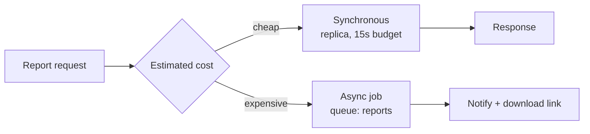

# 10 — Performance and Concurrency

**Status:** Accepted (Phase 0)
**Owner:** Architecture
**Last reviewed:** 2026-09-21

---

## 1. Purpose

Define performance principles, identify contention points before they are built, and specify where transactions, locks, optimistic concurrency and idempotency are required.

**This document does not prescribe premature optimisation.** It prescribes the small set of decisions that are expensive to retrofit — connection strategy, pagination style, idempotency, lock discipline, ledger shape — and explicitly defers everything else until measurement justifies it.

## 2. Principles

1. **Measure before optimising.** Every performance change references a profile or a production metric. "It felt slow" is not a justification.
2. **Correct-and-slow beats fast-and-wrong**, always, and especially in Books and Billing.
3. **Design for the p99, ship for the p50.** Tail latency is where users form opinions, but do not build for a tail nobody has yet.
4. **Bound everything.** Every query, list, upload, export and job has an explicit limit. Unbounded anything becomes an outage at a scale you did not choose.
5. **Push work off the request path.** If the user does not need the result to continue, it belongs in a queue.
6. **The database is the scarcest resource.** Connections, locks and I/O are budgeted deliberately.
7. **Per-tenant fairness is a first-class concern.** One tenant must not be able to degrade another.

## 3. Latency budgets

Targets, not guarantees — they define what "slow" means and what alerts fire on.

| Operation | p50 | p95 | p99 | Hard limit |
|---|---|---|---|---|
| Authenticated read (single record) | 50 ms | 200 ms | 500 ms | 10 s |
| List view (paginated, ≤50) | 80 ms | 300 ms | 800 ms | 10 s |
| Simple write | 100 ms | 400 ms | 1 s | 10 s |
| Complex write (multi-aggregate) | 200 ms | 800 ms | 2 s | 10 s |
| Search | 100 ms | 500 ms | 1.5 s | 10 s |
| Authorization check (cached) | 1 ms | 5 ms | 20 ms | 100 ms |
| Entitlement check (cached) | 1 ms | 5 ms | 20 ms | 100 ms |
| Report (interactive) | 1 s | 5 s | 15 s | 30 s → async |
| Bulk import (per 1k rows) | 2 s | 10 s | 30 s | async only |

Authorization and entitlement budgets are aggressive because they run on nearly every request; at 5 ms each with three checks per request they are already 15 ms of every response.

## 4. Database connections

The most consequential and most commonly mishandled decision in a Django deployment.

### The arithmetic

Django opens one connection per worker process. With ASGI and 4 processes × 8 workers × 12 instances, naive configuration demands 384 connections. RDS `db.r6g.xlarge` allows roughly 1,000, and each backend costs ~10 MB — so a few tiers of this consume the instance before any real load arrives.

### Configuration

| Tier | Pooling | `CONN_MAX_AGE` | Pool size | `statement_timeout` |
|---|---|---|---|---|
| Web | PgBouncer, transaction mode | 0 at design time; **300 since the 2026-10 audit** (below) | 60 | 10 s |
| Worker: default/events/notifications | PgBouncer, transaction mode | 0 | 50 total | 60 s |
| Worker: billing | PgBouncer, transaction mode | 0 | 10 | 60 s |
| Worker: imports | PgBouncer, transaction mode | 0 | 10 | 300 s |
| Worker: reports | PgBouncer → **replica** | 0 | 5 | 300 s |
| Migrations | Direct, owner role | 0 | 2 | none |

**Revised 2026-10 (architecture and performance audit): `CONN_MAX_AGE = 300` (seconds) with `CONN_HEALTH_CHECKS = True`.** The table above records the original plan. The reason given for `0` was that "idle Django connections pin PgBouncer server connections", which is true of *session* pooling, not of the *transaction* pooling actually deployed (`deploy/pgbouncer/pgbouncer.ini`): PgBouncer lends a server connection only for the length of one transaction, so an idle client connection holds nothing. What `0` did cost, measured on the staging stack:

| Per request | `CONN_MAX_AGE = 0` | persistent |
|---|---|---|
| connect + SCRAM login + DNS lookup | ~6 ms wall, ~2.8 ms API CPU | none (one `SELECT 1` health check, ~0.15 ms) |
| PgBouncer | a full client login each time | none |

The connection arithmetic is unchanged at peak and bounded at both ends:
- **Client side** (`max_client_conn = 500`): every api container holds `GUNICORN_WORKERS × GUNICORN_THREADS` client connections (3 × 4 = 12 today), every Celery worker one per process (4 + 4 + 2), Beat one. That is 23 for one instance of everything; 500 leaves room for about 35 api containers. Under `0` a busy container held the same number at peak, so persistence adds no new ceiling, it only keeps them between requests.
- **Server side** (`default_pool_size = 40`, `max_db_connections = 80`): unchanged. PostgreSQL never sees more than the pool, however many api instances run.

The worker tiers inherit the same setting: Celery's Django fixup closes a connection that has outlived its age between tasks.

`CONN_MAX_AGE` must stay bounded (production refuses `None`), so every connection is re-established at least every 5 minutes and picks up a PgBouncer or DNS change; the per-request health check means a PgBouncer restart costs a reconnect, not an error.

### Transaction-mode pooling constraints

Transaction pooling returns the server connection at `COMMIT`. Consequences that must be respected:

| Feature | Status | Mitigation |
|---|---|---|
| Session-level `SET` | **Broken** | `SET LOCAL` / `set_config(..., true)` only — see [03-multi-tenancy.md](03-multi-tenancy.md) |
| Server-side cursors | Broken | `DISABLE_SERVER_SIDE_CURSORS = True`; use keyset iteration |
| Prepared statements | Broken | Disable statement caching in the driver |
| `LISTEN`/`NOTIFY` | Broken | Not used; the broker handles messaging |
| Advisory locks (session) | Broken | Transaction-scoped `pg_advisory_xact_lock` only |
| Long transactions | Harmful | Kept short by rule |

**This is the highest-risk operational coupling in the design** (Risk R-01, [15-risk-register.md](15-risk-register.md)). It is validated by an integration test that runs interleaved tenant transactions through a real PgBouncer and asserts no context leakage, and it has a documented fallback to session pooling for the web tier.

### RLS cost

RLS adds a predicate to every query on a tenant table. Measured impact is small **provided** `organization_id` leads the relevant indexes; without that, it is a full scan per query.

**Rule: every index on a tenant table starts with `organization_id`.**

```python
class Meta:
    indexes = [
        models.Index(fields=["organization", "status", "-created_at"]),
        models.Index(fields=["organization", "owner", "-updated_at"]),
    ]
```

A fitness test flags any index on a `TenantScopedModel` that does not lead with `organization`. Partial indexes for common filters (`WHERE deleted_at IS NULL`) are encouraged once query patterns are known — not before.

## 5. API concurrency

- **ASGI (uvicorn) with sync views by default.** Django's ORM is synchronous; async views calling sync ORM code via `sync_to_async` add thread-pool overhead and subtle bugs for no gain. Async is used where it pays: SSE/streaming endpoints, and fan-out to multiple external providers.
- **Per-instance concurrency is bounded** and sized from the DB pool, not from CPU. Accepting more concurrent requests than there are connections converts a database bottleneck into a thundering queue of waiting workers.
- **Request timeout 30 s hard kill**, with a shorter internal budget so the application fails cleanly first.
- **Per-organization concurrency caps** on expensive endpoints (reports, exports, bulk) via a Redis semaphore, so one tenant cannot occupy the tier.

## 6. Background jobs

| Rule | Reason |
|---|---|
| Every task declares `queue` explicitly | Bulkheads are meaningless if tasks land in `default` by accident (`W360.E007`) |
| Every task has `soft_time_limit` and `time_limit` | A task without a limit runs forever and holds a worker |
| Tasks take **IDs, not objects** | Serialised model instances go stale; large payloads bloat the broker |
| Tasks are idempotent where retries are possible | At-least-once delivery is the norm |
| `acks_late=True` with idempotency | A worker crash re-runs the task rather than losing it |
| No unbounded fan-out | `chunk` large batches; 100k subtasks will exhaust the broker |
| No task waits on another task's result | Deadlocks the pool. Use chains/chords or an event |
| Long jobs checkpoint progress | Resumable after a crash; no restart from zero |

**Tenant context is mandatory in tasks** and carried in headers ([03-multi-tenancy.md](03-multi-tenancy.md)). Cross-tenant tasks opt out explicitly and iterate organizations, entering context per organization.

### Scheduling

- Celery Beat with a database-backed, locked scheduler — multiple beat instances must not double-schedule.
- **Jitter on per-tenant schedules.** Ten thousand organizations with a "daily 00:00" job all firing at midnight is a self-inflicted DDoS. Schedule time is derived from a hash of `organization_id` spread across the window.
- Missed schedules are skipped, not accumulated.

## 7. Caching

| Layer | Contents | TTL | Invalidation |
|---|---|---|---|
| Request-local | Entitlements, permissions, current org, feature flags | request | n/a |
| Redis (per tenant) | Entitlement snapshot, permission sets, expensive aggregates | 60–300 s | Version-key bump |
| Redis (global) | Catalog, plans, prices, reference data | 600 s | Publish event → bump |
| HTTP | Static assets, public pricing pages | long, hashed | Content hash |
| Database | Materialised views for heavy aggregates | scheduled | Refresh job |

Rules:

1. **Version-keyed invalidation, never key enumeration.** `w360:{org}:perms:v{n}`; bump `n` to invalidate everything for that org atomically. No `KEYS`/`SCAN` in production code — it is O(n) on the whole keyspace.
2. **Every cache key is tenant-prefixed**, enforced by a wrapper client.
3. **Cache only what is measurably hot.** A cache is a second source of truth and a new class of bug; it must earn its place.
4. **Never cache authorization denials longer than grants.** A revoked permission must take effect promptly; a granted one arriving late is harmless. Asymmetric TTLs.
5. **Stampede protection** on expensive entries: a short-lived lock lets one request recompute while others serve the stale value.

## 8. Pagination

**Keyset (cursor) pagination is the default.** Offset pagination degrades linearly — `OFFSET 100000` makes PostgreSQL scan and discard 100,000 rows — and it skips or duplicates rows when data changes between pages.

```python
# Cursor encodes the last-seen sort key; ordering must be deterministic and unique
qs = (Deal.objects.filter(organization_id=org_id)
      .filter(Q(created_at__lt=cur.ts) | Q(created_at=cur.ts, id__lt=cur.id))
      .order_by("-created_at", "-id")[:limit])
```

- Sort keys must be unique — always tie-break on `id`, or pages overlap at equal timestamps.
- Offset pagination is permitted only for bounded sets (< 1,000 rows) where users expect page numbers.
- Page size: default 25, max 100, hard cap 200. `limit=100000` is rejected, not honoured.
- **Exact counts are not returned for large sets.** `COUNT(*)` on a large filtered table is expensive; the API returns `has_more` plus an estimate. "Showing 1–25 of many" is preferable to a 3-second page load.

## 9. Search

Phase 0 decision: **PostgreSQL full-text search first** (`tsvector`, GIN, `pg_trgm` for fuzzy). Reasons: no new infrastructure, no sync lag, no consistency gap, tenant isolation for free via RLS, and it is genuinely sufficient to several million rows per tenant.

An external engine (OpenSearch) is introduced only when a measured requirement demands it — cross-product search, relevance tuning, faceting, or scale beyond Postgres. The `SearchIndex` port in `contracts/` exists from day one so the swap is an adapter change. That is the right amount of speculative work: an interface, not an infrastructure commitment.

When an external index arrives: it is a Tier-2 dependency (search unavailable ≠ platform unavailable), `organization_id` is a mandatory engine-side filter, and it is populated from domain events with lag monitoring.

## 10. Expensive reports and exports



- Cost is **estimated before execution** (row estimates, date range, join count). Over a threshold, the report becomes an async job. The user is told immediately, rather than waiting 30 seconds for a timeout.
- Reports run on the **read replica**, on their own queue, with their own small connection pool — three bulkheads.
- Results are written to S3 and delivered as an expiring presigned link; large payloads never stream through the web tier.
- Per-tenant concurrency cap of 2 concurrent reports.
- Repeated heavy aggregates become scheduled materialised views rather than repeated computation — but only after the query shows up in the slow log, not in anticipation.

## 11. Bulk operations

| Concern | Rule |
|---|---|
| Size | Chunked (default 500 rows/transaction). One transaction for 100k rows holds locks and bloats MVCC |
| Validation | Whole file validated before any row is applied — partial imports are worse than rejected ones |
| Progress | Persisted per chunk; resumable |
| Idempotency | Import job keyed by content hash; re-uploading the same file does not duplicate |
| Events | Aggregated (`inventory.stock.bulk_adjusted.v1`), not one per row — 100k events will clog the outbox |
| Rate | Per-tenant cap on concurrent imports |
| Rollback | Explicitly supported per import batch, via a batch ID on every created row |

`bulk_create`/`bulk_update` skip `save()`, signals and some validation. Given that cross-module signals are already forbidden ([02-dependency-rules.md](02-dependency-rules.md), F-8), this is safe — but any invariant relying on `save()` must be a database constraint, not Python code.

## 12. Contention points

Identified in advance, with a mitigation for each. These are the places where correctness fails under concurrency.

| # | Contention point | Risk | Mitigation |
|---|---|---|---|
| 1 | **Per-org document numbering** (invoice/order numbers) | Duplicate or gapped numbers | Dedicated `NumberSequence` row per `(org, type)`; `SELECT FOR UPDATE` in a short transaction at issue time, not at draft time |
| 2 | **Inventory stock levels** | Overselling | Row lock on `StockLevel`; movements append-only; level is a maintained projection. Lock ordering by ascending item ID to avoid deadlock |
| 3 | **Ledger balances** | Lost updates, unauditable totals | **No mutable balance column.** Append-only `LedgerLine` + periodic `BalanceSnapshot`; balance = snapshot + lines since |
| 4 | **Seat assignment** | Over-allocating paid seats | `SELECT FOR UPDATE` on `SeatGrant`, count inside the transaction ([06-entitlements.md](06-entitlements.md)) |
| 5 | **Subscription changes** | Double upgrade, double charge | Optimistic concurrency via `version`; provider idempotency key derived from durable state |
| 6 | **Outbox relay** | Duplicate publishing, relay bottleneck | `FOR UPDATE SKIP LOCKED` batching; multiple relay workers |
| 7 | **Entitlement recompute** | Concurrent runs racing | `pg_advisory_xact_lock(hash(org_id))`; last writer wins because compute is deterministic |
| 8 | **Counter columns** (`deal_count`, `open_tickets`) | Lock convoy on a hot row | Avoid stored counters. Use indexed `COUNT`, a cached aggregate, or sharded counters if truly needed |
| 9 | **Concurrent edits to one record** | Silent lost updates | Optimistic concurrency with `version`; 409 with a diff for the user to resolve |
| 10 | **Webhook/event handler races** | Double-applied effects | `ProcessedEvent` unique constraint |
| 11 | **Payout generation** | Double payment | Unique `idempotency_key` at the DB level + advisory lock on the batch |
| 12 | **Bulk import vs interactive edit** | Import overwrites a user's change | Row-level `updated_at` check; conflicts reported per row, not silently applied |
| 13 | **Hot tenant** | One tenant starves others | Per-tenant concurrency caps and rate limits |

### Concurrency control selection

| Technique | Use when | Example |
|---|---|---|
| **Pessimistic** (`SELECT FOR UPDATE`) | Short critical section, contention likely, correctness essential | Seats, stock, numbering |
| **Optimistic** (`version` column) | User-editable records, conflicts rare, humans can resolve | Deals, projects, subscriptions |
| **Append-only + projection** | Financial/audit data where history matters | Ledger, stock movements, commissions |
| **Advisory lock** | Cross-row coordination with no single row to lock | Entitlement recompute, payout batch |
| **Idempotency key** | Operation may be retried by a client or a queue | Payments, imports, event handlers |
| **Serializable isolation** | Complex multi-row invariant | Rare; requires retry-on-40001 handling |

Default isolation is `READ COMMITTED`. `SERIALIZABLE` is used only where a genuine multi-row invariant cannot be expressed otherwise, and any code path using it must implement serialization-failure retry — otherwise it fails intermittently in production under load.

### Deadlock avoidance

- **Consistent lock ordering** — always acquire in ascending primary-key order; a helper enforces this for multi-row locks.
- **Short transactions**, no external I/O inside them.
- **`NOWAIT` or `skip_locked`** where waiting is pointless.
- Deadlocks are retried once at the outermost boundary, and counted as a metric — a rising deadlock rate is a design signal, not something to retry harder.

## 13. Idempotency

| Surface | Mechanism |
|---|---|
| Public API mutations | `Idempotency-Key` header; stored `(key, org, endpoint, request_hash) → response` for 24 h; same key + different body = 422 |
| Event handlers | `ProcessedEvent` unique constraint |
| Celery tasks | Natural key or explicit dedupe key |
| Payment operations | Provider idempotency key from durable state, never random |
| Imports | Content hash |
| Webhooks (inbound) | Provider event ID |

Idempotency keys derived from **durable state** rather than randomly generated is the subtle point: a random key regenerated on retry is not a retry, it is a second operation.

## 14. What we are explicitly NOT doing yet

Deliberate non-decisions, with the trigger that would change them:

| Not doing | Trigger to reconsider |
|---|---|
| Database sharding | Single primary at sustained > 70 % capacity after tuning |
| Read replicas for general reads | Primary read load > 60 %; replica lag consistently < 1 s |
| Dedicated search cluster | Postgres FTS p95 > 1 s, or cross-product search is sold |
| CQRS / event sourcing | A domain demonstrably needs full temporal reconstruction beyond the append-only ledgers |
| GraphQL | Mobile/partner clients demonstrate over-fetching pain |
| Service extraction | A module's scaling profile genuinely diverges — see [13-deployment-evolution.md](13-deployment-evolution.md) |
| Multi-region | Data-residency contract requires it |
| Materialised views | A specific aggregate appears in the slow log |

Each is a real option, none is justified by current evidence, and each would add operational surface we would then have to maintain forever. Committing to them now would be speculative infrastructure — explicitly forbidden by the Phase 0 constraints.

## 15. Performance testing

| Test | Target | Frequency |
|---|---|---|
| Load test (normal) | Expected peak × 2, assert budgets | Per release |
| Soak test | 24 h at expected peak; assert no leak, no pool creep | Monthly |
| Spike test | 10× for 60 s; assert shedding, not collapse | Quarterly |
| Query regression | Fail CI if a hot endpoint's query count or plan cost regresses | Per PR |
| N+1 detection | Assert query counts on key endpoints | Per PR |
| Tenant fairness | Saturate one tenant; assert others within budget | Monthly |
| Lock contention | Concurrent writers on each §12 contention point | Per release |

The per-PR query-count assertion is the highest-value item here: N+1 queries are the single most common performance defect in Django, they are invisible in code review, and they are trivially caught by a test that pins the query count of an endpoint.

## 16. Related documents

- [03-multi-tenancy.md](03-multi-tenancy.md) — RLS, `SET LOCAL`, pooling constraints
- [09-failure-resilience.md](09-failure-resilience.md) — bulkheads, timeouts, backpressure
- [11-observability.md](11-observability.md) — the metrics that make this measurable
- [13-deployment-evolution.md](13-deployment-evolution.md) — scaling path
