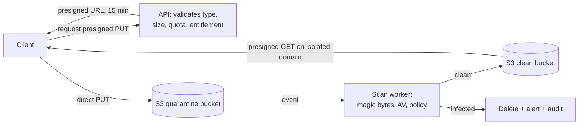

# 12 — Security Architecture

**Status:** Accepted (Phase 0)
**Owner:** Architecture / Security
**Last reviewed:** 2026-09-21

---

## 1. Purpose

Define the security architecture. Two principles govern every decision:

**Least privilege** — every principal, process and credential holds the minimum access required, for the minimum time.

**Fail closed** — when the system cannot determine whether access is permitted, it denies. There is no code path where uncertainty widens access.

Trust boundaries are defined in [00-system-context.md](00-system-context.md); tenant isolation in [03-multi-tenancy.md](03-multi-tenancy.md); authorization in [04-identity-authz.md](04-identity-authz.md). This document covers the remaining controls and consolidates the model.

## 2. Threat model summary

| # | Threat | Impact | Primary control | Residual |
|---|---|---|---|---|
| T1 | Cross-tenant data access | Catastrophic | 5-layer isolation ([03](03-multi-tenancy.md)) | Canary detection |
| T2 | Credential compromise (customer) | High | MFA, session binding, anomaly detection | Rapid revocation |
| T3 | Credential compromise (staff) | Catastrophic | SSO + hardware MFA, no default data access, break-glass | Audit, customer visibility |
| T4 | Privilege escalation within a tenant | High | Server-side authz, no client-trusted claims | Audit, denial alerting |
| T5 | Partner overreach into customer data | High | Capability grants, customer-issued `DataAccessGrant` | Audit, customer-visible |
| T6 | SSRF via user-supplied URLs | High | Egress allowlist, resolve-then-connect, redirect re-validation | Egress monitoring |
| T7 | Malicious file upload | Medium-High | Type validation, quarantine, AV scan, isolated serving domain | Scan-before-serve |
| T8 | Webhook forgery | High | HMAC + timestamp + replay cache | Idempotency |
| T9 | Entitlement bypass | Medium (revenue) | Server-side checks in services, never in UI | Reconciliation |
| T10 | API abuse / scraping | Medium | Layered rate limits, per-org quotas | Anomaly detection |
| T11 | Secrets exposure | High | Secrets Manager, no secrets in code/env files, rotation | Scanning, short-lived creds |
| T12 | Supply-chain compromise | High | Pinned deps, lockfiles, SCA, SBOM, signed images | Runtime monitoring |
| T13 | Insider data exfiltration | High | Break-glass, export limits, volume alerting | Audit |
| T14 | Billing manipulation | Medium | Server-side pricing, immutable published prices, approval for contracts | Reconciliation |

## 3. Authentication controls

Covered in [04-identity-authz.md](04-identity-authz.md); the security-specific requirements:

| Control | Requirement |
|---|---|
| Password hashing | Argon2id (Django's `Argon2PasswordHasher`), tuned to ≥ 250 ms on production hardware |
| Password policy | Minimum 12 characters; **breach-corpus check**; no composition rules, no forced rotation (both are counterproductive per current NIST guidance) |
| Login throttling | Per account and per IP, exponential lockout with jitter; never reveal which factor failed |
| Enumeration | Uniform responses and uniform timing on login, reset and invitation |
| Reset tokens | Single-use, 1 h expiry, hashed at rest, invalidated on password change, bound to the requesting session where possible |
| Session fixation | Session ID rotated on every privilege change (login, org switch, MFA satisfied, impersonation start) |
| MFA | TOTP + WebAuthn; required for staff and partner admins; org-configurable for customers |
| Step-up | `dangerous` permissions require `aal ≥ 2` and re-auth within 15 min |
| SSO | Signature, audience, recipient, time-window and replay validation; DNS-verified domain claims; mandatory break-glass local admin |

## 4. Authorization controls

- **Every check is server-side.** UI gating is UX; the API re-checks everything. A client that hides a button has hidden nothing.
- **One decision path** (`authz.check`) for session, API-key and OAuth principals. Parallel authorization paths are how privilege bugs arise.
- **Checks in application services, not views.** A view-only check is bypassed by the task path and the internal caller.
- **Object-level rules are queryset predicates** ([04-identity-authz.md](04-identity-authz.md)), so list endpoints cannot leak by forgetting a per-object filter.
- **Denial is the default.** A permission that does not exist in the registry cannot be granted; a resource with no rule registered is denied, not allowed.

## 5. Secrets management

| Secret | Storage | Rotation |
|---|---|---|
| Database credentials | AWS Secrets Manager, IAM-scoped | 90 d automatic |
| Payment provider keys | Secrets Manager | 180 d manual, dual-control |
| Email/SMS/AI provider keys | Secrets Manager | 180 d |
| Webhook signing secrets (outbound) | KMS-encrypted, per endpoint | Customer-initiated, overlap window |
| Customer connector credentials | KMS envelope encryption, per-tenant data key | On reconnect |
| Django `SECRET_KEY` | Secrets Manager | 180 d with key-rotation list |
| API keys (customer-facing) | **Argon2id hash only** — plaintext shown once | Customer-initiated |
| Internal service credentials | IAM roles, no static credentials | Automatic (STS) |

Rules:

1. **No secrets in code, config files, environment files in the repo, CI logs, or images.** Pre-commit and CI secret scanning; a detected secret fails the build and triggers rotation — detection is treated as exposure.
2. **Secrets are fetched at startup and cached in memory**, never written to disk.
3. **No secret is ever logged**, including inside exception payloads. Redaction processor as backstop ([11-observability.md](11-observability.md)).
4. **Rotation is tested**, not assumed. A rotation that has never been executed will fail when it matters.
5. **Envelope encryption for per-tenant secrets:** a tenant data key encrypted by a KMS master key, so a single leak does not expose every tenant's connector credentials.

## 6. Encryption

| Layer | Mechanism |
|---|---|
| In transit (external) | TLS 1.2+ (1.3 preferred), HSTS with preload, modern cipher suites only |
| In transit (internal) | TLS within the VPC; no plaintext database or Redis connections |
| At rest — database | RDS encryption with KMS CMK; encrypted snapshots |
| At rest — object storage | SSE-KMS; bucket policy denies unencrypted PUT |
| At rest — backups | Encrypted, separate account, restricted access |
| Field-level | A narrow, explicit set only — see below |

**Field-level encryption is applied narrowly and deliberately.** Encrypting everything destroys queryability and indexing while adding little over disk encryption for most fields. The designated set:

- Connector credentials and OAuth tokens (`platform`/`integration`)
- Bank/payout details (`commercial/commissions`)
- MFA secrets (`platform/identity`)
- Payroll-sensitive identifiers such as national insurance/tax numbers (`products/payroll`)

These share a property: they are high-value, rarely queried, and damaging if a database dump leaks. Adding a field to this set requires an ADR.

## 7. Input handling and injection

| Vector | Control |
|---|---|
| SQL injection | ORM parameterisation; raw SQL only via parameterised `RunSQL`/`cursor.execute` with a CI check banning f-strings in SQL |
| XSS | React escaping by default; `dangerouslySetInnerHTML` linter-banned outside a reviewed allowlist; server-side HTML sanitised with an allowlist; strict CSP |
| Template injection | No user-controlled template strings; notification templates are pre-registered with typed variables |
| Deserialization | JSON only; `pickle` banned including as a Celery serializer |
| Path traversal | No user-controlled filesystem paths; storage keys are server-generated |
| Mass assignment | Explicit serializer field lists; never `fields = "__all__"` on a writable serializer |
| ReDoS | No user-supplied regex; internal patterns reviewed and timeout-guarded |
| XXE | XML parsing disabled by default; `defusedxml` where imports require it |
| CSV injection | Formula-leading characters escaped on export — a common, overlooked path to code execution on the recipient's machine |

## 8. Web security headers

```
Content-Security-Policy: default-src 'self'; script-src 'self' 'nonce-{random}';
  style-src 'self' 'nonce-{random}'; img-src 'self' data: https://{cdn};
  connect-src 'self' https://{api}; frame-ancestors 'none'; base-uri 'self';
  form-action 'self'; object-src 'none'; upgrade-insecure-requests
Strict-Transport-Security: max-age=63072000; includeSubDomains; preload
X-Content-Type-Options: nosniff
Referrer-Policy: strict-origin-when-cross-origin
Permissions-Policy: geolocation=(), microphone=(), camera=(), payment=()
Cross-Origin-Opener-Policy: same-origin
Cross-Origin-Resource-Policy: same-origin
```

- **Nonce-based CSP, not `unsafe-inline`.** A CSP with `unsafe-inline` provides essentially no XSS protection.
- **`frame-ancestors 'none'`** for the app; embedding is opt-in per partner with an explicit allowlist, never wildcarded.
- CSP is deployed in report-only first, then enforced.

### CSRF

- Cookie-based sessions use Django CSRF with double-submit; `SameSite=Lax` as defence in depth, not as the primary control (browser support and subdomain nuances make it insufficient alone).
- Token-authenticated API requests are CSRF-exempt **only** when they carry `Authorization` — never when a cookie could authenticate them. Ambiguous dual-auth endpoints are the classic CSRF hole and are forbidden.
- State-changing operations never use GET.

### CORS

- **Explicit origin allowlist**, computed from verified partner custom domains plus our own. Never `*`, never reflected-origin.
- `Access-Control-Allow-Credentials: true` only for first-party and verified partner origins.
- Preflight cached 1 h.
- A partner domain added to CORS requires DNS verification first.

## 9. SSRF protection

User-supplied URLs exist in webhooks, connectors, image imports and feed URLs. This is one of the highest-risk surfaces in a multi-tenant SaaS, because a successful SSRF reaches the cloud metadata service and, from there, credentials.

```python
def safe_fetch(url: str, *, purpose: str, timeout: Timeout) -> Response:
    parsed = validate_scheme(url)                      # http/https only
    reject_credentials_in_url(parsed)
    addrs = resolve_all(parsed.hostname)               # every A/AAAA record
    for addr in addrs:
        reject_if_private(addr)                        # RFC1918, loopback, link-local
        reject_if_metadata(addr)                       # 169.254.169.254, fd00:ec2::254
        reject_if_reserved(addr)                       # CGNAT, multicast, IPv4-mapped IPv6
    chosen = addrs[0]
    return http_get(
        url, connect_to=chosen,                        # PIN the resolved address
        allow_redirects=False,                         # follow manually, re-validating each hop
        timeout=timeout, max_bytes=MAX_RESPONSE_BYTES,
    )
```

Controls, each closing a specific bypass:

1. **Scheme allowlist** — blocks `file://`, `gopher://`, `dict://`.
2. **Resolve-then-pin** — closes the DNS-rebinding TOCTOU window between validation and connection. Validating the hostname and then letting the HTTP client re-resolve is the most common flawed implementation.
3. **All records checked**, not just the first — a host with one public and one private record must be rejected.
4. **Redirects followed manually**, re-validating every hop. A public URL redirecting to `169.254.169.254` is the standard bypass.
5. **Response size and timeout caps** — prevents using us as an amplifier.
6. **IMDSv2 required** on all instances, so even a successful SSRF cannot read credentials with a simple GET.
7. **Egress security groups** deny worker access to internal ranges by default; connector workers have an explicit, narrow egress path.
8. **Validation at send time, not only at save time**, because DNS changes after a URL is accepted.

## 10. File upload security



| Control | Detail |
|---|---|
| Direct-to-S3 | Uploads never pass through the app tier — no memory exhaustion, no request timeouts |
| Presigned constraints | Content-type, max size and key prefix enforced in the policy, not merely requested |
| Quarantine first | Nothing is servable until scanned |
| Content validation | **Magic bytes, not the declared extension or Content-Type**, both of which are attacker-controlled |
| AV scanning | Every file; infected files deleted, the event audited and the uploader notified |
| Type allowlist | Per upload context; executables, archives-of-executables and HTML rejected by default |
| **SVG** | Treated as executable — rejected, or rasterised server-side. SVG is XML that can carry script |
| Serving domain | Separate origin (e.g. `files.workeasy360-usercontent.com`), so stored content cannot reach app cookies or the app origin |
| Content-Disposition | `attachment` by default; inline only for a narrow, safe set |
| Presigned GET | Short-lived, tenant-prefix-validated |
| Quotas | Per organization, from `FeatureEntitlement` — storage is a sellable dimension |
| Image processing | Sandboxed worker with resource limits; decompression-bomb guards |

## 11. Webhook security

### Inbound (from providers)

1. Verify HMAC over the **raw body** before parsing — parse-then-verify is exploitable.
2. Constant-time comparison.
3. Timestamp within a 5-minute tolerance.
4. Replay cache on the provider event ID.
5. Persist and return 200 quickly; process asynchronously ([06-entitlements.md](06-entitlements.md)).
6. Idempotent processing keyed on the provider's event ID.
7. Never trust webhook payload contents as authoritative — re-fetch from the provider API for consequential state changes. A signature proves origin, not that the payload reflects current truth.

### Outbound (to customers)

- `X-W360-Signature: t=<unix>,v1=<hmac_sha256(t + "." + body)>`, per-endpoint secret, versioned scheme (`v1=`, `v2=`) so rotation can overlap.
- Documented verification procedure, including that customers must check the timestamp — a signature without a timestamp check is replayable.
- SSRF validation on every delivery (§9).
- Bounded retries, per-endpoint breaker, auto-disable with notification.
- Payloads carry IDs and minimal detail; **sensitive fields are never included** — a webhook URL is a plaintext destination we do not control.

## 12. Administrative and staff security

| Control | Requirement |
|---|---|
| Access | Internal SSO + **hardware MFA mandatory**; no passwords |
| Network | Admin console reachable only via the corporate identity-aware proxy |
| Default privilege | **No access to tenant business data** for any staff role |
| Break-glass | Reason required, time-boxed (default 1 h, max 4 h), customer-visible, fully audited ([04-identity-authz.md](04-identity-authz.md)) |
| Write impersonation | Second-approver required |
| Blocked under impersonation | Security settings, auth factors, API keys, bulk export, anything `dangerous` |
| Separation of duties | Catalog publishing, contract-price approval and payout approval each need a second approver |
| Session | 8 h absolute, 30 min idle, re-auth for sensitive actions |
| Audit | Every staff action; customer-visible for anything touching their data |
| Production database | No direct human access. Break-glass via a proxy that logs every statement, with dual authorisation |

**The default-no-access rule for Platform Super Admin is the most important control here.** It converts a compromised staff credential from "total breach" into "control-plane incident with an audit trail", and it is the difference between an incident report and a breach notification.

## 13. Partner security

| Control | Requirement |
|---|---|
| Portal isolation | Separate URL namespace, separate session scope, separate rate limits |
| MFA | Mandatory for all partner admins |
| Default data access | **None.** Commercial metadata only |
| Business data | Requires a customer-issued `DataAccessGrant`: scoped, time-boxed, revocable, audited, customer-visible |
| Affiliate isolation | `REFER` capability grants aggregate attribution only; no code path yields customer PII |
| Custom domains | DNS verification, dedicated certificates, host-scoped cookies, **no authorization significance** |
| Branding | Schema-validated tokens; no partner-supplied CSS, HTML or JavaScript |
| Sub-partners | Depth-capped; no inherited data access |
| Offboarding | Termination revokes all grants and portal access immediately; commission ledger retained |

## 14. Rate limiting and abuse

Layered limits in [09-failure-resilience.md](09-failure-resilience.md). Security-specific additions: strict limits on authentication, password reset, invitation and API-key creation endpoints; progressive delays and CAPTCHA on repeated auth failure; per-org export volume limits with alerting; and detection for enumeration patterns, impossible travel, and API keys appearing from new networks.

## 15. Dependency and supply-chain security

- Pinned dependencies with lockfiles; no floating versions.
- Automated vulnerability scanning (SCA) on every build; critical findings block release.
- SBOM generated per release.
- Container images built from minimal bases, scanned, signed, and run as non-root with a read-only root filesystem.
- New dependencies require review: maintenance status, maintainer count, transitive footprint, licence.
- Frontend dependencies subject to the same scrutiny — an npm supply-chain compromise reaches the customer's browser with our origin's privileges.

## 16. Data protection and privacy

| Requirement | Implementation |
|---|---|
| Data minimisation | Collect only what a feature needs; PII fields are explicitly designated |
| Purpose limitation | PII use is documented per field in the data catalogue |
| Right of access | Per-module export contract ([08-data-ownership.md](08-data-ownership.md)) |
| Right to erasure | Per-module purge contract, with lawful-basis retention exceptions documented |
| Retention | Per-entity policies; automated enforcement, not manual cleanup |
| Sub-processors | Documented and disclosed; customer-visible list |
| Residency | `Organization.residency_region` reserved from day one ([13-deployment-evolution.md](13-deployment-evolution.md)) |
| Breach response | Detection → assessment → notification within statutory windows; runbook maintained and rehearsed |

**PII designation is a schema-level annotation**, so export, redaction, log-scanning and retention tooling can act on it automatically rather than relying on someone remembering which columns are sensitive.

## 17. Security testing

| Activity | Frequency |
|---|---|
| SAST | Every PR |
| Dependency scanning | Every build + daily |
| Secret scanning | Pre-commit + CI + repository history |
| Container scanning | Every build |
| DAST against staging | Weekly |
| Tenant isolation test suite | Every PR (canary tenants) |
| Authorization matrix tests | Every PR |
| Penetration test | Annually + before major releases |
| Threat model review | Per new module or trust boundary |
| Break-glass audit review | Monthly |
| Access review (staff + partner) | Quarterly |

The **authorization matrix test** is worth calling out: a generated test that asserts, for every (persona × endpoint) pair, the expected allow/deny. It catches the "new endpoint forgot its permission check" defect, which is the most common authorization bug in a growing codebase and is invisible to code review.

## 18. Fail-closed summary

| Condition | Result |
|---|---|
| Tenant context missing | Deny |
| RLS variable unset | Zero rows |
| Permission not in registry | Deny |
| Entitlement service unavailable | Deny the grant |
| Membership inactive | Deny |
| MFA required, not satisfied | Deny, prompt for step-up |
| Webhook signature invalid | Reject, log security event |
| URL fails SSRF validation | Reject |
| File not yet scanned | Not servable |
| Audit write fails | **Fail the operation** |
| Unknown or unmapped state | Deny |

## 19. Related documents

- [00-system-context.md](00-system-context.md) — trust boundaries
- [03-multi-tenancy.md](03-multi-tenancy.md) — isolation layers
- [04-identity-authz.md](04-identity-authz.md) — personas, break-glass, decision chain
- [11-observability.md](11-observability.md) — audit log, security events
- [15-risk-register.md](15-risk-register.md) — open security risks
