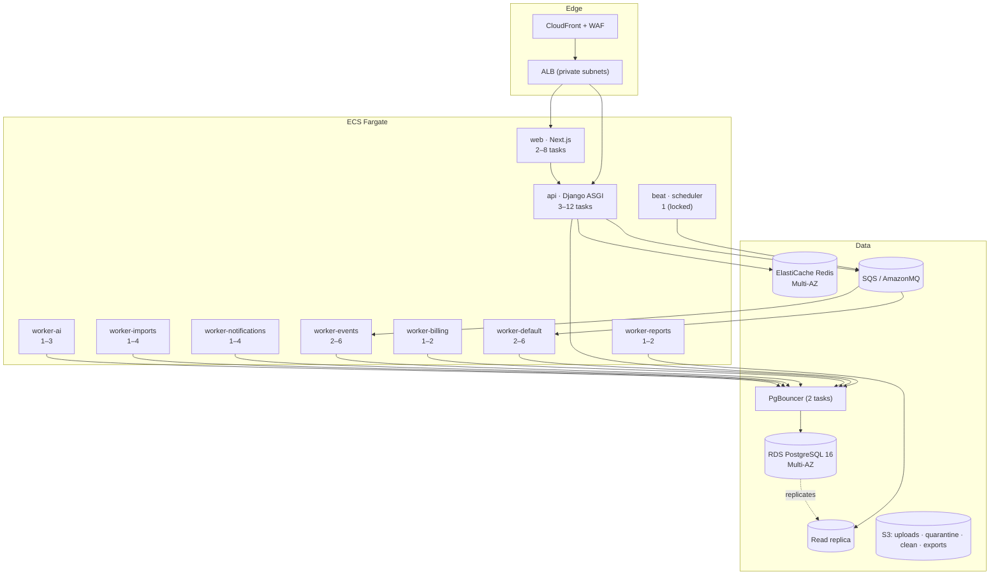
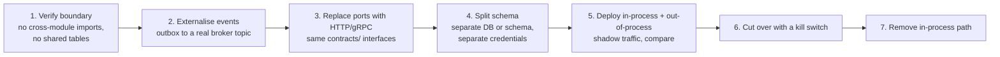

# 13 — Deployment and Architecture Evolution

**Status:** Accepted (Phase 0)
**Owner:** Architecture
**Last reviewed:** 2026-09-21

---

## 1. Purpose

Describe the deployment topology, and — more importantly — the **conditions under which the architecture is allowed to change**. A modular monolith is only defensible if the extraction path is real. This document makes it real, and it also makes extraction *hard to do for the wrong reasons*.

## 2. Deployment topology

### 2.1 Phase 1 (launch)

**One image, many entrypoints.** The Django image runs as API or as any worker depending on its command. One build, one migration set, one dependency graph — the operational payoff of the monolith, and the reason a seven-queue topology does not cost seven pipelines.

### 2.2 Environments

| Env | Purpose | Data | Notes |
|---|---|---|---|
| `local` | Development | Synthetic seed | Docker Compose incl. **PgBouncer in transaction mode** — parity matters here specifically ([10](10-performance-concurrency.md)) |
| `ci` | Automated tests | Ephemeral | Real Postgres with RLS enabled, real Redis, real broker |
| `staging` | Pre-production | Anonymised production-shaped | Same topology, smaller; failure tests run here |
| `production` | Live | Real | Multi-AZ |

**CI must run with RLS enabled and a non-owner role.** A test suite that runs as the table owner silently bypasses every RLS policy, so isolation tests would pass while production is broken.

### 2.3 Deployment process

- Rolling deploys with health-check gating; no downtime for compatible changes.
- **Migrations run as a separate, pre-deploy task** under the owner role, never from an application container at boot (concurrent boots would race).
- **Expand/contract migrations only.** Every schema change is backward-compatible with the previous release, because old and new code run simultaneously during a rolling deploy:
  1. Expand — add nullable column / new table / new index (`CONCURRENTLY`)
  2. Deploy code writing both, reading old
  3. Backfill in batches
  4. Deploy code reading new
  5. Contract — drop the old, a release later
- Destructive migrations require explicit approval and a rollback plan; a CI check flags column/table drops.
- Feature flags decouple deploy from release.
- Automatic rollback on error-rate or latency regression.

## 3. Scaling path

Ordered by cost-effectiveness, each step taken only when measurement justifies it:

| # | Step | Trigger | Cost |
|---|---|---|---|
| 1 | Vertical DB scaling | CPU/IO sustained > 70 % | Trivial, one restart |
| 2 | Add API/worker tasks | Latency or queue age | Trivial |
| 3 | Query and index tuning | Slow log | Engineering time |
| 4 | Caching hot paths | Profile shows repetition | Complexity |
| 5 | Read replicas for general reads | Read load > 60 % of primary | Replica lag handling |
| 6 | Dedicated search cluster | Postgres FTS p95 > 1 s | New infrastructure |
| 7 | Table partitioning | Single table > 500 M rows | Migration effort |
| 8 | Extract a module to a service | See §4 | **High** |
| 9 | Shard by tenant | Single primary exhausted after 1–7 | Very high |

Steps 1–5 cover an enormous range. A well-indexed PostgreSQL instance on modern hardware handles workloads far beyond what most SaaS platforms reach. The most common architectural mistake available to us is jumping to step 8 or 9 while steps 3 and 4 remain undone.

### Partitioning candidates (step 7)

`AuditEvent`, `OutboxEvent` (archive), `StockMovement`, `LedgerLine`, notification delivery records, analytics events — all append-heavy and time-ordered, so range partitioning by month is natural and enables cheap retention by dropping partitions.

## 4. Service extraction

### 4.1 The bar

Extraction is permitted only when **at least two** are demonstrably true, with evidence:

1. **Divergent scaling profile** — the module needs fundamentally different resources (e.g. GPU inference, 50× the traffic of everything else).
2. **Divergent availability requirement** — it must stay up when the monolith does not, or vice versa.
3. **Team scaling friction** — measured deployment contention across independent teams, not anticipated.
4. **Divergent technology need** — a genuine requirement the Python/Django stack cannot meet.
5. **Regulatory isolation** — a compliance regime requiring separate infrastructure.
6. **Divergent release cadence** — proven, sustained conflict.

Explicitly **not** valid reasons: "the codebase is large", "microservices are best practice", "team A wants autonomy", "it would be cleaner", "we might need to scale later".

### 4.2 Why the monolith is not the bottleneck people assume

A module that obeys the rules in [02-dependency-rules.md](02-dependency-rules.md) already has:

- no imports from peer modules,
- communication only via events and contracts,
- its own tables with no cross-module foreign keys,
- its own queues and its own API namespace.

It is, in every respect except process boundary, already a service. Extraction is therefore a **deployment change, not a rewrite** — which is precisely the property that makes deferring it rational. Extracting early buys distributed-systems problems (network partitions, distributed transactions, versioned wire protocols, cross-service debugging) in exchange for benefits we cannot yet measure.

### 4.3 Extraction procedure

Because ports are already interfaces in `contracts/`, step 3 replaces an in-process adapter with an HTTP one and no caller changes. That is the whole architectural investment paying off.

### 4.4 Most likely extraction candidates

| Candidate | Why | Likely trigger |
|---|---|---|
| AI/inference workloads | Different hardware, different scaling, bursty | GPU need or sustained volume |
| Analytics read models | Different store, different access pattern | Query load affecting transactional DB |
| Notification delivery | High volume, simple contract, already event-driven | Volume |
| File processing | CPU-heavy, isolatable, already sandboxed | Volume |
| A single very large product | If one product dwarfs the rest | Measured divergence |

Note that four of five are **platform/infrastructure** concerns, not products. That is the expected outcome: infrastructure diverges in scaling profile long before business domains do.

### 4.5 What must never be extracted

`platform/identity`, `platform/organizations`, `platform/authz`, `platform/entitlements`, `platform/tenancy` — the kernel. Distributing the authorization path introduces network latency into every request, cache-coherence problems in permission data, and the possibility of authorizing against stale state. The risk of a distributed authorization bug is categorically worse than any scaling benefit.

## 5. Data residency and multi-region

Not built now; **made possible** by three cheap decisions taken in Phase 0:

1. `Organization.residency_region` exists from day one.
2. `Organization.shard_key` exists from day one.
3. Tenant routing is centralised in `platform/tenancy` — one place to add region routing.

If a residency requirement arrives, the path is: deploy a regional stack → route by `residency_region` at the edge → migrate tenants per-region → keep the control plane global (catalog, partners, identity metadata) with regional data planes.

Deliberately deferred because multi-region costs roughly double the infrastructure and adds permanent operational complexity, and because splitting identity across regions is a hard problem best solved with a real requirement in hand rather than a hypothetical one.

## 6. Backup and disaster recovery

| Aspect | Target |
|---|---|
| RPO | ≤ 5 minutes (continuous WAL archiving) |
| RTO | ≤ 1 hour (full region), ≤ 5 min (AZ failure) |
| Backup retention | 35 days PITR + monthly archives for 1 year |
| Backup encryption | KMS, separate account |
| **Restore testing** | **Monthly, automated, to an isolated environment** |
| S3 | Versioning + cross-region replication for clean bucket |
| Config/IaC | Version-controlled, reproducible from scratch |

Monthly restore testing is the non-negotiable item. A backup that has never been restored is a hypothesis, and the discovery that it does not work always happens at the worst moment.

**Recovery order:** infrastructure → database → migrations verified → API (readiness gated) → workers → event relay (throttled to avoid a recovery stampede, [09](09-failure-resilience.md)) → reconciliation jobs (entitlement, payment, commission) → confirm consistency before reopening writes.

## 7. Evolution guardrails

Changes requiring an ADR and Architecture review:

- Any new top-level module, or any change to layer rules
- Any new forbidden-edge exception
- Any new infrastructure component
- Any change to the tenancy model or isolation mechanism
- Any change to identity, authorization or the entitlement contract
- Any service extraction
- Any new external provider handling customer data
- Any addition to the field-level encryption set
- Any framework-level technology change

Changes **not** requiring an ADR: new products (they follow the established pattern), new features within a product, new events, new roles/permissions, performance tuning, new dashboards. The process exists for structural decisions, not for ordinary work — a governance process that gates daily development gets routed around.

## 8. Technology decisions and their revisit conditions

| Choice | Rationale | Revisit if |
|---|---|---|
| Django + DRF | Mature ORM, migrations, admin, auth primitives; large talent pool; RLS-compatible | Fundamental blocker (none identified) |
| PostgreSQL | RLS, JSONB, FTS, partitioning, transactional DDL, maturity | — |
| Redis | Cache, locks, rate limits | — |
| Celery | Mature, well-understood, Django-integrated | Operational pain — reassess against alternatives then |
| SQS or AmazonMQ | Managed, durable | Ordering guarantees prove insufficient |
| Next.js + TypeScript | SSR, strong typing, ecosystem | — |
| ECS Fargate | Lower operational burden than Kubernetes at our size | Multi-cluster/multi-region needs exceed it |
| Modular monolith | See [ADR-001](adrs/ADR-001-modular-monolith-first.md) | §4 conditions met |

No technology changes are proposed. The stack specified in the brief is well-matched to the requirements, and PostgreSQL RLS in particular is load-bearing for the tenancy model — a strong reason not to substitute the database.

## 9. Related documents

- [00-system-context.md](00-system-context.md) — deployment context
- [09-failure-resilience.md](09-failure-resilience.md) — recovery behaviour
- [10-performance-concurrency.md](10-performance-concurrency.md) — what to tune before scaling out
- [ADR-001](adrs/ADR-001-modular-monolith-first.md)
