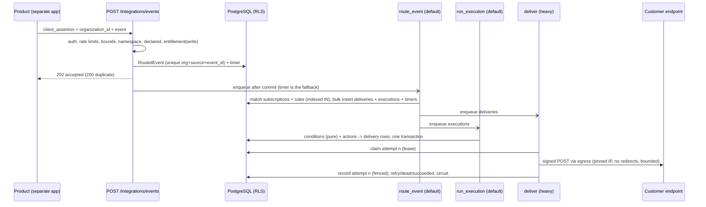

# Phase 6 — Integration, webhook and automation platform

**What Phase 6 adds:** a shared, product-agnostic way for independently
deployed products to publish events into the ecosystem, and for an
organization to send those events to systems it controls (signed webhooks)
and to act on them with bounded, generic automations. The platform moves
envelopes and runs customer-configured rules; it owns no product's business
meaning.

| Document | Covers |
|---|---|
| [01-event-model.md](01-event-model.md) | Namespaces and ownership, manifest event declarations, the ingestion contract, idempotency, limits, tenant binding |
| [02-connectors-and-egress.md](02-connectors-and-egress.md) | The connector contract, the reference webhook connector, SSRF and DNS-rebinding guarantees, timeouts and byte limits |
| [03-webhooks.md](03-webhooks.md) | Subscriptions, the delivery state machine, the signature and how to verify it, retries, at-least-once, dead letter, replay, backpressure |
| [04-automation.md](04-automation.md) | Rules and versions, triggers, conditions, the action registry, execution semantics, scheduling, loop protection |
| [05-failure-and-operations.md](05-failure-and-operations.md) | Failure behaviour, the due-work timer, queues, observability, recovery runbook |
| [06-security.md](06-security.md) | Permissions and step-up, tenant isolation, secrets, encryption-at-rest decision, privacy, audit |
| [07-api-and-frontend.md](07-api-and-frontend.md) | Customer and product API surface; Settings → Integrations / Webhook deliveries / Automations |
| [08-performance.md](08-performance.md) | Measured query counts, plans and timings |
| [phase-6-status.md](phase-6-status.md) | Status, gates, test evidence, findings, decisions to freeze |

Decisions: [ADR-024](../architecture/adrs/ADR-024-integration-platform-data-model-and-due-work.md)
(intra-`integration` foreign keys; the cross-tenant due-work timer),
[ADR-025](../architecture/adrs/ADR-025-outbound-http-and-ssrf-boundary.md)
(one outbound HTTP boundary, pinned to validated addresses),
[ADR-026](../architecture/adrs/ADR-026-automation-execution-semantics.md)
(automation creates durable records, never side effects).

## 1. Ownership

| Layer | Owns in Phase 6 |
|---|---|
| `contracts/` | Event namespaces and filter grammar (`events/namespaces.py`); the two platform-owned integration event schemas (`events/integration_events.py`); manifest event *declarations* (name, version, description — never a schema); retry arithmetic (`values/backoff.py`); cursors |
| `platform/` | Unchanged responsibilities. `ecosystem` exposes the authenticated client's declared events and a published-events selector; `authz` grants the new permissions to owner/admin |
| `integration/` | All Phase 6 mechanism (below) |
| `commercial/` | Nothing new. Entitlement is read through the existing decision, never through commercial |
| products | External. They publish their own namespaced events over HTTP and receive nothing from this repository's code |

`integration/` internal layering (import-linter `integration-internal-layers`):

```
integration.routing      ingestion API service, fan-out, retention
integration.automation   rules, immutable versions, executions, conditions, actions, schedules
integration.webhooks     subscriptions, deliveries, attempts, delivery pipeline, replay
integration.connectors   connection registry, sealed secrets, connector contract + registry, `webhook` connector
integration.events | idempotency | scheduling | egress
                         event log + outbox | commands | due-work timer | outbound HTTP
```

## 2. The flow



Nothing on the originating path waits for a remote endpoint (Task 12): the
request that accepts an event commits and returns before anything is sent,
and no external side effect ever runs inside the transaction that produced
the event (Task 40).

## 3. Deliberately not built

CRM/Books/Inventory workflows, product-specific conditions or actions, a
visual workflow builder, vendor connectors beyond the reference webhook,
routing of the platform's own domain events (`organizations.*`,
`entitlements.*`) to customer webhooks (each would need its own public
payload contract first), AI automation, payment providers, Super Admin,
reseller/white-label/affiliate.
